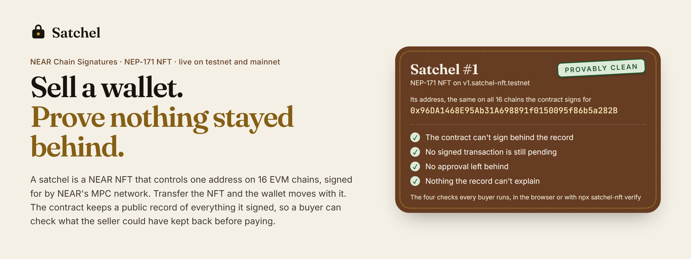
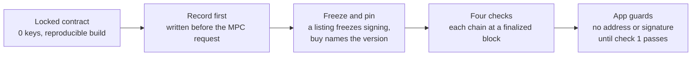

<div align="center">



# Satchel

**An NFT that is one wallet on 16 EVM chains, built on NEAR Chain Signatures. Transfer the NFT and the keys go with it. The contract keeps a public record of what its key signs, so before paying, a buyer can check on chain what the seller could have kept back.**

[](https://github.com/duongnq2798/satchel/actions/workflows/contract.yml)
[](https://github.com/duongnq2798/satchel/actions/workflows/web.yml)
[](https://www.npmjs.com/package/satchel-nft)
[](SECURITY.md)
[](#on-chain-proof)
[](#on-chain-proof)
[](LICENSE)

<a href="https://satchelnft.xyz"></a>
<a href="#how-to-evaluate-satchel-in-5-minutes"></a>
<a href="AGENTS.md#check-the-claims"></a>

**[Live app](https://satchelnft.xyz)** · **[Evaluate in 5 minutes](#how-to-evaluate-satchel-in-5-minutes)** · **[What is shipped](#status)** · **[On-chain proof](#on-chain-proof)** · **[Built on NEAR](#built-on-near)** · **[Threat model](docs/THREAT_MODEL.md)** · **[For AI agents](AGENTS.md)** · **[Security](SECURITY.md)** · **[Changelog](CHANGELOG.md)**

<sub>Built for the NEAR Hackathon 2026 · Rust contract on NEAR (near-sdk 5.29.1) · NEAR Chain Signatures · NEP-171, 177, 181, 297 and 330 · Next.js 16 and viem, no backend · a library and CLI, `satchel-nft`</sub>

</div>

Selling a wallet is easy to fake. The seller signs a withdrawal and keeps it, sells the wallet, then
broadcasts the withdrawal and empties it. Or the seller approves an address of their own to spend the
wallet's tokens, and pulls them out after the sale. A buyer cannot rule either out, so wallets,
positions and addresses with a history do not change hands safely. Satchel makes the wallet an NFT.
Each satchel is a NEP-171 token on NEAR whose secp256k1 key NEAR's MPC network derives from the
contract's account and the token's path (Chain Signatures), so one token is the same address on
Ethereum, Base, Arbitrum, OP, Polygon, BNB Chain, Avalanche and Aurora, mainnets and testnets. Only
the token's owner can have the contract sign with that key, and the contract builds every EVM
transaction it signs through `sign_evm` itself (anything else it signs is counted as opaque). Before
it asks for a signature it writes down, in a public record, the
highest nonce it signed on each chain and every approval it granted. A buyer compares that record
with each chain at a finalized block: if every nonce ever signed is spent, every approval revoked and
nothing was signed blind, the transfer is provably clean. One NEAR transaction then moves the NFT,
and with it the address on every one of those chains.

> The NFT moves the keys. The record proves what they signed.

> [!IMPORTANT]
> **Not audited.** No third party has reviewed this code. The contract is live on NEAR testnet at
> `v1.satchel-nft.testnet` and on NEAR mainnet at `v1.satchel-nft.near`: the same reproducible build
> on both, each locked (no access keys) before its first mint. On mainnet a satchel's address holds
> real funds on eight EVM chains, so keep in one only what you can afford to lose. A testnet
> satchel's address is a valid address on mainnet chains too, but NEAR's testnet MPC network signs for
> it: never send real funds to it. The demo satchels and the end-to-end runs are on testnet. On
> mainnet, [satchel #1](#satchel-1-the-first-on-mainnet) was funded with 0.00195 ETH on Base and has
> sent from it once, in the app.

## Contents

- [How to evaluate Satchel in 5 minutes](#how-to-evaluate-satchel-in-5-minutes)
- [Status](#status)
- [What Satchel does](#what-satchel-does)
- [Why it is different](#why-it-is-different)
- [How a sale works](#how-a-sale-works)
- [When is a transfer provably clean?](#when-is-a-transfer-provably-clean)
- [Safety architecture](#safety-architecture)
- [Built on NEAR](#built-on-near)
- [On-chain proof](#on-chain-proof)
- [Contract interface](#contract-interface)
- [Web app](#web-app)
- [Quick start with the near CLI](#quick-start-with-the-near-cli)
- [Where things are in this repository](#where-things-are-in-this-repository)
- [Documentation](#documentation)
- [Development](#development)
- [Limits, stated plainly](#limits-stated-plainly)
- [Prior work](#prior-work)
- [Other project by the same builder](#other-project-by-the-same-builder)
- [License](#license)

## How to evaluate Satchel in 5 minutes

You need Node.js 22 or later and git. No wallet, no key and no account: every step reads public NEAR
and Sepolia data through public RPC nodes. The timings and outputs below are from a fresh clone on a
Windows 10 laptop with Node 24.12, on 2026-11-09.

**Before you install anything: try to cheat a buyer in your browser.** Open
[satchelnft.xyz/#examples](https://satchelnft.xyz/#examples) and pick **Keep a signed withdrawal**.
Satchel #5's owner had a 10,000 ETH send signed for it and never broadcast it. Your browser reads the
satchel's record from `v1.satchel-nft.testnet` and Sepolia's nonce for its address at a finalized
block, and the report says **Not provable**: "A signed transaction may still be pending". The other
moves open satchels left the other ways (#1 played fair, #3 left an approval behind, #6 had a raw
payload signed), or show a call the contract refused on chain (signing while listed, buying after
the record changed).

<p align="center"></p>

1. **Clone.** Under two seconds here.

   ```bash
   git clone https://github.com/duongnq2798/satchel.git
   cd satchel
   ```

2. **Check both deployments against the chain.** No install.
   [`scripts/check-claims.mjs`](scripts/check-claims.mjs) reads the contract's keys, code hash,
   NEP-330 metadata and MPC signer from a public NEAR RPC node, and the transactions that deployed
   and locked it from an archival one. On testnet it also reads the calls the contract refused; on
   mainnet, satchel #1's mint and first signature, and that send on Base from a public Base node
   (set `BASE_RPC` to use your own). Each run took 5 to 17 s here, most of it waiting on the archival
   node.

   ```bash
   node scripts/check-claims.mjs                      # NEAR testnet: 11 claims
   node scripts/check-claims.mjs --network mainnet    # NEAR mainnet: 9 claims, the last also reads Base
   ```

   The mainnet run prints:

   ```text
   [PASS] v1.satchel-nft.near has no access keys, so no one can redeploy it or sign as it
          0 access keys
   [PASS] Its code is the reproducible build, not a global contract
          code hash 94x4MmZKXGetffqJJVePLTdFkJvsmeXRLmi74Mdp2Lph
   [PASS] Its NEP-330 metadata names commit 87148c6 and the pinned Docker image
          https://github.com/duongnq2798/satchel/tree/87148c6b6f97f3121cac13c93e22d7d153453b53
   [PASS] It signs only through v1.signer
          mpc_contract() = v1.signer
   [PASS] It was deployed and initialized in one transaction
          DeployContract, FunctionCall, new({ mpc_contract: "v1.signer" })
   [PASS] Its only key was deleted before any satchel was minted
          DeleteKey at block 223741744, nft_total_supply() = 0 there
   [PASS] Satchel #1, the first on mainnet, was minted by satchel-nft.near after the lock
          HCYB168y… minted #1 to satchel-nft.near at block 223756145, after the DeleteKey at 223741744
   [PASS] Its first signature is a Base transaction at nonce 0, recorded by the contract before v1.signer signed it
          2xqwe8AA… sign_evm: chain 8453, nonce 0, value_transfer, record version 1; v1.signer signed 4e9284fc… for satchel/1
   [PASS] Base ran exactly that signed transaction, in a block that is now finalized
          0x8044dd8c… from 0xdc269ead17b522d49db2cefd38cef0c5413868f9, block 55178996, status 1, fee 127494755188 wei, finalized

   9 of 9 claims hold (https://rpc.mainnet.fastnear.com, archival https://archival-rpc.mainnet.fastnear.com)
   ```

   The testnet run checks the same five facts about `v1.satchel-nft.testnet`, then that its key was
   deleted before the first mint (block 276856595, first mint at 276856686) and that the contract
   refused, on chain, a previous owner signing, a call to `new()` from another account, signing while
   listed and a `buy` naming an old record version, and what satchel #6's record held when that `buy`
   was refused. It ends with `11 of 11 claims hold`. Each run exits 0 only when
   every claim holds; [AGENTS.md](AGENTS.md#1-the-deployment-and-its-history-one-command) says what
   each line reads.

3. **Ask the chain without our scripts.** Two reads with curl, from the same directory:

   ```bash
   rpc() { curl -s https://rpc.mainnet.fastnear.com -H 'content-type: application/json' -d "{\"jsonrpc\":\"2.0\",\"id\":1,\"method\":\"query\",\"params\":$1}"; }
   rpc '{"request_type":"view_access_key_list","finality":"final","account_id":"v1.satchel-nft.near"}' | grep -o '"keys":\[[^]]*\]'   # "keys":[]
   rpc '{"request_type":"view_account","finality":"final","account_id":"v1.satchel-nft.near"}' | grep -o '"code_hash":"[^"]*"'      # "code_hash":"94x4MmZKXGetffqJJVePLTdFkJvsmeXRLmi74Mdp2Lph"
   ```

   That code hash belongs to the wasm the reproducible CI build produced. To hash that wasm
   yourself, download it with the GitHub CLI, signed in (GitHub asks for a login to download
   artifacts, even from a public repository; this one is kept until 2027-02-07):

   ```bash
   gh run download 42547394040 --repo duongnq2798/satchel --name satchel-reproducible-wasm --dir ci-build
   node scripts/code-hash.mjs ci-build/satchel.wasm    # 94x4MmZKXGetffqJJVePLTdFkJvsmeXRLmi74Mdp2Lph
   ```

   Without a GitHub login, rebuild the wasm yourself: check out `87148c6` and run
   `cargo near build reproducible-wasm` in `contracts/satchel` (cargo-near 0.22.0 and Docker;
   [AGENTS.md](AGENTS.md#4-the-reproducible-build) has the steps). It was not run for this README.

4. **Run the clean transfer report on the demo satchels.** The package
   [`satchel-nft`](packages/satchel-nft), [on npm](https://www.npmjs.com/package/satchel-nft), is the code the web app runs, and its command
   `satchel-nft verify` builds the same report ([`report.ts`](packages/satchel-nft/src/report.ts)) in your terminal.
   It needs no clone. In an empty folder, with an empty npm cache, this fetched the release and
   printed the report in 86 s and 93 s in two runs here; each report after that took 6 to 12 s:

   ```bash
   npx -y satchel-nft@0.1.0 verify 1
   ```

   `-y` installs it without asking, and every command below pins the same release. It was
   published from commit `728ed74`; the [threat model](docs/THREAT_MODEL.md#what-satchel-trusts)
   says how to check that it is. To run this checkout's code instead, at the repository root
   (installing took 2 min 54 s here, building 7 s):

   ```bash
   npm ci -w satchel-nft
   npm run build -w satchel-nft
   npx -y satchel-nft@0.1.0 verify 1
   ```

   After that, inside the repository, the same command runs this checkout's build, whose version is
   also 0.1.0, never a download. Either way it prints:

   ```text
   Satchel #1 on v1.satchel-nft.testnet (testnet)
   owner buyer.satchel-nft.testnet, address 0x96DA1468E95Ab31A698891f0150095f86b5a282B, record version 7

   [PASS] The contract can't sign behind the record
          No access keys, so no one can redeploy it or sign as it
          Code hash 94x4MmZKXGetffqJJVePLTdFkJvsmeXRLmi74Mdp2Lph is the reproducible build of commit 87148c6
          Signs only through v1.signer-prod.testnet

   [PASS] No signed transaction is still pending
          Sepolia: signed up to nonce 4, finalized nonce is 5

   [PASS] No approval left behind
          No approval was ever signed for this token

   [PASS] Nothing the record can't explain
          0 raw signatures, 0 unclassified calls, 0 approvals over the cap

   PROVABLY CLEAN (checked 2026-11-09T15:38:48.914Z)
   read from https://rpc.testnet.fastnear.com, https://ethereum-sepolia-rpc.publicnode.com
   ```

   Then the satchel that hides a signed send:

   ```bash
   npx -y satchel-nft@0.1.0 verify 5; echo "exit $?"
   ```

   ```text
   [FAIL] A signed transaction may still be pending
          Sepolia: signed up to nonce 0, finalized nonce is 0. That signature is public in its NEAR receipt, so anyone can still broadcast the transaction until one at nonce 0 is final

   NOT PROVABLE (checked 2026-11-09T15:17:47.674Z)
   exit 1
   ```

   (The satchel's own two lines, the three passing checks and the RPC line are left out above.) Run
   it for each demo satchel:

   | Satchel | What its owner did | `satchel-nft verify <id>` prints | Exit code |
   | --- | --- | --- | --- |
   | #1 | Had seven Sepolia transactions signed, at nonces 0 to 4. Five were broadcast (one reverted, which still spends its nonce); the other two were at nonce 0, so they are void | `PROVABLY CLEAN` | 0 |
   | #5 | Had a 10,000 ETH send signed for it and never broadcast it | `[FAIL] A signed transaction may still be pending`, `NOT PROVABLE` | 1 |
   | #3 | Approved satchel #2's address, which the same seller owns, to spend its USDC without limit | `[FAIL] An approval is still live`, `NOT PROVABLE` | 1 |
   | #6 | Listed, delisted, had a raw 32-byte payload signed, then listed again | `[FAIL] The record can't explain everything signed`, `NOT PROVABLE` | 1 |
   | #4 | Nothing: it holds 0.002 Sepolia ETH, never signed anything, and is listed for 1 NEAR | `PROVABLY CLEAN`, and `listed by satchel-nft.testnet at record version 0` | 0 |
   | #7 | Minted with the CLI, sent once on Sepolia, listed, delisted, listed again, sold and handed back, each step with `satchel-nft` ([below](#the-satchel-nft-cli-on-testnet)) | `PROVABLY CLEAN` | 0 |

   `npx -y satchel-nft@0.1.0 verify --network mainnet <id>` reads a mainnet satchel. Satchel #1, the first
   on mainnet, has sent once on Base; in 5 s here it prints, among its four passing checks:

   ```text
   [PASS] No signed transaction is still pending
          Base: signed up to nonce 0, finalized nonce is 1
   ```

   then `PROVABLY CLEAN`, and exits 0.

5. **Run every test.** Still at the repository root:

   ```bash
   npm test -w satchel-nft             # 111 tests in 12 files: 8 s here
   npm run typecheck -w satchel-nft    # 7 s here
   ```

   The web app's own 3 tests need the whole install: `npm ci`, then `npm test` runs both workspaces
   ([Development](#development)).

   The contract's 59 unit tests need Rust (rustup installs the pinned 1.99.1 from
   `contracts/satchel/rust-toolchain.toml` on first use). On Windows, set
   `AWS_LC_SYS_PREBUILT_NASM=1` first. With the dependencies already compiled, this took 43 s here;
   a first run compiles them before it starts.

   ```bash
   cd contracts/satchel
   cargo test           # test result: ok. 59 passed
   ```

**Reviewing security:** [docs/THREAT_MODEL.md](docs/THREAT_MODEL.md) goes through 32 attacks (the
seller's, a buyer's, the deployer's, an RPC's, the hosted app's), what stops each one, the transaction on testnet that
shows it where one exists, and what is left. [SECURITY.md](SECURITY.md) says how to report a
vulnerability. [AGENTS.md](AGENTS.md) maps each rule to its code and its tests, or says it has none.

## Status

What exists at this commit, and what does not yet.

| Component | Status | Where |
| --- | --- | --- |
| Contract: a NEP-171 NFT whose tokens each control an MPC-derived key, with the signing record, the sale and the refusals | **Shipped** on NEAR testnet as `v1.satchel-nft.testnet` and on NEAR mainnet as `v1.satchel-nft.near`, both on 2026-11-09, both from commit `87148c6` and locked before their first mint. A locked contract cannot change: a fix would ship as a new account | [`contracts/satchel`](contracts/satchel) |
| Reproducible build | **Shipped**. CI builds every pull request and every push to `main` or `dev` in the pinned image `sourcescan/cargo-near:0.22.0-rust-1.99.1` and writes the code hash to the run's summary. Both deployments run the build of commit `87148c6`, code hash `94x4MmZK…` | [`.github/workflows/contract.yml`](.github/workflows/contract.yml) |
| Clean transfer report: four checks, each chain read at a finalized block | **Shipped**, in the browser and as `satchel-nft verify`, from the same code | [`report.ts`](packages/satchel-nft/src/report.ts), [`cli.ts`](packages/satchel-nft/src/cli.ts) |
| Web app at [satchelnft.xyz](https://satchelnft.xyz) | **Shipped**. One deployment serves testnet, and mainnet under `/mainnet`: mint, send through the MPC network on the network's 8 EVM chains, list, delist, transfer, buy, the market, the report, and what a satchel holds and its history | [`web`](web) |
| Guards before anything is signed | **Shipped**. The app shows no address and signs nothing until the network's contract passes check 1; it refuses an account from the other network, a transaction for another contract, and a receiver that doesn't exist. The CLI runs the same guards | [`guard.ts`](packages/satchel-nft/src/guard.ts) |
| Demo satchels and two refused calls | **Shipped** on testnet: satchels #1 and #3 to #6 (#2 is retired), every step in an evidence file (two entries written by hand from the run log, one failed retry left out, as [noted below](#on-chain-proof)) | [`tools/demo-gallery.mjs`](tools/demo-gallery.mjs), [`deployments/testnet-gallery.json`](deployments/testnet-gallery.json) |
| End-to-end run against the real MPC network | **Shipped** on testnet: mint, sign, transfer, the previous owner refused, the new owner signing, a broadcast on Sepolia | [`tools/e2e-testnet.mjs`](tools/e2e-testnet.mjs), [`deployments/testnet-e2e.json`](deployments/testnet-e2e.json), [`deployments/testnet-sepolia-send.json`](deployments/testnet-sepolia-send.json) |
| Claim checker | **Shipped**: 11 claims on testnet, 9 on mainnet | [`scripts/check-claims.mjs`](scripts/check-claims.mjs) |
| Mainnet deploy script | **Shipped**, and used for the mainnet deployment. It reads the chain before each step, stops if a name belongs to someone else or the code isn't the build, and asks before it deletes the last key | [`tools/deploy-mainnet.sh`](tools/deploy-mainnet.sh) |
| The first satchel on mainnet: funded on Base, minted, one send from it in the app, its report clean | **Shipped** on 2026-11-09: satchel #1, 0.00195 ETH on Base, 0.0001 ETH sent from it at satchelnft.xyz, `PROVABLY CLEAN`. The owner signed every transaction | [`deployments/mainnet-first-send.json`](deployments/mainnet-first-send.json) |
| npm package `satchel-nft`: the report as a library and a CLI (`npx -y satchel-nft@0.1.0 verify 1`), with read commands and signing commands that use the near CLI's keychain | **Shipped** on npm as [`satchel-nft` 0.1.0](https://www.npmjs.com/package/satchel-nft), published by the owner on 2026-11-09 from commit `728ed74`, without npm provenance ([how to check it](docs/THREAT_MODEL.md#what-satchel-trusts)). The web app runs on the same code. `npx -y satchel-nft@0.1.0 verify 1` in an empty folder printed `PROVABLY CLEAN`. CI packs the package, installs the tarball in an empty project and runs it, then runs the release from npm on Linux. Every sign command ran on testnet, and an adversarial review of its signing found no way to make it send a transaction other than the one it shows | [`packages/satchel-nft`](packages/satchel-nft), [`deployments/testnet-cli.json`](deployments/testnet-cli.json) |
| What's inside a satchel: its USDC, USDT and WETH balances beside the native ones on each chain, and a timeline of mints, owners, signatures and sales on its page | **Shipped** on 2026-11-10. Above the report, a satchel's page shows its native balance on each of the network's 8 chains, and its USDC, USDT and WETH where a deployment is listed: 22 on the mainnets, 11 on the testnets (no testnet USDT). Each comes from Circle, Tether, USDT0 or the chain itself, except WETH on Sepolia, from Uniswap's deployment list; the sources are in `contents.ts`. After `npm ci` and `npm run build -w satchel-nft`, `node scripts/check-tokens.mjs` reads every one's code, symbol and decimals back from its chain. Below the report, its history: mint, transfers, signatures, listings and sales from FastNEAR's transaction index, each linked to its transaction. The report reads neither. In the CLI, `show` prints the same balances and `history <id>` the timeline; both come with the next npm release, not 0.1.0 | [`contents.ts`](packages/satchel-nft/src/contents.ts), [`history.ts`](packages/satchel-nft/src/history.ts), [`check-tokens.mjs`](scripts/check-tokens.mjs) |
| Demo kit: the video script, the X post and the submission text | **Written** on 2026-11-10, and checked against the hackathon's limits by `node scripts/check-demo-kit.mjs`. The video isn't recorded yet | [`docs/DEMO.md`](docs/DEMO.md), [`docs/submission`](docs/submission) |
| Third-party audit | **Not done** | [`SECURITY.md`](SECURITY.md) |

**Known limitations** (the main ones are in [Limits](#limits-stated-plainly), and every residual risk
is in the [threat model](docs/THREAT_MODEL.md#residual-risks-in-one-list)): calls are classified by their selector;
only secp256k1 chains, and only EVM transactions are built by the contract; the report trusts one
public RPC per chain unless you give it your own, and the NEAR RPC for a satchel's address; the chain list and the 32-approval cap are fixed
for the life of a contract.

## What Satchel does

| Piece | What it does |
| --- | --- |
| **A satchel** | A NEP-171 token on `v1.satchel-nft.near` (or `v1.satchel-nft.testnet`). Anyone can mint one for 0.1 NEAR, with any excess refunded. Its MPC path is `satchel/<token_id>`, fixed for its lifetime, whoever owns it |
| **Its address** | NEAR's MPC network derives a secp256k1 key from the Satchel contract's account and that path; the MPC contract's `derived_public_key` view returns it. Its EVM address is the same on all 16 chains the contract signs for. Nobody holds the key: the MPC nodes sign with it only when the Satchel contract asks |
| **`sign_evm`** | The owner sends the fields of an EIP-1559 transaction. The contract RLP-encodes and hashes it itself, classifies the call, updates the record, then asks the MPC contract to sign that hash. Owner only, 1 yoctoNEAR, at least 50 TGas, never while listed |
| **`sign_raw`** | Signs any 32-byte payload (a Bitcoin sighash, a message hash). Allowed, and counted as opaque |
| **The signing record** | Public, per token, and it only grows: for each chain the highest nonce signed and how many signatures; up to 32 approvals itemized and the rest counted; calls it could not classify; opaque signatures; and a version that goes up with every signature |
| **The sale** | `list` freezes signing and pins the record version. `buy` names the version and the price the buyer checked and fails if either changed; the NFT moves in the same receipt, and the seller is paid in NEAR |
| **The report** | Four checks against NEAR and every chain in the record, each chain read at a finalized block, in your browser or your terminal. "Provably clean" only when all four pass |
| **The web app** | [satchelnft.xyz](https://satchelnft.xyz): mint, see a satchel's address, what it holds and its history, send from it, list, buy, transfer, and read any satchel's report without a wallet |

## Why it is different

- **The key cannot leave with the seller.** Handing over a seed phrase hands over a copy, and the
  seller keeps theirs. A satchel's key is in no one's hands: the MPC network signs with it only when
  the contract asks, and the contract asks only for the token's current owner. After the transfer of
  satchel #1, its previous owner's request was
  [refused on chain](https://testnet.nearblocks.io/txns/GqFsnmFLcpDjJVC1b4qUPYxHRTP1Rw2vcVKxga3PVRvU).
- **What the key signed is on record, not in the seller's word.** The contract builds each EVM
  transaction itself, so it knows the chain, the nonce and the call. A buyer doesn't need the
  seller's history, only the record and the chains.
- **What Satchel can't see into is counted, never guessed.** A raw signature, a multicall, an
  approval past the 32nd: each one is counted, and the report says "not provable" with the reason.
  A seller can make a satchel unprovable, but cannot make it look clean.
- **One transfer, every chain.** The NFT moves on NEAR in one transaction, and the address on all 16
  chains moves with it. A token-bound account (ERC-6551) lives on one chain, and nothing there lists
  the approvals or signatures a seller left behind.
- **The proof doesn't depend on us.** The contract has no access keys and no admin, and its code is
  the reproducible build. The report runs in your browser or terminal against public RPC nodes, or
  your own. Each claim about the deployments has a command that checks it.

## How a sale works


In words:

1. **Mint.** Anyone mints a satchel for 0.1 NEAR. Its key is derived by the MPC network from the
   contract's account and `satchel/<id>`, so it exists the moment the token does.
2. **Use it.** The owner calls `sign_evm` with a transaction's fields. The contract builds and
   hashes the transaction, records the chain and the nonce (and an approval row, or a count if it
   can't classify the call), logs the call's class in a `satchel` event, and only then calls the MPC
   contract's `sign`. The contract never handles the signature: the MPC contract's answer is the
   transaction's result, and the owner (or the web app) broadcasts it.
3. **List.** `list` freezes signing and pins the record's current version to the listing.
4. **Check.** The buyer runs the four checks: the contract can't sign behind the record, every
   nonce ever signed is spent at a finalized block, every approval is revoked, and nothing was
   signed that the record can't explain.
5. **Buy.** `buy` names the record version and price the buyer checked. If the seller delisted,
   signed and relisted in between, or changed the price, the call fails and the buyer keeps their
   NEAR. Otherwise the NFT moves to the buyer in the same receipt and the seller is paid.
6. **After.** The address on every chain is now the buyer's to sign for. The seller's next
   `sign_evm` is refused.

## When is a transfer provably clean?

Satchel keeps a public, on-chain **signing record** for every token, built this way:

1. **The contract builds every EVM transaction it signs.** The owner sends the fields (`chain_id`,
   `nonce`, fees, `to`, `value`, `data`); the contract RLP-encodes and hashes them itself
   (EIP-1559), so it knows exactly what it signed. The record holds the highest nonce signed on each
   chain, written *before* the signature is requested.
2. **It classifies every call.** Each `sign_evm` call is exactly one of:
   - a **value transfer** (empty calldata);
   - an **asset transfer**: ERC-20 `transfer`/`transferFrom`, ERC-721 `transferFrom` and
     `safeTransferFrom` with no data, ERC-1155 `safeTransferFrom` with a non-zero amount and no
     data, WETH `deposit`/`withdraw`. A safe transfer *with* data runs the receiver's hook with data
     the signer chose, so it is not counted as plain;
   - an **approval**, decoded and itemized: ERC-20 `approve` and `increaseAllowance`, ERC-721
     `approve` (each token id its own row), `setApprovalForAll`, Permit2 `approve`;
   - a **revocation** that grants nothing (`setApprovalForAll(x, false)`, `increaseAllowance(x, 0)`,
     Permit2 `approve` of 0), logged but not itemized, so cleaning up before a sale never fills the
     approval list;
   - **anything else** (a multicall, a swap, `transferOwnership`…), counted in
     `unclassified_calls`. Satchel cannot see what such a call left behind, so it does not pretend to.
3. **Raw signatures are allowed but counted.** `sign_raw` signs any 32-byte payload (a Bitcoin
   sighash, a message) and the record counts it in `opaque_signatures`.
4. **Listing freezes signing, and `buy` pins what the buyer checked.** `buy` names the record version
   and price the buyer verified; if the seller delisted, signed and relisted in between, the purchase
   fails.

A buyer (or the [web app](#web-app), which runs these checks) can call a satchel provably clean only
when all four hold:

| Check | How |
| --- | --- |
| The contract can't sign behind the record | No access keys on the account; its code hash equals the reproducible build; not a global contract referenced by account ID; `mpc_contract()` is the canonical signer (`v1.signer` on mainnet, `v1.signer-prod.testnet` on testnet) |
| No signed transaction is still pending | For every chain in `record.evm`, the address's nonce at a **finalized** block is above `max_nonce` |
| No approval left behind | Every row in `record.approvals` is revoked on chain: allowance 0, operator off, Permit2 allowance 0 or expired. An `Approve` row can be ERC-20 or ERC-721, so the report reads both `allowance` and `getApproved(arg)` and counts the row live if either shows the grant |
| Nothing the record can't explain | `opaque_signatures`, `approvals_not_itemized` and `unclassified_calls` are all 0 |

If any of them fails, the honest answer is "not provable", with the reason. A check that cannot be
read (an RPC down, a chain the app doesn't know, an RPC serving the wrong chain) is "unknown", never
a pass. Many wallets will be used for swaps and DeFi and will not be provably clean; the record says
so instead of hiding it.

**What the record cannot cover:** powers built into an asset itself, which need no signature from
the wallet. A token the seller deployed or can upgrade, a token with a blacklist or clawback, an ENS
name whose registry controller is still the seller, an ERC-4907 `user`. The record proves what the
token's key signed; it says nothing about what the assets inside allow their issuers to do. Value
the assets as you would anywhere else.

## Safety architecture



| Layer | What it enforces | Code | Tests |
| --- | --- | --- | --- |
| **Locked contract** | No access keys, no admin, no upgrade method: nobody, the deployer included, can redeploy it or sign as it. `new` is private and ran in the deploy transaction | [`lib.rs`](contracts/satchel/src/lib.rs) (`new`), [`deploy-mainnet.sh`](tools/deploy-mainnet.sh) | `scripts/check-claims.mjs`, on chain |
| **The contract builds what it signs** | Every `sign_evm` signature is over an EIP-1559 transaction the contract RLP-encoded and hashed itself; anything else goes through `sign_raw` and is counted as opaque | `Eip1559Tx::signing_hash` in [`evm.rs`](contracts/satchel/src/evm.rs) | `evm_hash_and_rlp_match_viem_for_every_vector`, `evm_signing_hash_view_matches_the_hash_sign_evm_sends` |
| **Record first** | The record is saved in the `sign_evm` receipt; the MPC `sign` call is a later receipt, so whatever happens to it cannot undo the record | `sign_evm`, `sign_raw`, `request_signature` in [`lib.rs`](contracts/satchel/src/lib.rs) | `sign_evm_calls_mpc_with_the_token_path_and_records_the_nonce`, `sign_raw_counts_as_opaque` |
| **Every call classified** | Transfer, asset transfer, approval, revocation or unclassified; selectors are checked against the keccak of their signatures | `Eip1559Tx::classify` in [`evm.rs`](contracts/satchel/src/evm.rs) | `value_and_asset_transfers_are_classified`, `a_call_satchel_cannot_classify_is_counted`, `revocations_are_logged_but_never_take_an_approval_slot`, `approval_selectors_are_the_keccak_of_their_signatures` |
| **Approvals itemized, then counted** | 32 distinct approvals listed per token; beyond that, counted, never dropped | `sign_evm`, `MAX_APPROVALS` in [`lib.rs`](contracts/satchel/src/lib.rs) | `approvals_beyond_the_cap_are_counted_not_dropped`, `erc721_approvals_of_two_token_ids_stay_two_rows` |
| **Owner only; listing freezes signing** | Only the current owner signs, with 1 yoctoNEAR and at least 50 TGas, and never while listed | `assert_can_sign` in [`lib.rs`](contracts/satchel/src/lib.rs) | `sign_evm_refuses_a_non_owner`, `sign_evm_is_frozen_while_listed`, `sign_raw_is_frozen_while_listed`, `the_previous_owner_cannot_sign_after_a_transfer` |
| **`buy` pins what the buyer checked** | The record version and the price must be the ones the buyer names | `buy` in [`lib.rs`](contracts/satchel/src/lib.rs) | `buy_refuses_a_stale_record_version`, `buy_refuses_after_the_seller_delists_signs_and_relists`, `buy_refuses_a_changed_price` |
| **Any transfer ends the listing** | `nft_transfer`, `nft_transfer_call` and a bounced transfer each void the listing | `nft_transfer`, `nft_transfer_call`, `nft_resolve_transfer` in [`lib.rs`](contracts/satchel/src/lib.rs) | `nft_transfer_ends_the_listing_and_moves_signing_rights`, `a_transfer_cancels_the_sale`, `a_bounced_transfer_call_voids_the_receivers_listing` |
| **A fixed chain list** | Only the 16 chain ids in `SUPPORTED_CHAINS` can be signed for, so every record is checkable | `SUPPORTED_CHAINS` in [`evm.rs`](contracts/satchel/src/evm.rs) | `sign_evm_refuses_an_unsupported_chain`, `every_supported_chain_can_be_signed_for` |
| **The four checks** | Each chain read at a finalized block; anything unreadable is "unknown", never a pass | `contractCheck`, `pendingCheck`, `approvalsCheck`, `countersCheck` in [`report.ts`](packages/satchel-nft/src/report.ts), [`approvals.ts`](packages/satchel-nft/src/approvals.ts) | [`report.test.ts`](packages/satchel-nft/src/report.test.ts), [`approvals.test.ts`](packages/satchel-nft/src/approvals.test.ts) |
| **App and CLI guards** | No address and no signature until the network's contract passes check 1; only this network's contract, from an account on this network; no transfer to an account that doesn't exist | `assertDeployment`, `assertTxFor`, `assertReceiver` in [`guard.ts`](packages/satchel-nft/src/guard.ts) | [`guard.test.ts`](packages/satchel-nft/src/guard.test.ts) |
| **Check before broadcast** | A send checks that the contract's `evm_signing_hash` equals viem's hash of the same transaction, and that the MPC signature recovers to the satchel's address, before it broadcasts | `sendFromSatchel` in [`send.ts`](packages/satchel-nft/src/send.ts) | [`send.test.ts`](packages/satchel-nft/src/send.test.ts) |
| **CLI signing** | The near CLI only signs. `satchel-nft` runs it by its absolute path, decodes what it signed and compares the signer, receiver, method, arguments, gas and deposit with what it asked for; it shows the transaction, sends it only after `yes` (or `--yes`), and exits 3 with the hash when it can't read the outcome | `resolveNearCli`, `decodeSignedTx`, `assertSignedAsAsked` in [`near-cli.ts`](packages/satchel-nft/src/near-cli.ts); `submit` in [`cli.ts`](packages/satchel-nft/src/cli.ts) | [`near-cli.test.ts`](packages/satchel-nft/src/near-cli.test.ts), and on testnet ([`testnet-cli.json`](deployments/testnet-cli.json)) |

**What a dishonest seller can try**, and what happens:

| The seller tries to | and | Shown by |
| --- | --- | --- |
| Keep a signed withdrawal and broadcast it after the sale | Check 2 fails: a nonce was signed that is not yet spent at a finalized block | Satchel #5 on testnet |
| Approve an address of their own to spend the wallet's tokens | Check 3 fails: the allowance is still granted on chain | Satchel #3 on testnet |
| Have something signed blind (a permit, a Bitcoin transaction) | Check 4 fails: the opaque signature is counted | Satchel #6 on testnet |
| Hide an approval in a multicall, or push one past the 32nd row | Check 4 fails: the call is unclassified, or the approval counted | `a_call_satchel_cannot_classify_is_counted`, `approvals_beyond_the_cap_are_counted_not_dropped` |
| Sign while the satchel is listed | The contract refuses | [`5ZaKqJUx…`](https://testnet.nearblocks.io/txns/5ZaKqJUxEUauvpENMMp4KQoCwWRNqmAyHskpTF6Axft8) |
| Delist, sign and relist after the buyer checked | `buy` fails and the buyer keeps their NEAR | [`7HQPu9qe…`](https://testnet.nearblocks.io/txns/7HQPu9qeJauNrJLaMNCUuMJVska3u3uYsoGyp7gsCfWv) |
| Keep signing after the sale | Refused: only the token's owner can sign | [`GqFsnmFL…`](https://testnet.nearblocks.io/txns/GqFsnmFLcpDjJVC1b4qUPYxHRTP1Rw2vcVKxga3PVRvU) |
| Swap the contract's code, or sign as the contract | Not possible: the account has no keys, and check 1 would fail if it had | `node scripts/check-claims.mjs` |

What is left (the MPC network itself, the RPCs the report reads, powers built into assets) is in
[Limits](#limits-stated-plainly) and the [threat model](docs/THREAT_MODEL.md#residual-risks-in-one-list).

## Built on NEAR

| NEAR technology | How Satchel uses it | Where |
| --- | --- | --- |
| **Chain Signatures** (MPC contract `v1.signer` on mainnet, `v1.signer-prod.testnet` on testnet) | Every satchel's key is derived with `predecessor` = the Satchel contract, `path` = `satchel/<id>` and domain 0 (secp256k1). `sign_evm` and `sign_raw` call the MPC contract's `sign` with `payload_v2: { Ecdsa: <hash> }`, attaching 1 yoctoNEAR and the rest of the transaction's gas. The app gets a satchel's address from the `derived_public_key` view and recovers the signer from every signature before it broadcasts | `request_signature` in [`lib.rs`](contracts/satchel/src/lib.rs), `tokenAddress` in [`evm.ts`](packages/satchel-nft/src/evm.ts), [`send.ts`](packages/satchel-nft/src/send.ts) |
| **NEP-171, NEP-177, NEP-181** (`near-contract-standards` 5.29.1) | The NFT core, its metadata and enumeration. Every transfer path also ends the token's listing, a bounced `nft_transfer_call` included | [`lib.rs`](contracts/satchel/src/lib.rs) |
| **NEP-297 events** | The standard `nft_mint` and `nft_transfer`, plus Satchel's own `satchel` events: `sign_evm` (with the call's class, a decoded approval, the selector and a calldata hash), `sign_raw`, `list`, `delist` and `sale` | `emit` in [`lib.rs`](contracts/satchel/src/lib.rs) |
| **NEP-330 source metadata and reproducible builds** | `contract_source_metadata` names commit `87148c6` and the pinned Docker image; cargo-near 0.22.0 builds it in CI, so anyone can rebuild it and compare the code hash | [`Cargo.toml`](contracts/satchel/Cargo.toml), [`contract.yml`](.github/workflows/contract.yml) |
| **Locked accounts** | The contract was deployed and initialized in one transaction (`new` is `#[private]`), then its only access key was deleted. With no keys, nobody can redeploy it or sign as it, on either network | [`deployments/`](deployments), [`deploy-mainnet.sh`](tools/deploy-mainnet.sh) |
| **1 yoctoNEAR deposits** | `sign_evm`, `sign_raw`, `list`, `delist` and NEP-171 transfers need exactly 1 yoctoNEAR. A function-call access key (a dapp's login key) cannot attach a deposit, so each of them needs the owner's full-access key: a wallet confirmation | `assert_can_sign`, `list`, `delist` in [`lib.rs`](contracts/satchel/src/lib.rs) |
| **Receipts** | The record is saved in `sign_evm`'s own receipt, and the MPC call runs in a later one, so a failed or slow signature cannot undo the record: it only makes the record stricter | `sign_evm` in [`lib.rs`](contracts/satchel/src/lib.rs) |
| **Named accounts** | `v1.satchel-nft.near` is a sub-account of `satchel-nft.near`, which holds no power over it. A contract change would ship as `v2.…` beside it | [`deployments/mainnet.json`](deployments/mainnet.json) |
| **NEAR Connect** (`@hot-labs/near-connect` 0.11.4) | Wallet selection from a pinned list per network, a separate session on each network, and transactions signed in the user's own wallet | [`wallet.ts`](web/src/lib/wallet.ts), [`wallet-manifest.json`](web/src/lib/wallet-manifest.json) |
| **near CLI** ([near-cli-rs](https://github.com/near/near-cli-rs)) | `satchel-nft`'s sign commands (`mint`, `list`, `delist`, `buy`, `transfer`, `send`) have it sign with the key in its keychain (`sign-with-legacy-keychain` or `sign-with-keychain`, then `display`), so the package never reads a key. It decodes the borsh `SignedTransaction`, checks it, and sends it with `send_tx` | [`near-cli.ts`](packages/satchel-nft/src/near-cli.ts) |
| **FastNEAR RPC** | The public and archival nodes that the app, the `satchel-nft` CLI and `check-claims` read. For the two commands, `NEAR_RPC` (and `NEAR_ARCHIVAL_RPC`, for `check-claims`) replace them with nodes you trust | [`config.ts`](packages/satchel-nft/src/config.ts), [`check-claims.mjs`](scripts/check-claims.mjs) |
| **FastNEAR transaction index** | A satchel's history, on its page and from `satchel-nft history`: the contract's transactions and their event logs, from `tx.test.fastnear.com` or `tx.main.fastnear.com`. It keeps only the contract's own events from receipts that succeeded, and links each one's transaction. Display only: the report never reads it | [`history.ts`](packages/satchel-nft/src/history.ts) |

## On-chain proof

### NEAR mainnet, 2026-11-09

The same build as on testnet, deployed by [`tools/deploy-mainnet.sh`](tools/deploy-mainnet.sh), with
every transaction signed by the owner. The record is in
[`deployments/mainnet.json`](deployments/mainnet.json), and
`node scripts/check-claims.mjs --network mainnet` checks it.

| Account | Role |
| --- | --- |
| [`v1.satchel-nft.near`](https://nearblocks.io/address/v1.satchel-nft.near) | The contract. 0 access keys, code hash `94x4MmZKXGetffqJJVePLTdFkJvsmeXRLmi74Mdp2Lph` (commit [`87148c6`](https://github.com/duongnq2798/satchel/tree/87148c6b6f97f3121cac13c93e22d7d153453b53), [reproducible CI build](https://github.com/duongnq2798/satchel/actions/runs/42547394040)), signs only through `v1.signer` |
| [`satchel-nft.near`](https://nearblocks.io/address/satchel-nft.near) | The account that created it, and the owner of satchel #1. It has no power over the contract |

| What happened | Transaction | Result |
| --- | --- | --- |
| Created `satchel-nft.near` with 3.5 NEAR | [`ByH8EdoS…`](https://nearblocks.io/txns/ByH8EdoSUJjUwAFfyLiYiQQE9U5MwUvHVZXTehoxc9oN) | |
| Created `v1.satchel-nft.near` with 3 NEAR, from `satchel-nft.near` | [`BFGbXYUn…`](https://nearblocks.io/txns/BFGbXYUnLJQ7ZbGYde467Uzn481zXF4ymmz1MR3tWg1k) | |
| Deployed the build and called `new({"mpc_contract":"v1.signer"})`, in one transaction, so nobody could initialize it first | [`3cbRdh9W…`](https://nearblocks.io/txns/3cbRdh9WnftTPbhkLs5fJCBJLh43dTtWywSzuFk8GHK4) | `DeployContract`, `FunctionCall` |
| Deleted its only key | [`Dw29ZbeR…`](https://nearblocks.io/txns/Dw29ZbeRNSLgyoeXGEdnDhxCMWB7L3w4vhKpYqmN9qqE) | Block 223741744; `nft_total_supply()` read at that block is 0, so no satchel was minted while anyone could still change the code |

#### Satchel #1, the first on mainnet

Satchel #1's address was funded on Base, then the satchel was minted by `satchel-nft.near`, then it
sent once from the app; the owner signed each transaction. The funding came first because a token's
address is fixed by its id before the token exists, but `mint` is open to anyone: whoever had minted
#1 in the 92 seconds between would have owned that ETH. Mint first, then fund. The record is in
[`deployments/mainnet-first-send.json`](deployments/mainnet-first-send.json), and the last three
claims of `node scripts/check-claims.mjs --network mainnet` check its mint, its signature and its
send against NEAR and Base.

| What happened | Transaction | Result |
| --- | --- | --- |
| Funded satchel #1's address, `0xdC269Ead17B522d49db2ceFD38CEF0C5413868F9`, on Base (2026-11-09 10:40 UTC) | [`0x928d1092…`](https://basescan.org/tx/0x928d1092bf3d2cad7fc824c8ce7567d29b14fa1e0a6e12259d07ecc785bcf2fb) | 0.00195 ETH |
| Minted satchel #1 to `satchel-nft.near` for 0.1 NEAR | [`HCYB168y…`](https://nearblocks.io/txns/HCYB168yrYuR7U4THAbKZqyMgZ6pzSnWWNhLQNQJEU8g) | Token `1`, path `satchel/1`, at block 223756145, after the lock at 223741744 |
| `sign_evm` for 0.0001 ETH on Base (8453) at nonce 0, approved in a NEAR wallet at [satchelnft.xyz/mainnet/satchel/1](https://satchelnft.xyz/mainnet/satchel/1) | [`2xqwe8AA…`](https://nearblocks.io/txns/2xqwe8AAWwvssHNCMUioME2SCJeYAKcneV8iVCpa1Cj4) | The contract recorded chain 8453, nonce 0, `value_transfer`, then `v1.signer` signed |
| The app checked that the signature recovers to the satchel's address, then broadcast it | [`0x8044dd8c…`](https://basescan.org/tx/0x8044dd8cd53ea5aa7165b031098450d64a6c6910fc0cc9c3e138a480e6ac9532) | Block 55178996, status 1. Its r, s and parity are the ones `v1.signer` returned. Fee 0.000000127494755188 ETH, the L1 data fee included, paid by the satchel |
| Its report, `npx -y satchel-nft@0.1.0 verify --network mainnet 1` or [its page](https://satchelnft.xyz/mainnet/satchel/1) | | `PROVABLY CLEAN` once Base finalized that block, 21 minutes after the send |

Mainnet satchels hold real funds on Ethereum, Base, Arbitrum One, OP Mainnet, Polygon, BNB Chain,
Avalanche and Aurora, and the contract is not audited: keep in one only what you can afford to lose.

### NEAR testnet, 2026-11-09

| | |
| --- | --- |
| Contract | [`v1.satchel-nft.testnet`](https://testnet.nearblocks.io/address/v1.satchel-nft.testnet) |
| MPC signer | `v1.signer-prod.testnet` (Chain Signatures) |
| Source | commit [`87148c6`](https://github.com/duongnq2798/satchel/tree/87148c6b6f97f3121cac13c93e22d7d153453b53), recorded in the wasm's NEP-330 metadata |
| Code hash | `94x4MmZKXGetffqJJVePLTdFkJvsmeXRLmi74Mdp2Lph`, the wasm from the [reproducible CI build](https://github.com/duongnq2798/satchel/actions/runs/42547394040) (artifact `satchel-reproducible-wasm`) |
| Deploy and `new` | one transaction, so nobody could initialize it first: [`7pocx72c…`](https://testnet.nearblocks.io/txns/7pocx72c1bcDbNehTG32T18ukjR82byP3PfF9vmX44Uk) |
| Locked | its only key deleted in [`6FYx6hV5…`](https://testnet.nearblocks.io/txns/6FYx6hV5PRCfaUd6t4VEkz1bfkknxN8ymyw4nSP6YgAK), before the first mint. No one can redeploy it or sign as it |

That CI run was for pull request #2. Its summary prints GitHub's temporary merge commit for the pull
request; the commit it built, which the wasm records, is its head, `87148c6` (later runs print the
commit they built). The record is in [`deployments/testnet.json`](deployments/testnet.json), and
`node scripts/check-claims.mjs` checks it with the refused calls below. To check the first row of the
[clean-transfer table](#when-is-a-transfer-provably-clean) with the near CLI instead:

1. List the contract's keys. You should see an empty table.

   ```bash
   near account list-keys v1.satchel-nft.testnet network-config testnet now
   ```

2. Read its source metadata. You should see the commit above and the pinned Docker image.

   ```bash
   near contract call-function as-read-only v1.satchel-nft.testnet contract_source_metadata json-args '{}' network-config testnet now
   ```

3. Compare code hashes: hash the CI artifact as in [step 3 of the evaluation](#how-to-evaluate-satchel-in-5-minutes),
   and read the account's `code_hash`:

   ```bash
   curl -s https://rpc.testnet.fastnear.com -H 'content-type: application/json' -d '{"jsonrpc":"2.0","id":1,"method":"query","params":{"request_type":"view_account","finality":"final","account_id":"v1.satchel-nft.testnet"}}'
   ```

The contract refused two seller moves outright, and both refusals are on chain:

| Move | Call | The contract's answer |
| --- | --- | --- |
| Sign while it's listed | the owner of #4 calls `sign_evm` | [`Satchel: signing is frozen while the token is listed`](https://testnet.nearblocks.io/txns/5ZaKqJUxEUauvpENMMp4KQoCwWRNqmAyHskpTF6Axft8) |
| Change it after the buyer checked | a buyer calls `buy` on #6 naming record version 0, the version before the raw signature | [`Satchel: the signing record changed since you checked it`](https://testnet.nearblocks.io/txns/7HQPu9qeJauNrJLaMNCUuMJVska3u3uYsoGyp7gsCfWv), and the buyer keeps the 1 NEAR |

Satchel #4 can be bought from [its page](https://satchelnft.xyz/satchel/4) with any testnet NEAR
wallet. If someone has bought it by the time you look, it reads `PROVABLY CLEAN` without the listing
line. For about 13 minutes after a satchel sends on Sepolia, its report says
`COULD NOT CHECK EVERYTHING` until that block is final.

<details>
<summary><b>The end-to-end run against the real MPC network</b> (7 steps, then a broadcast on Sepolia)</summary>

[`tools/e2e-testnet.mjs`](tools/e2e-testnet.mjs) runs the whole path against the live contract and
the real MPC network. Its last run (evidence in
[`deployments/testnet-e2e.json`](deployments/testnet-e2e.json)):

| Step | Result | Transaction |
| --- | --- | --- |
| `mint` as `satchel-nft.testnet` | token `1`, path `satchel/1`, address `0x96DA1468E95Ab31A698891f0150095f86b5a282B` (from `derived_public_key` on the MPC contract) | [`3kBMVhva…`](https://testnet.nearblocks.io/txns/3kBMVhva8pagScLwGJDNwF6Bfbzno9LxAVN5JKENvPxo) |
| `sign_evm`, Sepolia, nonce 0 | the contract's hash equals viem's; the MPC signature recovers to the token's address | [`EZLXcvf4…`](https://testnet.nearblocks.io/txns/EZLXcvf43jqHYFUJm7gt3Ris5yM1Ru2FPihiEqJW1GUo) |
| `signing_record` | Sepolia `max_nonce` 0, version 1 | view |
| `nft_transfer` to `buyer.satchel-nft.testnet` | | [`3sLuGS9p…`](https://testnet.nearblocks.io/txns/3sLuGS9pEnvURpha3QQBtumExxKC2f3GMJSRaccvNBwB) |
| `sign_evm` by the previous owner | refused: "only the token's owner can do this" | [`GqFsnmFL…`](https://testnet.nearblocks.io/txns/GqFsnmFLcpDjJVC1b4qUPYxHRTP1Rw2vcVKxga3PVRvU) |
| `sign_evm` by the buyer | recovers to the same address | [`9GYTuZJo…`](https://testnet.nearblocks.io/txns/9GYTuZJoQAKcYib8NCEKXtcqDkRjGfy9nLavajkGaLnM) |
| `new` from another account | refused: "Method new is private" | [`BeoXbii9…`](https://testnet.nearblocks.io/txns/BeoXbii9WeodnG2XZarxZidtvqS6RzzA9KNqJnZRLrWv) |

**This run also shows the record catching what it exists for.** The first owner's nonce-0
signature was never broadcast (the address held no Sepolia ETH), and the signed transaction is in
the evidence file. While it was open, anyone holding it could broadcast it once the address was
funded, so the report for token 1 said **not provable**: Sepolia's nonce for the address was 0 and
the record's `max_nonce` was 0. A buyer cannot count on voiding such a signature with a transaction
of their own: it is public in the NEAR receipt, so a seller can broadcast it the moment the address
is funded. That is why the check has to pass before a sale, not after.

Then the address was funded, and its current owner sent a transaction at nonce 0 through
`sign_evm` (evidence in [`deployments/testnet-sepolia-send.json`](deployments/testnet-sepolia-send.json)):

| Step | Result | Transaction |
| --- | --- | --- |
| `sign_evm` by `buyer.satchel-nft.testnet`, Sepolia, nonce 0 | record version 3, `max_nonce` still 0 | [`27myw3U1…`](https://testnet.nearblocks.io/txns/27myw3U1iMmPvvGajeao1mqPaoqKu3C6SJQt7VL6FRCd) |
| broadcast on Sepolia | 1 wei to `0x…dEaD`, success, block 12094728 | [`0x43c37e67…`](https://sepolia.etherscan.io/tx/0x43c37e67eed3c849acfc4b3f525a762d9c862c9fec017b0391c49ee2f89d6965) |

Right after the broadcast the report said "could not confirm": the nonce was spent, but only in a
block Sepolia had not finalized. Once that block was final, the address's nonce (1) was above every
nonce ever signed for it (0), so every earlier signature was spent or void, and token 1 read
**provably clean**.

To run it yourself, put two testnet accounts in the legacy keychain (`~/.near-credentials`) and:

```bash
cd tools
npm ci
SATCHEL_OWNER=<your-account>.testnet SATCHEL_BUYER=<second-account>.testnet node e2e-testnet.mjs
```

You should see `E2E PASS`. To broadcast for real, fund the token's address on Sepolia, then run
`node e2e-testnet.mjs send <token_id> <owner-account>`; it prints the Etherscan link. Set
`NEAR_CLI` if `near` is not on your `PATH`.

</details>

<details>
<summary><b>How the demo satchels were built</b> (17 NEAR transactions and 3 Sepolia sends, and what went wrong)</summary>

[`tools/demo-gallery.mjs`](tools/demo-gallery.mjs) built satchels #2 to #6, with satchel #1
paying for gas from its own address through `sign_evm` (evidence in
[`deployments/testnet-gallery.json`](deployments/testnet-gallery.json)):

| Satchel | Step | Transaction |
| --- | --- | --- |
| #2 | `mint` | [`8UH5zpRj…`](https://testnet.nearblocks.io/txns/8UH5zpRjnpCYriKEGoyaPtt3vgqZh943uTma372dEBtT) |
| #2 | `sign_evm`: 0.01 ETH to `0x…dEaD` at nonce 0, never broadcast | [`DSqPLcxY…`](https://testnet.nearblocks.io/txns/DSqPLcxYVGq83S84L9HndBtCm2iMaQ92V6DVXHzWj384) |
| #5 | `mint` | [`Mo94fZuP…`](https://testnet.nearblocks.io/txns/Mo94fZuPy4FPPgvqro4MJvnbsWj5T63BSpqnLBSsf6K) |
| #5 | `sign_evm`: 10,000 ETH to `0x…dEaD` at nonce 0, never broadcast | [`G66SfkVz…`](https://testnet.nearblocks.io/txns/G66SfkVz9dbf4AeJam5jiLnZNmZGAAYpaLgDWPCa5Ga7) |
| #3 | `mint` | [`DfQFCpaX…`](https://testnet.nearblocks.io/txns/DfQFCpaXZmPhJu4fr5J6Ltbg42f97wtTLActAWaVSMhw) |
| #3 | satchel #1 sends it 0.002 ETH | [`8UgtBF6o…`](https://testnet.nearblocks.io/txns/8UgtBF6ohTDPRXpArSNkYZhpYf8v79adJpFdbThuwfyw), [`0xa30cd13c…`](https://sepolia.etherscan.io/tx/0xa30cd13cfb833fad2c4bcb6898a50405047e86a32af66c2348af0dfced6c6a51) |
| #3 | USDC `approve(satchel #2's address, max)`, on chain | [`VCULtPKm…`](https://testnet.nearblocks.io/txns/VCULtPKmd1TpD4Bu9N87dMVwXecxjUsBG6CnG5kdW4C), [`0x56b2735c…`](https://sepolia.etherscan.io/tx/0x56b2735c807429a1f6fc9bb35b63736500bc716accd1fbb213be8b3d17b94169) |
| #4 | `mint` | [`5C2zzM8K…`](https://testnet.nearblocks.io/txns/5C2zzM8KCP5o5RZNtPmXbAiZJ57pGR8KCAHjq7PqQW2c) |
| #4 | satchel #1 sends it 0.002 ETH | [`5VibfT9k…`](https://testnet.nearblocks.io/txns/5VibfT9ktSxgdau9gw4nJHtjZhUxvS9RMAsEj6zNjFLV), [`0x62b36999…`](https://sepolia.etherscan.io/tx/0x62b36999636a2fc63931f2fa57b997d2a51c4b165d2e64d15c75243b19e64380) |
| #4 | `list` for 1 NEAR | [`7Q9WxuJ4…`](https://testnet.nearblocks.io/txns/7Q9WxuJ4yfQcsRBgUzWJ37gQxrgZxjWJauz1r4QeXfe6) |
| #4 | `sign_evm` while listed, refused | [`5ZaKqJUx…`](https://testnet.nearblocks.io/txns/5ZaKqJUxEUauvpENMMp4KQoCwWRNqmAyHskpTF6Axft8) |
| #6 | `mint` | [`DEhXxjHy…`](https://testnet.nearblocks.io/txns/DEhXxjHy7sCte6tPM43rVJhH1eMACD4K1GYaygpr8HaL) |
| #6 | `list` for 1 NEAR at record version 0 | [`GoSfXxf7…`](https://testnet.nearblocks.io/txns/GoSfXxf7pgpb8fNCCbiFuxpT6gAYt5LW3Ve49R4oBL3z) |
| #6 | `delist` | [`8X7vStD8…`](https://testnet.nearblocks.io/txns/8X7vStD8r1AwVqdJfDkhsfiKoj8v5KJubXrhBdtJ35M) |
| #6 | `sign_raw`: a 32-byte hash, `0x5a09ef56…` | [`4J8Y6WSP…`](https://testnet.nearblocks.io/txns/4J8Y6WSPpW5d8pH6PpBGnC5NDVvuAKLzaDSYwRs1kwzB) |
| #6 | `list` again for 1 NEAR, now at record version 1 | [`6UNoo28p…`](https://testnet.nearblocks.io/txns/6UNoo28pdrTjDJbnREPLe8k4JNW1xpGVHKwHyZeUzdxG) |
| #6 | `buy` naming record version 0, refused | [`7HQPu9qe…`](https://testnet.nearblocks.io/txns/7HQPu9qeJauNrJLaMNCUuMJVska3u3uYsoGyp7gsCfWv) |

One send went wrong and stays in the record. The first run gave satchel #1's send to #3 a gas limit
of 21000, and it [reverted](https://sepolia.etherscan.io/tx/0x362be7cbacc888a7fa9ef121db57163828b298ff5910a193a88ee06178ef073f):
Sepolia now charges about 205k gas to send to an address that has never been used (the sends that
funded #3 and #4 used 204,600). A reverted transaction still spends its nonce, so satchel #1 stayed
provably clean. The scripts now estimate gas for every send from an address that can pay, as the
web app always has. A signature for an address that holds nothing yet, which no node can estimate,
uses 21000 gas and always goes to `0x…dEaD`, an address already in use, where 21000 is enough.

Satchel #2 was the first pending example and still reads `NOT PROVABLE`, but it was retired from the
gallery: its signed send is only 0.01 ETH, so anyone who sends its address about 0.0101 ETH can
broadcast that signature and make it clean. Satchel #5's 10,000 ETH send stays open. Two entries in
the evidence file were written by hand from the run log, `retiredPending` and #3's
`revertedFunding`; the script records every other step itself. One more call failed and is not in
the file: the first `sign_raw` for #6 passed the payload without its `0x` prefix, the contract
refused it (`Satchel: payload must start with 0x`) and nothing changed, so the script retried with
the prefix.

To build your own set, with the two accounts from the end-to-end run in your keychain and the
second one owning a satchel with Sepolia ETH (`SATCHEL_FUNDER=<its id>`):

```bash
cd tools
npm ci
SATCHEL_OWNER=<your-account>.testnet SATCHEL_BUYER=<second-account>.testnet SATCHEL_FUNDER=<id> node demo-gallery.mjs --out gallery.json
```

You should see `GALLERY PASS` and four new token ids. The script writes each step to `--out` as it
goes, a signed send before it broadcasts it, so a run that stops partway resumes from there with the
same `--out`, without minting or signing again.

</details>

### The satchel-nft CLI on testnet

Every transaction below was signed by the near CLI from its keychain and sent by `satchel-nft`,
after it decoded and checked what the near CLI signed. Each ran with `--yes`, since the shell had no
terminal to ask in. The record, with each block and time read back from the chain, is
[`deployments/testnet-cli.json`](deployments/testnet-cli.json).

| `satchel-nft …` | What happened | Transaction |
| --- | --- | --- |
| `mint --as satchel-nft.testnet` | Satchel #7, address `0x65C60dBFc8B3c949AE7Eb104EF47A08286AB9C8E` | [`FyT2ELA2…`](https://testnet.nearblocks.io/txns/FyT2ELA2jigMegAiVnMVAm3C4ESiVRiMSDJ6CQMBokTh) |
| `send 1 --chain sepolia --to 0x65C6…9C8E --value 0.002 --as buyer.satchel-nft.testnet` | Funded #7 from satchel #1, at #1's nonce 4 | [`2rWtXS4Z…`](https://testnet.nearblocks.io/txns/2rWtXS4Zum5uQ5Medoj8KZpRCbGFZperLtBABhfqEiV1), Sepolia [`0x2aae9695…`](https://sepolia.etherscan.io/tx/0x2aae9695b13c845ef3af9a90c11b20c9b18b6f7af9f95545a592c89b4e8ffaa9) |
| `send 7 --chain sepolia --to 0x…dEaD --value 0.0001 --as satchel-nft.testnet` | #7's first send, at nonce 0 | [`3u7kDzeB…`](https://testnet.nearblocks.io/txns/3u7kDzeB6zMSdC6Ddbvm55qoGwwoP1YxvMH3T9PvUYAL), Sepolia [`0xb732020d…`](https://sepolia.etherscan.io/tx/0xb732020d0283ee39eec9a8b27c7049015000ac5a108a2942207a986a6c314e45) |
| `list 7 0.5`, `delist 7`, `list 7 0.5` | Listed, delisted, listed again | [`AkqiPEQU…`](https://testnet.nearblocks.io/txns/AkqiPEQUVXjmaFdr8fKRVd4f7CyFrER6V6EkRd4ZgzMF), [`2g9KsqmK…`](https://testnet.nearblocks.io/txns/2g9KsqmKVQGiSNSJMGkMo7WpdxakVji8BkRPg7ZnBBAL), [`7guTVgDq…`](https://testnet.nearblocks.io/txns/7guTVgDqjx1gwCnMjeyMipg9TGMwBHxf5cLhBFap4qC9) |
| `buy 7 --as buyer.satchel-nft.testnet` | Bought for 0.5 NEAR once its report read `PROVABLY CLEAN`, naming record version 1 | [`BcrTmMCq…`](https://testnet.nearblocks.io/txns/BcrTmMCqdYGdCXDHH4fZqUHCy8bYdnUXLx3JS94jKUHX) |
| `transfer 7 satchel-nft.testnet --as buyer.satchel-nft.testnet` | Handed back | [`8TKVW1K3…`](https://testnet.nearblocks.io/txns/8TKVW1K3KwZ91PDJcjXmEQ8XA7vfq1AeH4B7FqHpsETH) |
| `list 7 0.5`, `delist 7 --json` | Again after the review fixes, with `near` found on the PATH | [`6nsbk52H…`](https://testnet.nearblocks.io/txns/6nsbk52HkRK7KV2SbcauHJxX84jaUm1WFsQMgmMrSSMc), [`G2EC3pQ7…`](https://testnet.nearblocks.io/txns/G2EC3pQ7gF51nVjpsFNdefwvTe7Y43yzskACqVSeJUU8) |

Before signing anything, it refused: buying #6 (`NOT PROVABLE`), buying #7 while its send was not
yet final, the seller buying their own listing (#4), a transfer to an account that doesn't exist, a
list by an account that doesn't own the satchel, a mint with no terminal and no `--yes`, and a
`.near` account on testnet. Each exited 1 or 2 with nothing signed.

`satchel-nft history 7` reads the same steps back from FastNEAR's transaction index, in order,
each with its transaction: the mint, the send at nonce 0, three listings, two delistings, the sale
and the hand-back. `history` isn't in 0.1.0; to run it from this checkout, build it first
(`npm run build -w satchel-nft`), then `node packages/satchel-nft/bin/satchel-nft.js history 7`.

## Contract interface

| Method | Who | Deposit | What it does |
| --- | --- | --- | --- |
| `new(mpc_contract)` | the contract account itself (`#[private]`) | | Run in the same transaction as the deploy. No admin, nothing to change later |
| `mint(receiver_id?)` | anyone | 0.1 NEAR (excess refunded) | New token; its path is `satchel/<token_id>` |
| `sign_evm(token_id, tx)` | owner | 1 yocto, ≥ 50 TGas | Builds and hashes the EIP-1559 tx, updates the record, returns the MPC signature |
| `sign_raw(token_id, payload)` | owner | 1 yocto, ≥ 50 TGas | Signs 32 bytes, counted as opaque |
| `list(token_id, price)` / `delist(token_id)` | owner | 1 yocto | Sale in NEAR; signing frozen while listed |
| `buy(token_id, record_version, price)` | anyone but the seller | ≥ price (excess refunded) | Moves the token in this receipt and sends the seller's payment as a transfer receipt |
| `nft_transfer`, `nft_transfer_call`, enumeration, metadata | NEP-171/177/181 | 1 yocto for transfers | A transfer ends any listing |
| `satchel(token_id)`, `signing_record`, `listing`, `listings`, `derivation_path`, `mpc_contract`, `evm_signing_hash(tx)` | views | | Everything a buyer needs to check |

The 16 chain ids in `SUPPORTED_CHAINS`. A fixed list keeps every record checkable and rules out
signatures for chains that do not exist yet. Either contract can sign for any of them; the web app
sends on the 8 mainnets from `/mainnet` pages and on the 8 testnets from the others. So the testnet
contract can sign a mainnet transaction too, with a key from NEAR's testnet MPC network: a testnet
satchel's address must never hold real funds.

| Mainnet | Chain id | Testnet | Chain id |
| --- | --- | --- | --- |
| Ethereum | 1 | Sepolia | 11155111 |
| Base | 8453 | Base Sepolia | 84532 |
| Arbitrum One | 42161 | Arbitrum Sepolia | 421614 |
| OP Mainnet | 10 | OP Sepolia | 11155420 |
| Polygon | 137 | Polygon Amoy | 80002 |
| BNB Chain | 56 | BNB testnet | 97 |
| Avalanche | 43114 | Avalanche Fuji | 43113 |
| Aurora | 1313161554 | Aurora testnet | 1313161555 |

Events: NEP-171 `nft_mint` and `nft_transfer`, plus NEP-297 events with standard `satchel`:
`sign_evm` (with the call's class, decoded approval, selector and calldata hash), `sign_raw`,
`list`, `delist`, `sale`.

## Web app

[`web/`](web) is a Next.js app with no backend, hosted at <https://satchelnft.xyz> (Vercel, built
from `main`). Pages under `/mainnet` work on NEAR mainnet and the 8 EVM mainnets; every other page
works on NEAR testnet and the 8 testnets. A switch in the header moves between them. Every read
goes from your browser to a public NEAR RPC and to each EVM chain's public RPC; every write is a
transaction your NEAR wallet signs.

<p align="center"></p>

| Page | What you can do there |
| --- | --- |
| `/` | What Satchel is: satchel #1's hand-over with its verdict checked live, facts about the deployment (contract keys, chains, MPC signer, supply), "Try to cheat the buyer" with the demo satchels and the refused calls, a sale step by step, a comparison with seed phrases and token-bound accounts, and a link to every transaction behind a claim |
| `/satchels` | Connect a NEAR wallet, mint a satchel for 0.1 NEAR, see the ones you own |
| `/satchel/<id>` | The token's address, what it holds on the 8 testnets (the native coin, and USDC and WETH where a testnet deployment is listed), the clean transfer report, its history from the mint on; as owner, send from the address, list, delist or transfer the NFT; as a buyer, buy |
| `/market` | The listed satchels, each with its price and the verdict of its report |
| `/verify` | Enter a token id and read its report, no wallet needed |
| `/mainnet`, `/mainnet/satchels`, `/mainnet/satchel/<id>`, `/mainnet/market`, `/mainnet/verify` | The same pages on mainnet, with the deployment's facts read live |

<table>
<tr>
<td width="50%"></td>
<td width="50%"></td>
</tr>
<tr>
<td><sub>A satchel's page: its address on the network's 8 chains and its report, read live. Satchel #5 hides a signed send.</sub></td>
<td><sub>Satchel #1 on mainnet after its one send on Base: the same report, read live, <code>PROVABLY CLEAN</code>.</sub></td>
</tr>
</table>

**Before it signs or shows an address**, on either network, the app checks the contract: the account
exists, runs the reproducible build, has no keys and signs only through the network's canonical MPC
contract. Until then the account could hold anyone's code, and an address derived from it would be
theirs to sign for, so the app shows none and signs nothing. A transfer refuses a receiver that
doesn't exist on the network, since the contract takes any name and an NFT sent to one is lost.

**The report** runs the four checks of the [clean-transfer table](#when-is-a-transfer-provably-clean)
against NEAR and every chain the record lists. Each chain is read at its own finalized block
(Aurora's RPC calls its latest block finalized, so the app reads 10 blocks back there). A check
that cannot be read (an RPC down, a chain the app does not know, an RPC serving the wrong chain) is
shown as unknown, never as a pass, and the verdict is "Provably clean" only when all four pass.

**Buying** takes the record version and the price from the report you read, not from the rest of
the page. If the seller delists, signs and relists before your transaction lands, the contract
refuses the sale and you keep your NEAR. A satchel that is not provably clean can still be bought,
after you tick a box that says so.

**Sending** from a satchel: pick a chain (a testnet, or a mainnet under `/mainnet`), a recipient and
an amount (or raw calldata, under Advanced). The app estimates gas, reads the nonce and fees, checks
that the contract hashes the same transaction, has your wallet call `sign_evm`, recovers the signer
from the MPC signature, and only then broadcasts. It stops before your wallet opens if the address
cannot pay the value plus the most the fees can reach (on OP Mainnet, Base and their Sepolia testnets,
the L1 data fee included), and shows that fee while your wallet asks.

**Wallets.** The app lists a pinned set of NEAR wallets. On testnet that is Meteor, Intear,
Nightly, Ledger and NEAR CLI; on mainnet, those and HOT and MyNearWallet. Each network remembers
its own wallet, and an account from the other network is refused with a message saying so.

To run it yourself:

1. Install and start it, from the repository root. Node 22 or later. `npm run dev` builds the
   package `satchel-nft` first.

   ```bash
   npm ci
   cd web
   npm run dev
   ```

2. Open <http://localhost:3000>. The card at the top should read "Provably clean" for satchel #1.
   Under "Try to cheat the buyer", "Play fair" shows #1 with all four checks passing; "Keep a signed
   withdrawal", "Leave an approval behind" and "Sign a raw payload" show #5, #3 and #6 "Not
   provable", each with the failing check picked out; the last two moves show the contract's refusal.
   Below them, #4 is for sale for 1 NEAR. Open <http://localhost:3000/satchel/1> for the full
   report, and <http://localhost:3000/mainnet> for the mainnet deployment's facts.

3. Get the same report without a browser: `npx -y satchel-nft@0.1.0 verify 1`, as in
   [step 4 of the evaluation](#how-to-evaluate-satchel-in-5-minutes). It exits 0 only when the
   satchel is provably clean.

4. Read from nodes you trust. The report is only as honest as its RPCs: one that lies about a
   nonce or an allowance could make a satchel look clean. The app names the public RPCs it used
   under every report; the CLI can use your own instead:

   ```bash
   NEAR_RPC=https://<your-near-testnet-node> RPC_11155111=https://<your-sepolia-node> npx -y satchel-nft@0.1.0 verify 1
   ```

   `RPC_<chain id>` works for each of the 16 chains. The app also checks that every EVM RPC
   answers with the chain id it expects, and the CLI that `NEAR_RPC` serves the network it reads:
   pointed at the wrong network, it stops with exit code 2.

## Quick start with the near CLI

The contract needs no SDK: any NEAR client can call it. These use
[near-cli-rs](https://github.com/near/near-cli-rs) on testnet. The two views need no account and were
run for this README.

Read a satchel: its owner, its MPC path and its signing record.

```bash
near contract call-function as-read-only v1.satchel-nft.testnet satchel json-args '{"token_id":"1"}' network-config testnet now
```

```text
{
  "listing": null,
  "owner_id": "buyer.satchel-nft.testnet",
  "path": "satchel/1",
  "record": {
    "approvals": [],
    "approvals_not_itemized": 0,
    "evm": [{ "chain_id": "11155111", "max_nonce": "4", "signatures": 7 }],
    "last_opaque_at": "0",
    "opaque_signatures": 0,
    "unclassified_calls": 0,
    "version": "7"
  },
  "token_id": "1"
}
```

(The CLI prints `evm` over several lines.) Hash a transaction exactly as `sign_evm` would sign it.
Numbers are strings, and `data` defaults to `0x`:

```bash
near contract call-function as-read-only v1.satchel-nft.testnet evm_signing_hash json-args '{"tx":{"chain_id":"11155111","nonce":"4","max_priority_fee_per_gas":"1000000000","max_fee_per_gas":"20000000000","gas_limit":"21000","to":"0x000000000000000000000000000000000000dEaD","value":"1","data":"0x"}}' network-config testnet now
# "5b62cc6120b69aa2f0ce614fc48e847311a73fc9f2d1b5f9384778d2edc0ba57"
```

viem's `keccak256(serializeTransaction(...))` gives the same hash for that transaction.

Mint and sign, from a testnet account in your keychain. These two are shown, not run for this README;
they take the deposits and gas the web app attaches:

```bash
near contract call-function as-transaction v1.satchel-nft.testnet mint json-args '{}' prepaid-gas '50 Tgas' attached-deposit '0.1 NEAR' sign-as <your-account>.testnet network-config testnet sign-with-keychain send
near contract call-function as-transaction v1.satchel-nft.testnet sign_evm json-args '{"token_id":"<id>","tx":{"chain_id":"11155111","nonce":"0","max_priority_fee_per_gas":"1000000000","max_fee_per_gas":"20000000000","gas_limit":"21000","to":"0x000000000000000000000000000000000000dEaD","value":"1","data":"0x"}}' prepaid-gas '300 Tgas' attached-deposit '1 yoctoNEAR' sign-as <your-account>.testnet network-config testnet sign-with-keychain send
```

`sign_evm` returns the MPC signature (`big_r`, `s`, `recovery_id`). [`send.ts`](packages/satchel-nft/src/send.ts)
turns it into a raw transaction, checks that it recovers to the satchel's address and broadcasts it;
[`tools/e2e-testnet.mjs`](tools/e2e-testnet.mjs) does the same from a script. Use a nonce the
address hasn't spent yet: the record keeps the highest nonce ever signed, so a signature that is
never broadcast leaves the satchel unprovable until that nonce is spent. `npx satchel-nft send` does
all of this with the near CLI's key, checking each step
([its README](packages/satchel-nft/README.md#signing)).

## Where things are in this repository

| Path | What it holds |
| --- | --- |
| [`contracts/satchel`](contracts/satchel) | The contract (Rust, near-sdk 5.29.1): [`lib.rs`](contracts/satchel/src/lib.rs) has the NFT, the record, the sale and the MPC call; [`evm.rs`](contracts/satchel/src/evm.rs) the EIP-1559 encoding, call classification and `SUPPORTED_CHAINS`; [`tests.rs`](contracts/satchel/src/tests.rs) the 59 unit tests; [`evm_vectors.json`](contracts/satchel/src/evm_vectors.json) the test vectors viem wrote |
| [`packages/satchel-nft`](packages/satchel-nft) | The npm package `satchel-nft`: the report, the guards, the send flow and the contract's reads and transactions as a library, with 111 unit tests, and the `satchel-nft` command ([`cli.ts`](packages/satchel-nft/src/cli.ts), [`near-cli.ts`](packages/satchel-nft/src/near-cli.ts)). Its [README](packages/satchel-nft/README.md) is the page npm shows |
| [`web`](web) | The Next.js 16 app, no backend, built on `satchel-nft`. [`src/lib`](web/src/lib) holds the wallet connection and the network routes, with their 3 unit tests. The root [`package.json`](package.json) makes both one npm workspace with one lockfile |
| [`scripts`](scripts) | [`check-claims.mjs`](scripts/check-claims.mjs) and [`code-hash.mjs`](scripts/code-hash.mjs): Node only, no install. [`check-tokens.mjs`](scripts/check-tokens.mjs) checks the token list against each chain; it reads the built package, so run `npm ci` and `npm run build -w satchel-nft` first. [`check-demo-kit.mjs`](scripts/check-demo-kit.mjs) checks the demo kit's lengths, tags, timing and pages, with no network |
| [`tools`](tools) | [`e2e-testnet.mjs`](tools/e2e-testnet.mjs), [`demo-gallery.mjs`](tools/demo-gallery.mjs), [`gen-vectors.mjs`](tools/gen-vectors.mjs) (viem as the independent reference) and [`deploy-mainnet.sh`](tools/deploy-mainnet.sh) |
| [`deployments`](deployments) | The record of each deployment ([`testnet.json`](deployments/testnet.json), [`mainnet.json`](deployments/mainnet.json)) and the evidence of every testnet run |
| [`docs`](docs) | [`THREAT_MODEL.md`](docs/THREAT_MODEL.md), and [`assets`](docs/assets): this README's images, with the HTML and scripts that render them in [`assets/src`](docs/assets/src) |
| [`.github/workflows`](.github/workflows) | [`ci.yml`](.github/workflows/ci.yml), the pull request gate, which calls [`contract.yml`](.github/workflows/contract.yml), [`web.yml`](.github/workflows/web.yml) and [`package.yml`](.github/workflows/package.yml) |

## Documentation

| | |
| --- | --- |
| **Checking the claims** | [AGENTS.md](AGENTS.md), for AI agents and humans: every claim with the command that checks it, and where each rule lives in the code |
| **Security** | [Threat model](docs/THREAT_MODEL.md) (32 attacks, what stops each, what is left) · [Security policy](SECURITY.md) (private reporting, scope) |
| **Demo and submission** | [Demo kit](docs/DEMO.md): the 2:00 video script, the recording checklist, the X post, the "What did you build?" text, the form's values and tracks, and what to leave unchanged until judging ends |
| **Evidence** | [Testnet deployment](deployments/testnet.json) · [Mainnet deployment](deployments/mainnet.json) · [End-to-end run](deployments/testnet-e2e.json) · [Sepolia send](deployments/testnet-sepolia-send.json) · [Demo satchels](deployments/testnet-gallery.json) · [CLI run](deployments/testnet-cli.json) |
| **This repository** | [Changelog](CHANGELOG.md) · [Pull request CI runs](https://github.com/duongnq2798/satchel/actions/workflows/ci.yml) · [Contract CI runs](https://github.com/duongnq2798/satchel/actions/workflows/contract.yml) · [Web CI runs](https://github.com/duongnq2798/satchel/actions/workflows/web.yml) · [Package CI runs](https://github.com/duongnq2798/satchel/actions/workflows/package.yml) · [Package README](packages/satchel-nft/README.md) · [License](LICENSE) |

## Development

Rust 1.99.1 (pinned in [`rust-toolchain.toml`](contracts/satchel/rust-toolchain.toml), target
`wasm32-unknown-unknown`), near-sdk and near-contract-standards 5.29.1, cargo-near 0.22.0. The
package and the web app: Node.js 22 or later (CI uses 22 for the package, 24 for the app), viem
2.57, TypeScript 5.9 and Vitest 3; the app adds Next.js 16.4, React 19.3 and Tailwind 4.

```bash
cd contracts/satchel
cargo test                                   # 59 unit tests
cargo near build non-reproducible-wasm       # target/near/satchel.wasm

cd ../..
npm ci                                     # the package and the app, one lockfile
npm run typecheck && npm test              # both workspaces: 111 package tests, 3 app tests
npm run build -w satchel-web               # the app; it builds the package first
npm pack -w satchel-nft --dry-run          # what npm publish would publish
```

On Windows, set `AWS_LC_SYS_PREBUILT_NASM=1` first: a dependency of near-sdk's test runtime builds
`aws-lc-sys`, which otherwise needs NASM. Also add `--no-abi` to the build: the ABI step links a host
DLL against NEAR host functions, which MSVC refuses. CI builds with the ABI on Linux. A local build is
not reproducible and is not a source of code hashes: the deployed hash comes from CI's reproducible
job.

CI runs on GitHub Actions (ubuntu). Every pull request runs [`ci.yml`](.github/workflows/ci.yml),
which calls the contract, web and package workflows, then `verify`: the one check `main` and `dev`
require before a merge, and it passes only when all three pass. Pushes to `main` and `dev` run the
three workflows directly, each when its paths change.

| Workflow | Job | What it does | When |
| --- | --- | --- | --- |
| Contract | Format, lint, unit tests, wasm build | `cargo fmt --check`, `cargo clippy --tests -- -D warnings`, `cargo test`, then `cargo near build non-reproducible-wasm --locked`; uploads `satchel-wasm` | Every pull request, every push to `main` or `dev` |
| Contract | Reproducible build and code hash | `cargo near build reproducible-wasm` in the pinned Docker image, then writes the commit and the code hash to the run's summary; uploads `satchel-reproducible-wasm`, kept 90 days. cargo-near's release binary is checked against the sha256 its own installer pins | The same |
| Web | Typecheck, unit tests, build | `npm ci` at the root, then in `web` `npm run typecheck`, `npm test`, `npm run build`, on Node 24 | Every pull request; pushes to `main` or `dev` that touch `web/`, `packages/`, the root `package.json` or lockfile, or the workflow |
| Package | Typecheck, unit tests, pack and run the tarball | `npm ci`, then for `satchel-nft`: typecheck, unit tests, `npm pack` (it fails if the tarball holds anything but the launcher, `dist`, the README, LICENSE and `package.json`), then installs the tarball in an empty project and runs `satchel-nft --version` and `--help`, imports the library, and checks that bad input exits 2, on Node 22. Last, it runs the 0.1.0 release from npm | Every pull request; pushes to `main` or `dev` that touch `packages/`, the root `package.json` or lockfile, or the workflow |
| CI | verify | Passes only when the contract, web and package workflows all succeeded; a skipped or cancelled one fails it | Every pull request |

The tests, as of 2026-11-10: 59 Rust unit tests in
[`tests.rs`](contracts/satchel/src/tests.rs); 111 package tests in 12 files: `report.test.ts` 20,
`near-cli.test.ts` 13, `history.test.ts` 13, `satchel.test.ts` 11, `cli-args.test.ts` 10, `evm.test.ts`
10, `send.test.ts` 10, `approvals.test.ts` 8, `guard.test.ts` 7, `contents.test.ts` 4,
`config.test.ts` 3 and `limit.test.ts` 2; and 3 app tests in `routes.test.ts`. Three rules have no
unit test: `verifiedClient` (each EVM RPC must report the chain id it is configured for) and
`finalizedAt` read live chains, and the sale panel's use of the report's version and price was
checked by hand on testnet. [AGENTS.md](AGENTS.md#where-each-rule-lives) lists them with the rest.

What the tests pin down:

- **EIP-1559 encoding against an independent implementation.** `tools/gen-vectors.mjs` uses
  [viem](https://viem.sh) to write `contracts/satchel/src/evm_vectors.json`; the test
  `evm_hash_and_rlp_match_viem_for_every_vector` compares the contract's RLP and hash for nonce 0,
  single-byte values, the 0x80 boundary, ERC-20 calldata, and maximum values with 600 bytes of data.
- **Every selector is the keccak of its signature**, computed in the test, so a typo cannot hide.
- **The attacks the record exists for:** ERC-721 approvals of two token ids stay two rows; a
  `multicall` is counted as unclassified; a safe transfer with data, an ERC-1155 transfer of 0 and
  a batch transfer are unclassified; revocations never take an approval slot; a seller who delists,
  signs and relists cannot complete a sale against the version the buyer checked; a bounced
  `nft_transfer_call` voids the listing the receiver made while holding the token; a previous owner
  cannot sign after a transfer.
- **The web app's own rules:** the address derivation and the full signing round trip against the
  real `sign_evm` result from the end-to-end run (same hash, same signer, same raw transaction byte
  for byte), each check and the verdict order, every approval kind (a cleared ERC-721 approval
  included), every guard in the send flow, and the guards that keep the two networks apart.

## Limits, stated plainly

- **Calls are classified by selector**, assuming the called contract gives that selector its
  standard meaning. A call runs with the wallet as sender only in the contract it calls; anything
  that contract calls next sees the contract as sender, and can use only rights the wallet gave it,
  which the approval check covers. Safe-transfer hooks are the exception, which is why a safe
  transfer only counts as plain with empty data.
- **secp256k1 only** (MPC domain 0): EVM chains through `sign_evm`, Bitcoin and anything else only
  through `sign_raw`, which is opaque. No Ed25519 chains (Solana, NEAR) yet.
- **The MPC network signs**; Satchel cannot sign without it, and trusts it: if enough MPC nodes
  colluded, they could sign with any derived key. If a request fails, the record still shows the
  nonce, which makes the record stricter, never looser.
- **Per-token limits are permanent.** 32 approvals are itemized; more are only counted. Any owner can
  make a token unprovable for every later owner, and the record shows it.
- **The chain list is fixed.** There is no admin, so `SUPPORTED_CHAINS` cannot gain a new chain or
  drop a testnet that shuts down. A new chain needs a new contract.
- **The seller's payment can fail** if the seller deletes their account before it lands; the NEAR then
  stays in the contract, which has no admin to return it.
- `listings` pages can shift between calls, because removing a listing moves the last one into its slot.
- **The web app trusts the RPCs it reads.** The checks are only as true as the answers of one public
  RPC per chain and one NEAR RPC. The report names them, and `satchel-nft verify` can read from your own
  nodes instead. It does not yet compare two RPCs or check storage proofs.
- **The hosted app and the wallet scripts it loads are trusted** by anyone who doesn't run
  `satchel-nft verify` themselves or read their wallet's prompt. A fork that keeps a chain id could replay
  a signature on a chain the report doesn't read, and an NFT transferred outside the app and the CLI
  gets no check that its receiver exists.
- **Mainnet is new.** The mainnet contract is the same build as on testnet, checked the same way, but
  the demo satchels and the end-to-end runs are on testnet. On mainnet, as of 2026-11-09, one
  satchel has been minted and has sent once, on Base.
- **Not audited** by anyone outside the project. Internal reviews only: two of the contract (one
  adversarial) found two ways to slip an approval past the first version of the record, then two
  smaller gaps in the fix, all fixed and tested; the web app and the mainnet path had two each, one of
  them adversarial ([CHANGELOG](CHANGELOG.md), Security).

[docs/THREAT_MODEL.md](docs/THREAT_MODEL.md) goes through each attack (the seller's, a buyer's, the
deployer's, an RPC's, the hosted app's), what stops it, the transaction on testnet that shows it
where one exists, and what is left.

## Prior work

Satchel was designed and built inside the hackathon's build window (1 to 14 November 2026). The
first contract, its tests and its CI were written in a local working copy in the hours before the
repository existed, and landed as its second commit,
[`2503af2`](https://github.com/duongnq2798/satchel/commit/2503af2), five seconds after the first:
both on 2026-11-09 at 01:02 UTC. Everything since is in the public history, each piece of work on its
own branch and merged by pull request.

## Other project by the same builder

Under the NEAR Hackathon 2026 rules, one person may enter two independent projects if each README
names the other. The other entry is **Probarion**, a mandate layer for AI agents on NEAR:
<https://github.com/probarion/probarion>. The two projects share no code.

## License

[MIT](LICENSE). NEAR, Ethereum, Base, Arbitrum, OP, Polygon, BNB Chain, Avalanche, Aurora and USDC
are trademarks of their respective owners; their names say what Satchel is built on and signs for,
not an endorsement.
