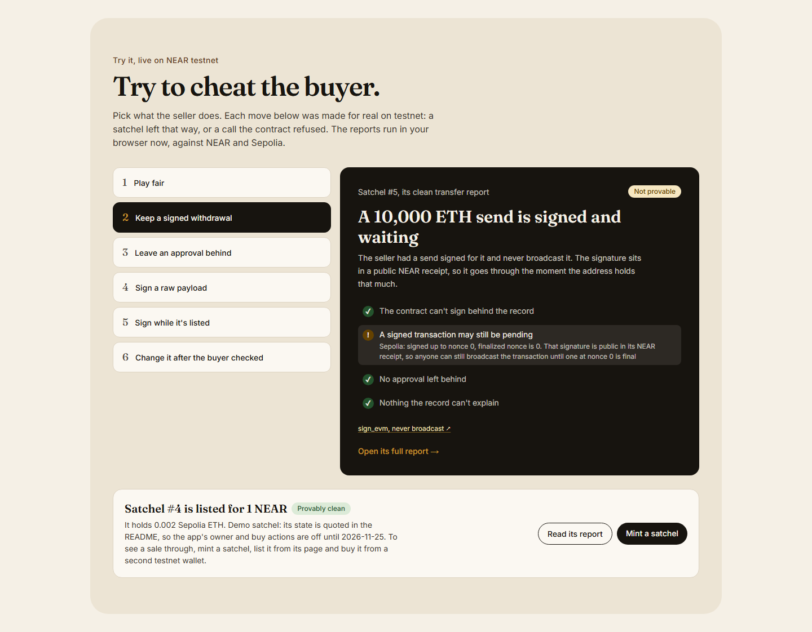
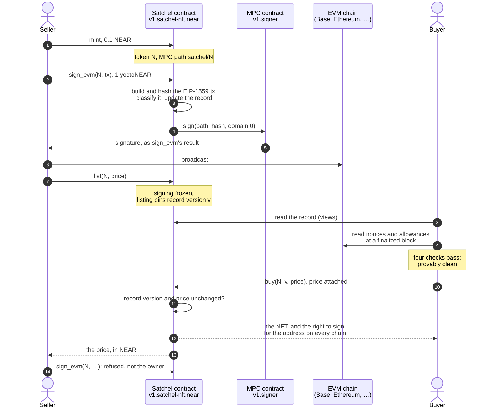
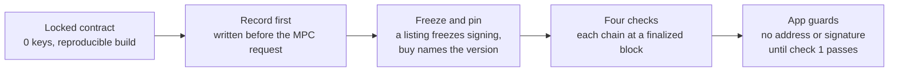
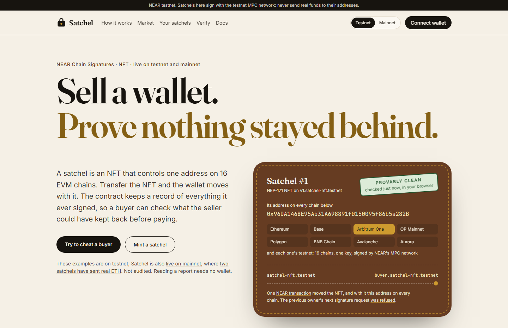
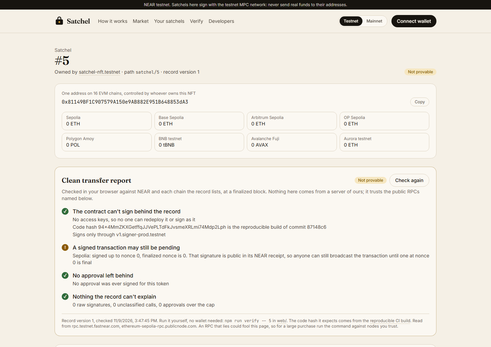
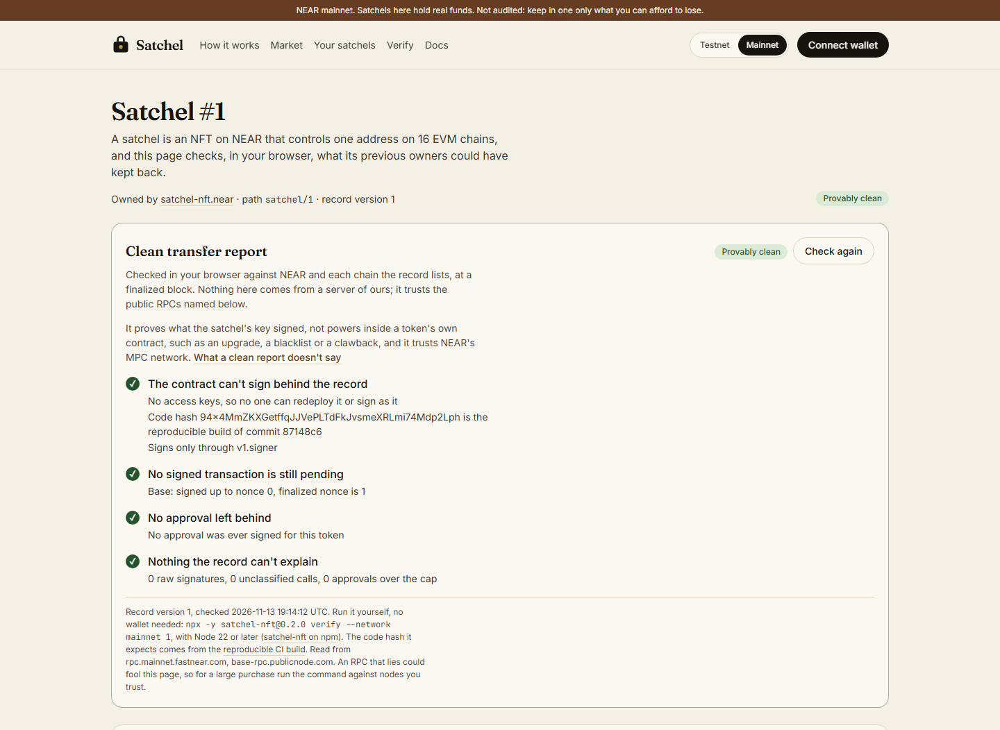

<div align="center">


# Satchel

**An NFT that is one wallet on 16 EVM chains (8 mainnets and a testnet of each), built on NEAR Chain Signatures. Transfer the NFT and the right to sign for that wallet goes with it; no one ever holds its key. The contract keeps a public record of what its key signs, so before paying, a buyer can check on chain what the seller could have kept back.**

[](https://github.com/duongnq2798/satchel/actions/workflows/contract.yml)
[](https://github.com/duongnq2798/satchel/actions/workflows/web.yml)
[](https://www.npmjs.com/package/satchel-nft)
[](SECURITY.md)
[](#on-chain-proof)
[](#on-chain-proof)
[](LICENSE)

<a href="https://satchelnft.xyz"></a>
<a href="#how-to-evaluate-satchel-in-5-minutes"></a>
<a href="AGENTS.md#check-the-claims"></a>

**[Live app](https://satchelnft.xyz)** · **[Demo video, 2:06](https://x.com/satchelnfthq/status/2120883522059837618)** · **[Evaluate in 5 minutes](#how-to-evaluate-satchel-in-5-minutes)** · **[What is shipped](#status)** · **[On-chain proof](#on-chain-proof)** · **[Built on NEAR](#built-on-near)** · **[Threat model](docs/THREAT_MODEL.md)** · **[For AI agents](AGENTS.md)** · **[Security](SECURITY.md)** · **[Changelog](CHANGELOG.md)**

<sub>Built for the NEAR Hackathon 2026 · Rust contract on NEAR (near-sdk 5.29.1) · NEAR Chain Signatures · NEP-171, 177, 181, 297, 330 and 413 · Next.js 16 and viem, one stateless server route · a library and CLI, `satchel-nft`</sub>

</div>

Selling a wallet is easy to fake. The seller signs a withdrawal and keeps it, sells the wallet, then
broadcasts the withdrawal and empties it. Or the seller approves an address of their own to spend the
wallet's tokens, and pulls them out after the sale. A buyer cannot rule either out, so wallets,
positions and addresses with a history do not change hands safely. Satchel makes the wallet an NFT.
Each satchel is a NEP-171 token on NEAR whose secp256k1 key NEAR's MPC network derives from the
contract's account and the token's path (Chain Signatures), so one token is the same address on
Ethereum, Base, Arbitrum, OP, Polygon, BNB Chain, Avalanche and Aurora, mainnets and testnets. Only
the token's owner can have the contract sign with that key, and the contract builds every EVM
transaction it signs through `sign_evm` itself (anything else it signs is counted as opaque). Before
it asks for a signature it writes down, in a public record, the
highest nonce it signed on each chain and every approval it granted. A buyer compares that record
with each chain at a finalized block: if every nonce ever signed is spent, every approval revoked and
nothing was signed blind, the transfer is provably clean. One NEAR transaction then moves the NFT,
and with it the right to sign for the address on every one of those chains.

> The NFT moves the wallet. The record proves what it signed.

> [!IMPORTANT]
> **Not audited.** No third party has reviewed this code. The contract is live on NEAR testnet at
> `v1.satchel-nft.testnet` and on NEAR mainnet at `v1.satchel-nft.near`: the same reproducible build
> on both, each locked (no access keys) before its first mint. On mainnet a satchel's address holds
> real funds on eight EVM chains, so keep in one only what you can afford to lose. A testnet
> satchel's address is a valid address on mainnet chains too, but NEAR's testnet MPC network signs for
> it: never send real funds to it. The demo satchels and the end-to-end runs are on testnet. On
> mainnet, [satchel #1](#satchel-1-the-first-on-mainnet) was funded with 0.00195 ETH on Base and has
> sent from it once, in the app, and [satchel #2](#satchel-2-a-swap-through-1click) swapped 0.00258
> ETH on Base for USDC on Arbitrum One through NEAR Intents' 1Click.

## Satchel in 60 seconds

**The point is the check, not the wallet behind an NFT.** Satchel's contract writes down what the
wallet's key signs, approvals included, and a report compares that record with each chain at a
finalized block, so a signed send the seller kept back or an approval they left live shows up before
the buyer pays. When it does, the owner can fix it from the satchel's page.

Open these three. Reading needs no wallet, and each page reads the chains live:

| Open | It reads | What happened |
| --- | --- | --- |
| [Testnet satchel #5](https://satchelnft.xyz/satchel/5) | **Not provable**: "A signed transaction may still be pending" | Its owner had a 10,000 ETH send on Sepolia signed and never broadcast it. On an ordinary wallet nothing on chain would show that; Satchel's record names the nonce |
| [Testnet satchel #9](https://satchelnft.xyz/satchel/9) | **Provably clean**, at record version 5 | It was left with a live USDC approval and two signed sends. On 2026-11-12 its owner pressed **Revoke** and **Spend nonce** on its page, and once Sepolia finalized, the report read clean ([the run](#make-it-clean-on-testnet-satchel-9)) |
| [Mainnet satchel #2](https://satchelnft.xyz/mainnet/satchel/2) | **Provably clean**, holding 5.280549 USDC on Arbitrum One | Real funds: its ETH on Base was swapped through NEAR Intents' 1Click into its own address. **Quote an exit** on its page asks 1Click for a dry quote, with no wallet |

To check rather than trust: `node scripts/check-claims.mjs` needs no install and reads 13 claims
back from NEAR testnet in seconds. [Evaluate in 5 minutes](#how-to-evaluate-satchel-in-5-minutes)
covers the rest.

## Why it is different

Different, first, from handing over a seed phrase. Other NFTs that hold a key share some of these
points ([others have tied keys to NFTs](#the-nft-tracks-brief-point-by-point)).

- **The key cannot leave with the seller.** Handing over a seed phrase hands over a copy, and the
  seller keeps theirs. A satchel's key is in no one's hands: the MPC network signs with it only when
  the contract asks, and the contract asks only for the token's current owner. After the transfer of
  satchel #1, its previous owner's request was
  [refused on chain](https://testnet.nearblocks.io/txns/GqFsnmFLcpDjJVC1b4qUPYxHRTP1Rw2vcVKxga3PVRvU).
- **What the key signed is on record, not in the seller's word.** The contract builds each EVM
  transaction itself, so it knows the chain, the nonce and the call. A buyer doesn't need the
  seller's history, only the record and the chains.
- **What Satchel can't see into is counted, never guessed.** A raw signature, a multicall, an
  approval past the 32nd: each one is counted, and the report says "not provable" with the reason.
  A seller can make a satchel unprovable, but cannot make it look clean.
- **One transfer, every chain.** The NFT moves on NEAR in one transaction, and with it the right to
  sign for its address on all 16 chains. A token-bound account (ERC-6551) is controlled from the
  NFT's chain. The standard's reference account checks the NFT's current owner each time it acts, so
  a signature made before a sale doesn't work after it, but approvals it granted stay in the token
  contracts after the sale, and only a scan of that chain's logs finds them.
- **The proof doesn't depend on us.** The contract has no access keys and no admin, and its code is
  the reproducible build. The report runs in your browser or terminal against public RPC nodes, or
  your own. Each claim about the deployments has a command that checks it:
  `node scripts/check-claims.mjs` needs no install and checks 13 of them on testnet in seconds
  ([step 2](#how-to-evaluate-satchel-in-5-minutes)).

## Contents

- [Satchel in 60 seconds](#satchel-in-60-seconds)
- [Why it is different](#why-it-is-different)
- [How to evaluate Satchel in 5 minutes](#how-to-evaluate-satchel-in-5-minutes)
- [Status](#status)
- [What Satchel does](#what-satchel-does)
- [The NFT track's brief, point by point](#the-nft-tracks-brief-point-by-point)
- [The other tracks, point by point](#the-other-tracks-point-by-point)
- [How a sale works](#how-a-sale-works)
- [When is a transfer provably clean?](#when-is-a-transfer-provably-clean)
- [A swap through NEAR Intents that keeps the proof](#a-swap-through-near-intents-that-keeps-the-proof)
- [Safety architecture](#safety-architecture)
- [Built on NEAR](#built-on-near)
- [On-chain proof](#on-chain-proof)
- [Contract interface](#contract-interface)
- [Web app](#web-app)
- [Holder room](#holder-room)
- [Quick start with the near CLI](#quick-start-with-the-near-cli)
- [Where things are in this repository](#where-things-are-in-this-repository)
- [Documentation](#documentation)
- [Development](#development)
- [Limits, stated plainly](#limits-stated-plainly)
- [Failure cases](#failure-cases)
- [The case against Satchel](#the-case-against-satchel)
- [Prior work](#prior-work)
- [Libraries, templates and AI-assisted code](#libraries-templates-and-ai-assisted-code)
- [Other project by the same builder](#other-project-by-the-same-builder)
- [License](#license)

## How to evaluate Satchel in 5 minutes

You need Node.js 22 or later, git and curl. No wallet, no key and no account: every step reads public
NEAR, Sepolia, Base and Arbitrum One data through public RPC nodes. Steps 1 to 3 need no install,
except step 3's optional wasm check: step 2's scripts use only Node (a `check-claims.mjs` run took 6
to 11 s here), and step 3's reads are curl, with two at its end that redo one of the report's
verdicts by hand. Step 4 is optional. Its `npx` command downloads the package `satchel-nft` before
it prints a report, which took 142 s and 230 s in two runs here; to fit it in five minutes, start it
before the other steps, in a second terminal and an empty folder, and do them while it runs. Skip
the optional parts: step 3's wasm check (downloading the CI wasm needs the GitHub CLI, signed in;
rebuilding it needs cargo-near and Docker) and building this checkout's package in step 4. Step 5
needs step 4's install and compiles the Rust tests, so give it longer. The timings and outputs
below are from a fresh clone on a Windows 10 laptop with Node 24.12, on 2026-11-09; step 4's `npx`
timings are from 2026-11-10, the claim checker's runs and output in step 2 from 2026-11-11, and the
by-hand reads in step 3 from 2026-11-12.

**Try to cheat a buyer in your browser; it needs no install.** Open
[satchelnft.xyz/#examples](https://satchelnft.xyz/#examples) and pick **Keep a signed withdrawal**.
Satchel #5's owner had a 10,000 ETH send signed for it and never broadcast it. Your browser reads the
satchel's record from `v1.satchel-nft.testnet` and Sepolia's nonce for its address at a finalized
block, and the report says **Not provable**: "A signed transaction may still be pending". The other
moves open satchels left the other ways (#1 played fair, #3 left an approval behind, #6 had a raw
payload signed), or show a call the contract refused on chain (signing while listed, buying after
the record changed).

<p align="center"></p>

1. **Clone.** Under two seconds here.

   ```bash
   git clone https://github.com/duongnq2798/satchel.git
   cd satchel
   ```

2. **Check both deployments against the chain.** No install.
   [`scripts/check-claims.mjs`](scripts/check-claims.mjs) reads the contract's keys, code hash,
   NEP-330 metadata and MPC signer, and the MPC contract's root key and the keys it derives for the
   satchels in the package's test fixture (testnet #1 to #8, mainnet #1), from a public NEAR RPC
   node, and the transactions that deployed the Satchel contract and locked it from an archival one.
   On testnet it also reads the calls the contract refused; on mainnet, satchel #1's mint and first
   signature, and that send on Base from a public Base node, then satchel #2's swap through 1Click,
   on NEAR, Base, Arbitrum One and 1Click's public status (set `BASE_RPC` and `ARBITRUM_RPC` to use
   your own nodes). Each run took 6 to 11 s here, most of it waiting on the archival node.

   ```bash
   node scripts/check-claims.mjs                      # NEAR testnet: 13 claims
   node scripts/check-claims.mjs --network mainnet    # NEAR mainnet: 15 claims, four also read Base, one Arbitrum One and 1Click
   node scripts/check-dao.mjs                         # the satchel a DAO owned: 5 claims, on NEAR testnet and Sepolia
   ```

   The mainnet run prints:

   ```text
   [PASS] v1.satchel-nft.near has no access keys, so no one can redeploy it or sign as it
          0 access keys
   [PASS] Its code is the reproducible build, not a global contract
          code hash 94x4MmZKXGetffqJJVePLTdFkJvsmeXRLmi74Mdp2Lph
   [PASS] Its NEP-330 metadata names commit 87148c6 and the pinned Docker image
          https://github.com/duongnq2798/satchel/tree/87148c6b6f97f3121cac13c93e22d7d153453b53
   [PASS] It signs only through v1.signer
          mpc_contract() = v1.signer
   [PASS] The package derives every satchel's address from v1.signer's root key, and pins that key
          public_key({ domain_id: 0 }) = secp256k1:3tFRbMqmoa6A…, as config.ts pins it
   [PASS] The keys the package's tests derive are the ones v1.signer gives for each satchel
          derived_public_key matches for satchel/1
   [PASS] It was deployed and initialized in one transaction
          DeployContract, FunctionCall, new({ mpc_contract: "v1.signer" })
   [PASS] Its only key was deleted before any satchel was minted
          DeleteKey at block 223741744, nft_total_supply() = 0 there
   [PASS] Satchel #1, the first on mainnet, was minted by satchel-nft.near after the lock
          HCYB168y… minted #1 to satchel-nft.near at block 223756145, after the DeleteKey at 223741744
   [PASS] Its first signature is a Base transaction at nonce 0, recorded by the contract before v1.signer signed it
          2xqwe8AA… sign_evm: chain 8453, nonce 0, value_transfer, record version 1; v1.signer signed 4e9284fc… for satchel/1
   [PASS] Base ran exactly that signed transaction, in a block that is now finalized
          0x8044dd8c… from 0xdc269ead17b522d49db2cefd38cef0c5413868f9, block 55178996, status 1, fee 127494755188 wei, finalized
   [PASS] Satchel #2 was minted by satchel-nft.near before its Base address held any ETH
          8NE2xLni… minted #2 at 2026-11-11T01:49:56.266Z; 0 wei and nonce 0 at Base block 55857952, then 0x9c786eab… brought 0.0026 ETH at 2026-11-11T01:52:46.000Z
   [PASS] Its first signature is a plain transfer on Base at nonce 0, of the amount 1Click quoted, to the deposit address it quoted
          FnFSMSh1… sign_evm: chain 8453, nonce 0, value_transfer, record version 1; v1.signer signed 9691e10a… for satchel/2, 2580000000000000 wei to 0x588f8C4419974bC735Ac784B3dA41B44c42bb64b
   [PASS] Base ran exactly that deposit, in a block that is now finalized
          0x2d9b1a1c… from 0xf5383275efedde8b90f59de8e8d15b1e23b4965f, block 55860595, status 1, fee 126456114997 wei, finalized
   [PASS] 1Click reports SUCCESS for this deposit, and the payout it names sent the same address more USDC on Arbitrum One than the quote's minimum
          1Click: SUCCESS, deposit 0x2d9b1a1c…, payout 0x417322bd…; 5.280549 USDC (0xaf88d065…) to 0xf5383275efedde8b90f59de8e8d15b1e23b4965f, 23 s after the deposit; minimum 5.232520

   15 of 15 claims hold (https://rpc.mainnet.fastnear.com, archival https://archival-rpc.mainnet.fastnear.com)
   ```

   The testnet run checks the same seven facts about `v1.satchel-nft.testnet`, then that its key was
   deleted before the first mint (block 276856595, first mint at 276856686) and that the contract
   refused, on chain, a previous owner signing, a call to `new()` from another account, signing while
   listed and a `buy` naming an old record version, and what satchel #6's record held when that `buy`
   was refused. It ends with `13 of 13 claims hold`. Each run exits 0 only when
   every claim holds; [AGENTS.md](AGENTS.md#1-the-deployment-and-its-history-one-command) says what
   each line reads. A read that fails is tried once more. With `BASE_RPC` unset, a Base read the
   default node fails goes to Base's own node, `https://mainnet.base.org`. A claim that fails only
   because a node or 1Click didn't answer says it is not a change to any satchel, and what to do.
   `check-dao.mjs` keeps asking a busy node: a NEAR or Sepolia read a node answers with HTTP 408, 429
   or 5xx, or whose connection fails, is sent up to 3 more times, 1, 2 and 4 s apart, or longer if
   the node's Retry-After asks, up to 8 s. With `NEAR_ARCHIVAL_RPC` unset, an archival read FastNEAR's
   node still doesn't answer goes to NEAR's own, `https://archival-rpc.testnet.near.org`, and once
   FastNEAR's has failed a read that NEAR's answered, later archival reads go to NEAR's node first;
   on 2026-11-12 FastNEAR's answered HTTP 429 to every retry when the script ran right after
   `check-claims.mjs`. With `SEPOLIA_RPC` unset, a Sepolia read the default node
   fails, or answers with null, goes to `https://1rpc.io/sepolia`, then
   `https://sepolia.gateway.tenderly.co`; on 2026-11-12 the default node returned the DAO's Sepolia
   transaction but a null receipt for it.
   GitHub runs the three commands every day until judging ends on 2026-11-25
   ([`watch.yml`](.github/workflows/watch.yml)), with a request to satchelnft.xyz and `/mainnet`.

3. **Ask the chain without our scripts.** Two reads with curl, from the same directory:

   ```bash
   rpc() { curl -s https://rpc.mainnet.fastnear.com -H 'content-type: application/json' -d "{\"jsonrpc\":\"2.0\",\"id\":1,\"method\":\"query\",\"params\":$1}"; }
   rpc '{"request_type":"view_access_key_list","finality":"final","account_id":"v1.satchel-nft.near"}' | grep -o '"keys":\[[^]]*\]'   # "keys":[]
   rpc '{"request_type":"view_account","finality":"final","account_id":"v1.satchel-nft.near"}' | grep -o '"code_hash":"[^"]*"'      # "code_hash":"94x4MmZKXGetffqJJVePLTdFkJvsmeXRLmi74Mdp2Lph"
   ```

   That code hash belongs to the wasm the reproducible CI build produced. Optional: to hash that
   wasm yourself, download it with the GitHub CLI, signed in (GitHub asks for a login to download
   artifacts, even from a public repository; this one is kept until 2027-02-07):

   ```bash
   gh run download 42547394040 --repo duongnq2798/satchel --name satchel-reproducible-wasm --dir ci-build
   node scripts/code-hash.mjs ci-build/satchel.wasm    # 94x4MmZKXGetffqJJVePLTdFkJvsmeXRLmi74Mdp2Lph
   ```

   Without a GitHub login, rebuild the wasm yourself: check out `87148c6` and run
   `cargo near build reproducible-wasm` in `contracts/satchel` (cargo-near 0.22.0 and Docker;
   [AGENTS.md](AGENTS.md#4-the-reproducible-build) has the steps). It was not run for this README.

   Then redo one of the report's verdicts by hand: check 2, "No signed transaction is still
   pending", for satchel #5, the one that hides a signed send. Two reads; `node -e` decodes the
   contract's answer, which NEAR returns as bytes. `args_base64` is `{"token_id":"5"}`.

   ```bash
   # 1. Satchel #5's signing record, from v1.satchel-nft.testnet at a final block
   curl -s https://rpc.testnet.fastnear.com -H 'content-type: application/json' \
     -d '{"jsonrpc":"2.0","id":1,"method":"query","params":{"request_type":"call_function","finality":"final","account_id":"v1.satchel-nft.testnet","method_name":"signing_record","args_base64":"eyJ0b2tlbl9pZCI6IjUifQ=="}}' \
     | node -e "let s='';process.stdin.on('data',d=>s+=d).on('end',()=>console.log(Buffer.from(JSON.parse(s).result.result).toString()))"
   # 2. The nonce of #5's address on Sepolia at the finalized block
   curl -s https://ethereum-sepolia-rpc.publicnode.com -H 'content-type: application/json' \
     -d '{"jsonrpc":"2.0","id":1,"method":"eth_getTransactionCount","params":["0x81149BF1C907579A150e9AB882E951B648853dA3","finalized"]}'
   ```

   On 2026-11-12 they printed:

   ```text
   {"evm":[{"chain_id":"11155111","max_nonce":"0","signatures":1}],"approvals":[],"approvals_not_itemized":0,"unclassified_calls":0,"opaque_signatures":0,"last_opaque_at":"0","version":"1"}
   {"jsonrpc":"2.0","id":1,"result":"0x0"}
   ```

   The record says the contract signed one transaction for Sepolia (chain 11155111), and the highest
   nonce it signed there is 0 (`max_nonce`). The address's nonce at Sepolia's finalized block is
   `0x0`: no transaction from it is final, so nonce 0 is not spent. Check 2 (`pendingCheck` in
   [`report.ts`](packages/satchel-nft/src/report.ts)) passes a chain only when the finalized nonce is
   above `max_nonce`, and 0 is not above 0. The transaction signed at nonce 0, a 10,000 ETH send
   whose signature is public in its NEAR receipt
   ([`G66SfkVz…`](https://testnet.nearblocks.io/txns/G66SfkVz9dbf4AeJam5jiLnZNmZGAAYpaLgDWPCa5Ga7)),
   stays valid: anyone can broadcast it, and it lands once the address can pay for it. So check 2
   fails, "A signed transaction may still be pending", and the verdict is `NOT PROVABLE`, as step 4
   prints. The report also reads the nonce at the latest block (`"latest"` in place of
   `"finalized"`), only to tell a transaction at that nonce that isn't final yet, which reads "could
   not confirm", from one that was never sent; on 2026-11-12 it was `0x0` too. The same record's
   empty `approvals` and zero counters are why checks 3 and 4 pass.

   In PowerShell, don't pass these bodies to `curl.exe`: Windows PowerShell 5.1 strips the double
   quotes inside an argument it passes to a program, and the nodes answer `Parse error`.
   `Invoke-RestMethod` sends them as they are:

   ```powershell
   $r = Invoke-RestMethod https://rpc.testnet.fastnear.com -Method Post -ContentType 'application/json' -Body '{"jsonrpc":"2.0","id":1,"method":"query","params":{"request_type":"call_function","finality":"final","account_id":"v1.satchel-nft.testnet","method_name":"signing_record","args_base64":"eyJ0b2tlbl9pZCI6IjUifQ=="}}'
   [Text.Encoding]::UTF8.GetString([byte[]]$r.result.result)
   (Invoke-RestMethod https://ethereum-sepolia-rpc.publicnode.com -Method Post -ContentType 'application/json' -Body '{"jsonrpc":"2.0","id":1,"method":"eth_getTransactionCount","params":["0x81149BF1C907579A150e9AB882E951B648853dA3","finalized"]}').result
   ```

4. **Run the clean transfer report on the demo satchels.** Optional: it downloads the package
   before it runs, and step 3's last two reads redo one of its verdicts without it. The package
   [`satchel-nft`](packages/satchel-nft), [on npm](https://www.npmjs.com/package/satchel-nft), is the code the web app runs, and its command
   `satchel-nft verify` builds the same report ([`report.ts`](packages/satchel-nft/src/report.ts)) in your terminal.
   It needs no clone. In an empty folder, with an empty npm cache, this fetched the release and
   printed the report in 142 s and 230 s in two runs here (0.2.0, 2026-11-10); each report after that took 6 to 11 s:

   ```bash
   npx -y satchel-nft@0.2.0 verify 1
   ```

   `-y` installs it without asking, and every command below pins the same release. It was
   published from commit `2dd4209`; the [threat model](docs/THREAT_MODEL.md#what-satchel-trusts)
   says how to check that it is. To run this checkout's code instead, at the repository root
   (installing took 2 min 54 s here, building 7 s):

   ```bash
   npm ci -w satchel-nft
   npm run build -w satchel-nft
   npx satchel-nft verify 1
   ```

   Inside the repository, `npx satchel-nft` runs this checkout's build, never a download, and so
   does the pinned command while the checkout's package is 0.2.0 too. Either way it prints:

   ```text
   Satchel #1 on v1.satchel-nft.testnet (testnet)
   owner buyer.satchel-nft.testnet, address 0x96DA1468E95Ab31A698891f0150095f86b5a282B, record version 7

   [PASS] The contract can't sign behind the record
          No access keys, so no one can redeploy it or sign as it
          Code hash 94x4MmZKXGetffqJJVePLTdFkJvsmeXRLmi74Mdp2Lph is the reproducible build of commit 87148c6
          Signs only through v1.signer-prod.testnet

   [PASS] No signed transaction is still pending
          Sepolia: signed up to nonce 4, finalized nonce is 5

   [PASS] No approval left behind
          No approval was ever signed for this token

   [PASS] Nothing the record can't explain
          0 raw signatures, 0 unclassified calls, 0 approvals over the cap

   PROVABLY CLEAN (checked 2026-11-09T15:38:48.914Z)
   read from https://rpc.testnet.fastnear.com, https://ethereum-sepolia-rpc.publicnode.com
   ```

   Then the satchel that hides a signed send:

   ```bash
   npx -y satchel-nft@0.2.0 verify 5; echo "exit $?"
   ```

   ```text
   [FAIL] A signed transaction may still be pending
          Sepolia: signed up to nonce 0, finalized nonce is 0. That signature is public in its NEAR receipt, so anyone can still broadcast the transaction until one at nonce 0 is final

   NOT PROVABLE (checked 2026-11-09T15:17:47.674Z)
   exit 1
   ```

   (The satchel's own two lines, the three passing checks and the RPC line are left out above.) Run
   it for each demo satchel:

   | Satchel | What its owner did | `satchel-nft verify <id>` prints | Exit code |
   | --- | --- | --- | --- |
   | #1 | Had seven Sepolia transactions signed, at nonces 0 to 4. Five were broadcast (one reverted, which still spends its nonce); the other two were at nonce 0, so they are void | `PROVABLY CLEAN` | 0 |
   | #5 | Had a 10,000 ETH send signed for it and never broadcast it | `[FAIL] A signed transaction may still be pending`, `NOT PROVABLE` | 1 |
   | #3 | Approved satchel #2's address, which the same seller owns, to spend its USDC without limit | `[FAIL] An approval is still live`, `NOT PROVABLE` | 1 |
   | #6 | Listed, delisted, had a raw 32-byte payload signed, then listed again | `[FAIL] The record can't explain everything signed`, `NOT PROVABLE` | 1 |
   | #4 | Nothing: it holds 0.002 Sepolia ETH, never signed anything, and is listed for 1 NEAR | `PROVABLY CLEAN`, and `listed by satchel-nft.testnet at record version 0` | 0 |
   | #7 | Minted with the CLI, sent once on Sepolia, listed, delisted, listed again, sold and handed back, each step with `satchel-nft` ([below](#the-satchel-nft-cli-on-testnet)) | `PROVABLY CLEAN` | 0 |

   `npx -y satchel-nft@0.2.0 verify --network mainnet <id>` reads a mainnet satchel. Satchel #1, the first
   on mainnet, has sent once on Base; in 6 s here it prints, among its four passing checks:

   ```text
   [PASS] No signed transaction is still pending
          Base: signed up to nonce 0, finalized nonce is 1
   ```

   then `PROVABLY CLEAN`, and exits 0.

5. **Run every test.** Still at the repository root, after step 4's `npm ci -w satchel-nft` (run it
   now if you skipped it):

   ```bash
   npm test -w satchel-nft             # 235 tests in 18 files: 6 s here
   npm run typecheck -w satchel-nft    # 7 s here
   ```

   The web app's own 309 tests need the whole install: `npm ci`, then `npm test` runs both workspaces
   ([Development](#development)).

   The contract's 64 unit tests need Rust (rustup installs the pinned 1.99.1 from
   `contracts/satchel/rust-toolchain.toml` on first use). On Windows, set
   `AWS_LC_SYS_PREBUILT_NASM=1` first. With the dependencies already compiled, this took 43 s here;
   a first run compiles them before it starts.

   ```bash
   cd contracts/satchel
   cargo test           # test result: ok. 64 passed
   ```

**Reviewing security:** [docs/THREAT_MODEL.md](docs/THREAT_MODEL.md) goes through 42 attacks (the
seller's, a buyer's, the deployer's, an RPC's, the hosted app's, and on the holder room), what stops each one, the transaction on testnet that
shows it where one exists, and what is left. [SECURITY.md](SECURITY.md) says how to report a
vulnerability. [AGENTS.md](AGENTS.md) maps each rule to its code and its tests, or says it has none.

## Status

What exists at this commit, and what does not yet.

| Component | Status | Where |
| --- | --- | --- |
| Contract: a NEP-171 NFT whose tokens each control an MPC-derived key, with the signing record, the sale and the refusals | **Shipped** on NEAR testnet as `v1.satchel-nft.testnet` and on NEAR mainnet as `v1.satchel-nft.near`, both on 2026-11-09, both from commit `87148c6` and locked before their first mint. A locked contract cannot change: a fix would ship as a new account | [`contracts/satchel`](contracts/satchel) |
| Reproducible build | **Shipped**. CI builds every pull request and every push to `main` or `dev` in the pinned image `sourcescan/cargo-near:0.22.0-rust-1.99.1` and writes the code hash to the run's summary. Both deployments run the build of commit `87148c6`, code hash `94x4MmZK…` | [`.github/workflows/contract.yml`](.github/workflows/contract.yml) |
| Clean transfer report: four checks, each chain read at a finalized block | **Shipped**, in the browser and as `satchel-nft verify`, from the same code | [`report.ts`](packages/satchel-nft/src/report.ts), [`cli.ts`](packages/satchel-nft/src/cli.ts) |
| Web app at [satchelnft.xyz](https://satchelnft.xyz) | **Shipped**. One deployment serves testnet, and mainnet under `/mainnet`: mint, send through the MPC network on the network's 8 EVM chains, list, delist, transfer, buy, the market, the report, and what a satchel holds and its history. On the demo satchels this README quotes (testnet #1 to #9, mainnet #1 and #2), the app's owner and buy actions are off until 2026-11-25: a guard in the app, not a protection | [`web`](web), [`frozen.ts`](web/src/lib/frozen.ts) |
| Make it clean: under a report that isn't clean, the revokes and nonce spends that would fix checks 2 and 3, with a button for each one the app can send | **Shipped** on 2026-11-11, with tests, and run once on testnet on 2026-11-12: on satchel #9, left with a live approval and two signed sends, its owner pressed **Revoke** and **Spend nonce**, and once Sepolia finalized, the report read `PROVABLY CLEAN` ([the run](#make-it-clean-on-testnet-satchel-9)). `readFixInputs` reads each chain's latest block, and `fixPlan` builds the revoke for each live approval (`approve(spender, 0)`, `approve(0x0, id)`, `setApprovalForAll(operator, false)` or Permit2 `approve(token, spender, 0, 0)`) and a send of 0 to the satchel's own address for each open nonce a revoke doesn't spend. Anyone can read the plan and its calldata. Only the owner gets buttons, and each sends through `sendFromSatchel` like any send. It shows the approval slot each revoke takes and won't send a 33rd while check 4 passes; more than 10 open nonces on a chain get a terminal command instead. Nothing fixes check 4. The package code is in this repository, not in npm 0.2.0 | [`clean.ts`](packages/satchel-nft/src/clean.ts), [`fix-panel.tsx`](web/src/components/fix-panel.tsx) |
| Guards before anything is signed | **Shipped**. The app shows no address and signs nothing until the network's contract passes check 1; it refuses an account from the other network, a transaction for another contract, and a receiver that doesn't exist. The CLI runs the same guards | [`guard.ts`](packages/satchel-nft/src/guard.ts) |
| Demo satchels and two refused calls | **Shipped** on testnet: satchels #1 and #3 to #6 (#2 is retired), every step in an evidence file (two entries written by hand from the run log, one failed retry left out, as [noted below](#on-chain-proof)) | [`tools/demo-gallery.mjs`](tools/demo-gallery.mjs), [`deployments/testnet-gallery.json`](deployments/testnet-gallery.json) |
| End-to-end run against the real MPC network | **Shipped** on testnet: mint, sign, transfer, the previous owner refused, the new owner signing, a broadcast on Sepolia | [`tools/e2e-testnet.mjs`](tools/e2e-testnet.mjs), [`deployments/testnet-e2e.json`](deployments/testnet-e2e.json), [`deployments/testnet-sepolia-send.json`](deployments/testnet-sepolia-send.json) |
| Claim checker | **Shipped**: 13 claims on testnet, 15 on mainnet | [`scripts/check-claims.mjs`](scripts/check-claims.mjs) |
| Mainnet deploy script | **Shipped**, and used for the mainnet deployment. It reads the chain before each step, stops if a name belongs to someone else or the code isn't the build, and asks before it deletes the last key | [`tools/deploy-mainnet.sh`](tools/deploy-mainnet.sh) |
| The first satchel on mainnet: funded on Base, minted, one send from it in the app, its report clean | **Shipped** on 2026-11-09: satchel #1, 0.00195 ETH on Base, 0.0001 ETH sent from it at satchelnft.xyz, `PROVABLY CLEAN`. The owner signed every transaction | [`deployments/mainnet-first-send.json`](deployments/mainnet-first-send.json) |
| A satchel's ETH on Base swapped for USDC on Arbitrum One through NEAR Intents' 1Click, with the satchel itself as recipient and refund address, its report still clean | **Shipped** on 2026-11-11 on mainnet: satchel #2 sent 0.00258 ETH to 1Click's deposit address from the app's Send panel, a plain transfer at nonce 0, and 5.280549 USDC reached its address on Arbitrum One; `PROVABLY CLEAN`. A script asked for the real quote and followed the swap. One run. The USDC arrives only if 1Click sends it ([what it shows](#a-swap-through-near-intents-that-keeps-the-proof)). The app quotes and doesn't swap: on a mainnet satchel's page, **Quote an exit** asks 1Click for a dry quote of what the satchel holds, with no wallet and the satchel as recipient and refund address, and the history marks satchel #2's deposit with 1Click's status ([in the app](#quote-an-exit-in-the-app)) | [`tools/oneclick-exit.mjs`](tools/oneclick-exit.mjs), [`deployments/mainnet-1click-exit.json`](deployments/mainnet-1click-exit.json), [`oneclick.ts`](web/src/lib/oneclick.ts), [`quote-panel.tsx`](web/src/components/quote-panel.tsx) |
| npm package `satchel-nft`: the report as a library and a CLI (`npx -y satchel-nft@0.2.0 verify 1`), with read commands and signing commands that use the near CLI's keychain | **Shipped** on npm as [`satchel-nft` 0.2.0](https://www.npmjs.com/package/satchel-nft), published by the owner on 2026-11-10 from commit `2dd4209` (0.1.0 on 2026-11-09 from `728ed74`), without npm provenance ([how to check it](docs/THREAT_MODEL.md#what-satchel-trusts)). The web app runs on the same code. `npx -y satchel-nft@0.2.0 verify 1` in an empty folder printed `PROVABLY CLEAN`. CI packs the package, installs the tarball in an empty project and runs it, then runs the release from npm on Linux. Every sign command ran on testnet, and an adversarial review of its signing found no way to make it send a transaction other than the one it shows | [`packages/satchel-nft`](packages/satchel-nft), [`deployments/testnet-cli.json`](deployments/testnet-cli.json) |
| What's inside a satchel: its USDC, USDT and WETH balances beside the native ones on each chain, and a timeline of mints, owners, signatures and sales on its page | **Shipped** on 2026-11-10. Above the report, a satchel's page shows its native balance on each of the network's 8 chains, and its USDC, USDT and WETH where a deployment is listed: 22 on the mainnets, 11 on the testnets (no testnet USDT). Each comes from Circle, Tether, USDT0 or the chain itself, except WETH on Sepolia, from Uniswap's deployment list; the sources are in `contents.ts`. After `npm ci` and `npm run build -w satchel-nft`, `node scripts/check-tokens.mjs` reads every one's code, symbol and decimals back from its chain. Below the report, its history: mint, transfers, signatures, listings and sales from FastNEAR's transaction index, each linked to its transaction. The report reads neither. In the CLI, `show` prints the same balances and `history <id>` the timeline, both since 0.2.0 | [`contents.ts`](packages/satchel-nft/src/contents.ts), [`history.ts`](packages/satchel-nft/src/history.ts), [`check-tokens.mjs`](scripts/check-tokens.mjs) |
| What came in: every USDC, USDT and WETH transfer into a satchel's address, with totals | **Shipped** on 2026-11-13, in the app only. Below its history, a satchel's page lists the USDC, USDT and WETH sent to its address since the network's Satchel contract was created, oldest first, each with its time, amount, chain, sender and a link to the transaction, and a total per token and chain. The browser reads each chain's ERC-20 Transfer logs from a free node with no key, in chunks no larger than the node allows, and shows each chain as soon as it is read. It scans the chains where the satchel holds one of these tokens now or where the record has signatures; a chain whose node no longer returns its first known Transfer shows as unread, and a range that fails shows as a gap, not as empty. BNB Chain isn't scanned: no free node tried read its logs back to the start. The report doesn't read it. `node scripts/check-scan-start.mjs` checks each start block against the contract's creation and each chain's first Transfer | [`received.ts`](web/src/lib/received.ts), [`received.tsx`](web/src/components/received.tsx), [`check-scan-start.mjs`](scripts/check-scan-start.mjs) |
| A satchel's address derived without an RPC | **Shipped** on 2026-11-10. The app and the CLI compute each satchel's key from the MPC network's root key, pinned in the package, the contract and the path, as the MPC contract does, so no RPC answer changes a satchel's address. Which satchel is yours (the id a mint returns, the tokens you own) still comes from the NEAR RPC, or for a mint from the wallet. The tests derive the keys of the 9 satchels in their fixture (testnet #1 to #8, mainnet #1) and get what the MPC contract's `derived_public_key` returned, and `check-claims.mjs` compares the pinned root key with the chain. `satchel-nft` derives it since 0.2.0; 0.1.0 reads the address through the NEAR RPC | [`evm.ts`](packages/satchel-nft/src/evm.ts), [`derived-keys.json`](packages/satchel-nft/src/__fixtures__/derived-keys.json) |
| A satchel owned by a Sputnik DAO: its council votes what it signs, and a vote hands it on | **Shipped** on testnet on 2026-11-10, with no contract change. `satchel-club.sputnikv2.testnet` owned satchel #8: a vote passed a `sign_evm` proposal, the contract built the Sepolia transaction from the proposal's arguments and recorded it, `v1.signer-prod.testnet` signed, `satchel-nft dao finish` broadcast it after checking the hash and the signer, and the report read `PROVABLY CLEAN`. A second vote gave the satchel to `buyer.satchel-nft.testnet` with `nft_transfer`. The package builds the proposals, checks open proposals for a nonce already in use, and reads the signature from the vote's receipts; `dao finish` is in the CLI since 0.2.0. Not run on mainnet, and no DAO sale yet | [`dao.ts`](packages/satchel-nft/src/dao.ts), [`deployments/testnet-dao.json`](deployments/testnet-dao.json), [`check-dao.mjs`](scripts/check-dao.mjs), [the walkthrough](https://satchelnft.xyz/docs/tutorials/dao-owned-satchel) |
| Holder room: a page only a satchel's current holder can open, with a holder card and a handover kit | **Shipped** on 2026-11-10. The holder's wallet signs a NEP-413 message; the app's one server route, `/api/room`, checks the signature, that the key is a full-access key of the account and that the account owns the satchel, at one final NEAR block, on every request, and stores nothing. The kit says what to do before selling, from the satchel's report. Run on 2026-11-10 with messages signed by near-cli-rs, first against a local build, then against satchelnft.xyz: `satchel-nft.testnet` opened satchel #4's room (200, block 277055444 on satchelnft.xyz), and `buyer.satchel-nft.testnet` got the 403 that names the owner ([below](#holder-room)). In a browser, Meteor's Chrome extension opened mainnet satchel #1's room for `satchel-nft.near` (200, block 223915441) | [`holder.ts`](packages/satchel-nft/src/holder.ts), [`nep413.ts`](packages/satchel-nft/src/nep413.ts), [`kit.ts`](packages/satchel-nft/src/kit.ts), [`route.ts`](web/src/app/api/room/route.ts) |
| Demo kit: the video script, the X post and the submission text | **Written** on 2026-11-10 and updated on 2026-11-11 and 2026-11-12, and checked against the hackathon's limits by `node scripts/check-demo-kit.mjs`. Its 1:18 scene is Make it clean on testnet satchel #9, its 1:30 scene opens the holder room with a wallet, and its 1:42 scene is a dry 1Click quote on mainnet satchel #2. The video was recorded on 2026-11-12 from satchelnft.xyz, the owner's wallet and a terminal; its Make it clean scene is the run on satchel #9. The cut runs 2:06 against the script's 2:00, within the 2:20 X plays without Premium. Posted on X on 2026-11-12 ([the post](https://x.com/satchelnfthq/status/2120883522059837618)) | [`docs/DEMO.md`](docs/DEMO.md), [`docs/submission`](docs/submission) |
| Third-party audit | **Not done** | [`SECURITY.md`](SECURITY.md) |

**Known limitations** (the main ones are in [Limits](#limits-stated-plainly), and every residual risk
is in the [threat model](docs/THREAT_MODEL.md#residual-risks-in-one-list)): calls are classified by their selector;
only secp256k1 chains, and only EVM transactions are built by the contract; the report trusts one
public RPC per chain and one NEAR RPC unless you give it your own; the chain list and the 32-approval cap are fixed
for the life of a contract.

## What Satchel does

| Piece | What it does |
| --- | --- |
| **A satchel** | A NEP-171 token on `v1.satchel-nft.near` (or `v1.satchel-nft.testnet`). Anyone can mint one for 0.1 NEAR, with any excess refunded. Its MPC path is `satchel/<token_id>`, fixed for its lifetime, whoever owns it |
| **Its address** | NEAR's MPC network derives a secp256k1 key from its root key, the Satchel contract's account and that path; the MPC contract's `derived_public_key` view returns it. The app and the CLI (since `satchel-nft` 0.2.0; 0.1.0 reads the view) do the same math from the root key pinned in the package, so no RPC answer changes a satchel's address. Its EVM address is the same on all 16 chains the contract signs for. Nobody holds the key: the MPC nodes sign with it only when the Satchel contract asks |
| **`sign_evm`** | The owner sends the fields of an EIP-1559 transaction. The contract RLP-encodes and hashes it itself, classifies the call, updates the record, then asks the MPC contract to sign that hash. Owner only, 1 yoctoNEAR, at least 50 TGas, never while listed |
| **`sign_raw`** | Signs any 32-byte payload (a Bitcoin sighash, a message hash). Allowed, and counted as opaque |
| **The signing record** | Public, per token, and it only grows: for each chain the highest nonce signed and how many signatures; up to 32 approvals itemized and the rest counted; calls it could not classify; opaque signatures; and a version that goes up with every signature |
| **The sale** | `list` freezes signing and pins the record version. `buy` names the version and the price the buyer checked and fails if either changed; the NFT moves in the same receipt, and the seller is paid in NEAR |
| **The report** | Four checks against NEAR and every chain in the record, each chain read at a finalized block, in your browser or your terminal. "Provably clean" only when all four pass |
| **The web app** | [satchelnft.xyz](https://satchelnft.xyz): mint, see a satchel's address, what it holds and its history, send from it, list, buy, transfer, read any satchel's report without a wallet, open the holder room of a satchel you hold, and, on mainnet, ask 1Click for a dry quote of what a satchel holds |

## The NFT track's brief, point by point

Satchel is entered in the hackathon's NFT track, "NFTs That Do Something", whose brief asks for
NFTs as accounts: assets that own money, earn royalties, hold inventory, and carry credentials,
memberships or access rights.

| The brief asks for an NFT that | A satchel | How, or why not |
| --- | --- | --- |
| Owns money | **Yes** | Its address holds coins and tokens on each of the network's 8 EVM chains. Its page shows the native balance on each, and USDC, USDT and WETH where a deployment is listed. Mainnet satchel #1 was funded with ETH on Base and has sent from it; mainnet satchel #2 swapped its ETH on Base for USDC on Arbitrum One through NEAR Intents' 1Click, and holds that USDC |
| Earns royalties | **Not built in: any address can be a payee** | Point income at the satchel's address: an EIP-2981 royalty receiver, a protocol's fee recipient, a creator payout. Income paid straight to the address keeps landing there for whoever holds the NFT, so the stream changes hands with it. Income the satchel has to claim itself usually needs a call the contract can't classify, which then makes the satchel not provable for every later owner. Whoever controls the paying contract can still redirect it, and the record can't see that. No satchel has earned income yet. A satchel pays no royalty itself: the contract has no NEP-199 payout, so a resale pays the seller the full price |
| Holds inventory | **Yes: ERC-20, ERC-721 and ERC-1155 on its chains** | Assets stay at the address; the right to sign for it moves with the NFT. Their plain transfers are classified as such, so moving inventory out keeps a satchel provable; a batch transfer is not, and counts as unclassified. Assets sent to the address on a chain the contract doesn't sign for can be moved only through `sign_raw`, which the app and the CLI don't offer and which makes the satchel not provable for every later owner. The page shows the native coin and USDC, USDT and WETH, not the NFTs it holds |
| Carries access rights | **Yes: the right to sign** | Having the contract sign with the satchel's key is the access right, and it belongs to whoever holds the token. After testnet satchel #1 changed hands, its previous owner's request was [refused on chain](https://testnet.nearblocks.io/txns/GqFsnmFLcpDjJVC1b4qUPYxHRTP1Rw2vcVKxga3PVRvU). A credential the address holds outright (an ENS name it owns, a membership NFT) goes with it. One whose controller is still the seller, such as an ENS name's controller or an ERC-4907 `user`, is outside what the record sees ([what the record cannot cover](#when-is-a-transfer-provably-clean)) |

The track's example prompt, a membership NFT that carries its own wallet, lists four requirements
and a threat model. Here is where Satchel stands on each:

| The&nbsp;example&nbsp;prompt&nbsp;asks&nbsp;for | Satchel |
| --- | --- |
| An NEP-171 contract that ties each token to its account, and a README that says how control passes on transfer and what stops the old owner | **Met, with an MPC address in place of a NEAR sub-account.** Control is one rule: `assert_can_sign` lets only the token's current owner have the contract ask the MPC network for a signature, and never while it is listed. `nft_transfer`, `nft_transfer_call` and `buy` change the owner in the receipt that runs them, so the seller's next request fails in the contract, before any MPC call. There is no key to revoke: no key, seed phrase or access key was ever in the seller's hands. What a seller can leave behind through the satchel's key is a signature obtained before the sale (check 2), an approval they granted (check 3), or something the record can't explain, such as a raw signature (check 4). The record lists or counts each, and the report reads it before the buyer pays. Powers built into the assets themselves are outside it ([what the record cannot cover](#when-is-a-transfer-provably-clean))<br><br>Where: `assert_can_sign` in [`lib.rs`](contracts/satchel/src/lib.rs); `the_previous_owner_cannot_sign_after_a_transfer`; [How a sale works](#how-a-sale-works) |
| A gated page that only current holders can open | **Met.** Each satchel's holder room, `/satchel/<id>/room`, opens only for the account that owns the satchel at a final NEAR block. The holder's wallet signs a NEP-413 message naming the satchel, the network, the account and the time; the server route `/api/room` verifies it, checks that the key is a full-access key of that account and reads the owner, on every request, with no cookie and nothing stored. Sell the satchel and the room opens for the buyer instead, and the seller gets a 403 that names the new owner. Inside: a holder card and a handover kit, what to do before selling, from the satchel's report. Nothing in it is secret: what moves with the NFT is the right to open it ([Holder room](#holder-room))<br><br>Where: [`holder.ts`](packages/satchel-nft/src/holder.ts), [`nep413.ts`](packages/satchel-nft/src/nep413.ts), [`route.ts`](web/src/app/api/room/route.ts), [`holder-room.tsx`](web/src/components/holder-room.tsx) |
| A history per NFT: what it earned, what it paid out, who held it | **Partly.** Each satchel's page lists its mint, every owner, every sale with its price, and every signature, with the amount and receiver for native-coin sends (token transfers are listed by kind), from FastNEAR's transaction index. What it holds now is above it. Below it, **Received** lists the USDC, USDT and WETH that came into its address on the network's chains since the contract was created, each with its sender and transaction, read from each chain's Transfer logs: mainnet #2's one line is the 5.280549 USDC 1Click paid it on Arbitrum One. A chain's own coin that came in isn't listed one by one, since a plain send logs no event, and BNB Chain isn't scanned. The report reads none of it<br><br>Where: [`history.ts`](packages/satchel-nft/src/history.ts), [`received.ts`](web/src/lib/received.ts), [`contents.ts`](packages/satchel-nft/src/contents.ts) |
| Tests for the transfer path, including a sale in the middle of a payout | **Met.** `a_sale_in_the_middle_of_a_payout_keeps_the_send_on_record`: the seller has a send signed, lists, and a buyer buys before the MPC network answers; the record the buyer bought still names that send's nonce, so the report can't read clean until a transaction at that nonce is final. `the_seller_cannot_sign_while_their_payment_is_in_flight`: once `buy` runs, the seller is refused while their NEAR is still on its way. A unit test can't run the MPC call, so both pin the state each step leaves, not the race between receipts<br><br>Where: [`tests.rs`](contracts/satchel/src/tests.rs), [Development](#development) |
| A threat model of every way a seller could try to keep the money | **Met**<br><br>Where: [`docs/THREAT_MODEL.md`](docs/THREAT_MODEL.md#a-seller-keeps-power-over-the-wallet): what the seller signs before the sale, approvals, signing during the sale, changing the deal after the buyer checked |

**Why an MPC address, not a NEAR sub-account.** A sub-account would work too: its access keys are
public, and it can hold none and take orders only from the NFT contract. Satchel uses an
MPC-derived address because the money people want to hand over mostly sits on EVM chains, and one
satchel is the same address on eight of them, with a key no one holds. The cost: what a satchel
controls is on those chains; NEAR assets stay in NEAR accounts.

**Others have tied keys to NFTs.** NEAR's own [NFT Chain Keys](https://github.com/near/multichain-gas-station-contract/tree/2d43bf0129a81bfe0ca66814cdf696545fe03b9d/nft_key)
(2024) is an NEP-171 token that controls every Chain Signatures path under its token id. It signs
any 32-byte hash for its holder, or for an account the holder approved (a transfer revokes those
approvals), and keeps no record of what it signed. Its repository marks it as early software and
lists a testnet deployment only, whose account still has a full access key. Lit Protocol's PKPs
were key pairs minted as ERC-721 NFTs
([Lit's docs, archived on 2025-01-13](http://web.archive.org/web/20250113122321/https://developer.litprotocol.com/user-wallets/pkps/minting/overview)):
the owner, and any auth method it permitted, within that method's scopes, could sign, and the
permissions stayed with the token when it changed hands, since its transfer hook clears none of them
([scopes](https://github.com/LIT-Protocol/lit-peer/blob/cd8674fa77f125a4d38d001a944ea60481390309/rust/lit-node/lit-node/src/pkp/auth/mod.rs#L438-L457),
[transfer hook](https://github.com/LIT-Protocol/lit-peer/blob/cd8674fa77f125a4d38d001a944ea60481390309/blockchain/contracts/contracts/lit-node/PKPNFT/PKPNFTFacet.sol#L196-L212)).
Lit has since sunset those networks, Datil and Naga
([its node repository](https://github.com/LIT-Protocol/lit-peer/blob/cd8674fa77f125a4d38d001a944ea60481390309/README.md));
in Lit Protocol v3, Chipotle, a PKP is an entry in an account's on-chain registry
([its authentication model](https://developer.litprotocol.com/architecture/authModel)). ERC-6551
gives each NFT a smart-contract account, which can be deployed at the same address on many chains.
The standard's reference account acts only on the NFT's own chain;
[Tokenbound's widely deployed account](https://github.com/tokenbound/contracts/blob/2bd70ff3fb5f1c0e562425b4d5312f619d9f2720/src/AccountV3.sol)
(v0.3.1) can also act on others, through executors its guardian Safe trusts. The standard's security
section suggests safeguards to marketplaces, such as binding an order to the account's state, and
leaves preventing fraud in a sale out of scope
([EIP-6551 at `3033abc`](https://github.com/ethereum/ERCs/blob/3033abc21892360e91bc5eb76ab75aaf70000567/ERCS/erc-6551.md)).

**Why not swap a Safe's owners?** That hands over a wallet too, but one chain at a time, and what the
seller set up stays after the swap: modules, which
[Safe's docs](https://docs.safe.global/advanced/smart-account-modules) say can execute arbitrary
transactions and can take over a Safe, guards, and the approvals the Safe granted. A buyer has to
read each chain for them. A satchel's address is an ordinary account with one key: it could get code
only through an EIP-7702 authorization, which only `sign_raw` can sign, and check 4 counts that
([threat model](docs/THREAT_MODEL.md#a-seller-keeps-power-over-the-wallet), row 3).

**Not a way to launder an existing wallet.** A satchel's address is fixed by the contract and its
token id, so nothing can be signed from it before its token exists, and an existing wallet can't be
wrapped into one. Anyone can list every satchel's address (ids are sequential, and the contract,
the path and the MPC network's root key are public), so a protocol can recognize satchels and
exclude them. A satchel that has been used does carry its own history to the buyer. One whose
history is bound to a person (airdrop eligibility, a reputation score, an identity check) is the
wrong thing to sell, and the protocol that granted it may forbid the sale. Not for: hiding where
funds came from, or selling what a person earned. `PROVABLY CLEAN` means nothing the seller can
still sign; it is not AML-clean. Every sale through `buy` is public on NEAR: its `sale` event names
the seller, buyer, price and record version. A satchel handed over with `nft_transfer` shows both
accounts, but no price.

**Who it is for.** A satchel fits a payee that a contract fixes for good, such as a royalty
receiver no one can change, whose income then changes hands with it; a team's or a DAO's address,
passed on when someone leaves; and inheritance, with a DAO or a multisig as owner and a vote to
hand it on (a DAO's vote did so on testnet; no timer is involved). Heirs with enough votes can hand
it to themselves at any time; nothing waits for the owner to be gone. Satchel cannot recover a lost
NEAR key ([Failure cases](#failure-cases)). After the hackathon both contracts keep running as
deployed, with no keys and no admin; nothing more is promised.

**No fee.** The contract takes nothing from a sale: `buy` pays the seller the full price and refunds
the rest.

## The other tracks, point by point

Satchel is entered in three more tracks, as "Satchel (satchelnft.xyz)": Open Innovation, Unstoppable
DeFi and Social Money. This repository is not "Satchel: membership cards that are wallets"
([ChrisTu117/satchel](https://github.com/ChrisTu117/satchel)), another entry in this hackathon,
whose club contract `satchel-club.testnet` is not this project's DAO,
`satchel-club.sputnikv2.testnet`. Each table below takes a track's example prompt, from
[near-hackathon-prompt-examples](https://github.com/nearai/near-hackathon-prompt-examples/tree/main/tracks),
requirement by requirement. **Met** links to the code, a document or a transaction; **Partly** and
**Missing** say what isn't there.

**Hints we use.** Of the four tracks' "Lean on" hints, Satchel uses NEP-171 (each satchel is a
token), Chain Signatures (each satchel's key), chain abstraction (one NFT, one address on 16
chains), NEAR Intents (one swap through 1Click), Sputnik DAO (a satchel a DAO owned, on testnet) and
named accounts (`v1.satchel-nft.near`, the DAO `satchel-club.sputnikv2.testnet`). In part: dynamic
NFTs (a token's metadata never changes and has no picture; the signing record behind it grows with
every signature) and trading (a market where satchels sell for NEAR, and one token swap; no
exchange). Not used: a NEAR sub-account per token, as the NFT prompt has it (see "Why an MPC
address" under [the NFT track's brief](#the-nft-tracks-brief-point-by-point)), and Trezu (the DAO
run called the Sputnik DAO contract with the near CLI). "Experimental" and "build your own" name no
technology.

### Open Innovation (`open`)

**What Satchel brings to this track: a check that nothing the last holder signed can still be
used.** A wallet behind an NFT is not new ([others have tied keys to
NFTs](#the-nft-tracks-brief-point-by-point)). What Satchel adds is a check for a wallet that has
been used for sends, token transfers and approvals: approvals are itemized and can be revoked,
anything the contract can't read is counted rather than refused, and when a signed nonce is open or
an approval is live, Make it clean fixes it from the satchel's page. Nothing fixes a raw signature,
a call the contract can't classify or an approval past the 32nd: each leaves a satchel not provable
for every later owner ([the case against Satchel](#the-case-against-satchel)). The handover need not
be a sale: a Sputnik DAO's vote passed testnet satchel #8 on, and the same report reads `PROVABLY
CLEAN` for its new owner ([the run](#a-satchel-owned-by-a-sputnik-dao-on-testnet)).

The prompt: an inheritance account. One NEAR account controls the owner's Bitcoin and Ethereum
addresses through Chain Signatures; if the owner stops checking in, guardians can release the assets
to named heirs, after a waiting period the owner can still cancel.

| The prompt asks for | Satchel | Where |
| --- | --- | --- |
| New ways for money and ownership to work together (the track's brief) | **Met.** One NFT is one wallet on 16 chains; it changes hands in one NEAR transaction, with a public record of what its key signed | [Why it is different](#why-it-is-different) |
| One NEAR account controlling addresses on Bitcoin and Ethereum through Chain Signatures | **Partly.** Only the NEAR account that holds a satchel can have its address signed for, on Ethereum and 7 other EVM chains, mainnets and testnets, through Chain Signatures. Bitcoin needs `sign_raw`, which the app and the CLI don't offer and which makes a satchel not provable for every later owner | `request_signature` in [`lib.rs`](contracts/satchel/src/lib.rs), [Built on NEAR](#built-on-near) |
| Check-ins on a schedule, and a release to named heirs after missed ones | **Missing.** No check-in, timer or list of heirs, and the locked contract can't gain one. What exists is ownership by a DAO: a council vote handed testnet satchel #8 to another account | [A satchel owned by a Sputnik DAO](#a-satchel-owned-by-a-sputnik-dao-on-testnet) |
| Guardians who approve the release | **Partly.** A DAO that owns a satchel acts as its guardians: nothing is signed or moved without a proposal its policy passes. A DAO with one council member ran this on testnet | [`dao.ts`](packages/satchel-nft/src/dao.ts), [`testnet-dao.json`](deployments/testnet-dao.json) |
| A waiting period the owner can cancel until it ends | **Missing.** Nothing in Satchel waits. A Sputnik proposal runs on the vote that reaches its threshold | |
| Release rules in a contract anyone can read | **Partly.** Satchel's own rules (no one but the owner has it sign, a listing freezes signing, `buy` names the record version) are in a locked contract whose code is the reproducible build of commit `87148c6`, and a DAO's policy is public through its `get_policy` view. There are no release rules | [`lib.rs`](contracts/satchel/src/lib.rs), [`check-claims.mjs`](scripts/check-claims.mjs), [`check-dao.mjs`](scripts/check-dao.mjs) |
| A testnet demo with the timers shortened to minutes | **Missing.** There are no timers. The DAO run is on testnet, with proposals open for an hour | [`testnet-dao.json`](deployments/testnet-dao.json) |
| A README section on failure cases: lost guardian keys, a hostile guardian, an owner alive but offline | **Met.** A lost or stolen NEAR key, a DAO council that loses its keys or turns hostile, a holder offline during a swap, the MPC network, NEAR, an RPC, satchelnft.xyz | [Failure cases](#failure-cases) |
| One paragraph against the idea, then the objections the design must answer | **Met** | [The case against Satchel](#the-case-against-satchel) |

### Unstoppable DeFi (`defi`)

The prompt: a cross-chain DCA vault. A user deposits USDC from any chain NEAR Intents supports and
picks a target asset and a schedule; at each interval the app asks 1Click for a quote, rejects one
past the user's slippage limit, and swaps into the user's own address on the target chain. Satchel's
one swap is in [A swap through NEAR Intents that keeps the proof](#a-swap-through-near-intents-that-keeps-the-proof).

| The prompt asks for | Satchel | Where |
| --- | --- | --- |
| Markets that settle through NEAR Intents with no custodian and nobody who can switch them off (the track's brief) | **Partly.** The contract has no access keys and no admin, and a sale needs no escrow: `buy` moves the NFT in the receipt that takes the buyer's NEAR, and pays the seller from it. The swap's output arrives because 1Click's system sends it, and every signature needs NEAR's MPC network | [`lib.rs`](contracts/satchel/src/lib.rs), [Failure cases](#failure-cases) |
| USDC from any chain NEAR Intents supports, swapped for BTC, ETH or NEAR | **Partly.** One route ran, once, on mainnet: 0.00258 ETH on Base for USDC on Arbitrum One, from a script that asks for that route alone. In the app, **Quote an exit** asks 1Click for a dry quote from what a mainnet satchel holds to the native coin, USDC or USDT of 7 EVM mainnets, ETH among them; not BTC or NEAR, and it never swaps | [`oneclick-exit.mjs`](tools/oneclick-exit.mjs), [`oneclick.ts`](web/src/lib/oneclick.ts) |
| A schedule, with a quote at each interval | **Missing.** Nothing runs on a schedule, and no keeper or bot can be given a limited key to sign on one. Each `sign_evm` needs exactly 1 yoctoNEAR, which a function-call access key can't attach, so each needs the owner's full-access key, a wallet confirmation (or a council vote, for a satchel a DAO owns). A bot could sign on a schedule only holding that key, which can do anything the owner can. The owner sent the one deposit by hand | `assert_can_sign` in [`lib.rs`](contracts/satchel/src/lib.rs) |
| A quote rejected when its slippage beats the user's limit | **Partly.** In the app's quote panel the user picks a slippage limit of 0.5 %, 1 % or 3 %, not any value, and the panel refuses a quote that doesn't echo it or whose minimum out doesn't match it. The panel only quotes: the one swap ran from the script, which asks for 1 %, fixed, with the same check, and also refuses fees above 25 bps; the panel shows the fee | `checkQuote` in [`oneclick-exit.mjs`](tools/oneclick-exit.mjs) and in [`oneclick.ts`](web/src/lib/oneclick.ts) |
| The asset lands in the user's own address on the target chain | **Met.** The quote's `recipient` and `refundTo` were the satchel's own address, and 5.280549 USDC reached it on Arbitrum One | [`0x417322bd…`](https://arbiscan.io/tx/0x417322bdacc90439ada251ab53ca96117f4c5dcda5ad9671636b2dcd45243209), [`mainnet-1click-exit.json`](deployments/mainnet-1click-exit.json) |
| The near-intents agent skill, and the 1Click API for quotes, deposits and status | **Partly.** Claude Code loaded the skill while building the swap. The script calls `/v0/quote`, `/v0/deposit/submit` and `/v0/status`. The app calls `/v0/tokens`, `/v0/quote` with `dry: true` only, and `/v0/status`, never `/v0/deposit/submit` | [`oneclick-exit.mjs`](tools/oneclick-exit.mjs), [`oneclick.ts`](web/src/lib/oneclick.ts), [Libraries](#libraries-templates-and-ai-assisted-code) |
| `REFUNDED` and `FAILED` handled, and shown in the UI | **Partly.** The script's `status` stops on either and exits 1. On mainnet, a satchel's history marks a send that paid a 1Click deposit address with 1Click's status for it, whatever it is, `REFUNDED` and `FAILED` included: such a line says what the swap was for, not an amount out, and links 1Click's status, not a payout. Tests feed it 1Click's real status answer, changed to read as each with nothing paid out. The one run ended `SUCCESS` | `status` in [`oneclick-exit.mjs`](tools/oneclick-exit.mjs), `swapMarks` in [`oneclick.ts`](web/src/lib/oneclick.ts), [`oneclick.test.ts`](web/src/lib/oneclick.test.ts) |
| Where the funds sit at every step | **Partly.** A satchel's page shows its native coin on each chain, and USDC, USDT and WETH where a deployment is listed, and the Send panel links the deposit on the chain's explorer. While a swap runs, the satchel's history shows 1Click's status for the deposit, read live; the report doesn't count what is in flight | [`contents.ts`](packages/satchel-nft/src/contents.ts), [`send-panel.tsx`](web/src/components/send-panel.tsx) |
| A web UI: deposit, schedule, and a history of executed buys with explorer links | **Partly.** The deposit went from the app's Send panel. No schedule. A satchel's history lists the deposit's `sign_evm` with its amount, receiver and NEAR transaction, and under it 1Click's line, `1Click swap · SUCCESS · 5.280549 USDC to this satchel on Arbitrum One`, linked to the payout's transaction on Arbiscan, the one 1Click's status names. A swap whose status names no payout links 1Click's status | [`history.ts`](packages/satchel-nft/src/history.ts), [satchelnft.xyz/mainnet/satchel/2](https://satchelnft.xyz/mainnet/satchel/2) |
| A dry-run mode with real quotes, for judges with no funds | **Met.** On a mainnet satchel's page, **Quote an exit** asks 1Click for a real quote with `dry: true`, from the browser, with no wallet and no funds: no deposit address, nothing signed. On `/mainnet/satchel/2` it quotes the satchel's 5.280549 USDC ([in the app](#quote-an-exit-in-the-app)). The script's `plan <id>` does the same from a terminal, for a satchel with ETH on Base | [`quote-panel.tsx`](web/src/components/quote-panel.tsx), `plan` in [`oneclick-exit.mjs`](tools/oneclick-exit.mjs) |
| Stretch: a NEAR contract owns the vault and controls a derived BTC address through Chain Signatures | **Partly.** The Satchel contract controls each satchel's address through Chain Signatures, and the key is secp256k1, Bitcoin's curve. But the contract builds EVM transactions: a Bitcoin one needs `sign_raw`, which the app and the CLI don't offer | `request_signature` in [`lib.rs`](contracts/satchel/src/lib.rs) |

### Social Money (`social`)

The prompt: a bounty board with earned trust, for a community whose treasury runs on Sputnik DAO or
Trezu. Members post bounties, contributors claim and finish them, payouts come from the treasury,
and a good track record raises how much a contributor can be paid without a full council vote.

| The prompt asks for | Satchel | Where |
| --- | --- | --- |
| Collective ownership on top of Sputnik DAO (the track's brief) | **Met, on testnet.** A Sputnik DAO owned satchel #8, and with it the right to sign for its address on every chain; its council voted what it signed and who got it next | [A satchel owned by a Sputnik DAO](#a-satchel-owned-by-a-sputnik-dao-on-testnet) |
| Custody and approvals by an existing DAO or Trezu treasury, with no new multisig | **Met, with Sputnik DAO.** `satchel-club.sputnikv2.testnet` (`sputnikdao2` 2.3.1, from the `sputnikv2.testnet` factory) owned satchel #8, and so the right to sign for its address on every chain. Its `sign_evm` and its `nft_transfer` each ran by a passed vote, with no contract change and no multisig of Satchel's own. The DAO was created for the run, with one council member. Trezu was not used | [`testnet-dao.json`](deployments/testnet-dao.json), [`check-dao.mjs`](scripts/check-dao.mjs), [`dao.ts`](packages/satchel-nft/src/dao.ts) |
| Payouts from the treasury | **Partly.** A vote had satchel #8 send 0.0001 Sepolia ETH from its address, and `satchel-nft dao finish` broadcast it. One payout, to `0x…dEaD`, on testnet | [`0x27e3262b…`](https://sepolia.etherscan.io/tx/0x27e3262bb3208da84ab3332b018f9f88210b69ec4d85ed5b5299238a38945ba3) |
| Bounties that members post and contributors claim and finish | **Missing** | |
| Reputation tied to named accounts, every point traceable to a finished bounty | **Missing** | |
| Payout tiers: small ones auto-approved for trusted contributors, mid-size ones by one council member, large ones by a normal DAO proposal | **Missing.** Every action of the DAO's satchel went through a normal proposal and vote; Satchel adds no tiers | |
| A public board of open bounties, claims, payouts and each contributor's record | **Missing.** What is public is per satchel: its record, and the owners, sales and signatures in its history | [`history.ts`](packages/satchel-nft/src/history.ts) |
| Which approval flows Sputnik DAO and Trezu already have | **Partly.** Sputnik already has bounties (an `AddBounty` proposal, `bounty_claim`, `bounty_done`), a `Transfer` proposal for payouts, and a vote policy per role and proposal kind. Tiers by track record and reputation would have to be added. Satchel uses neither the bounties nor `Transfer`: the run used the `FunctionCall` proposal kind and `VoteApprove`, and `check-dao.mjs` reads the DAO's policy back. Nothing in Satchel uses Trezu | [`sputnikdao2`](https://github.com/near-daos/sputnik-dao-contract/tree/main/sputnikdao2/src), [the walkthrough](https://satchelnft.xyz/docs/tutorials/dao-owned-satchel) |

## How a sale works



In words:

1. **Mint.** Anyone mints a satchel for 0.1 NEAR. Its key is derived by the MPC network from the
   contract's account and `satchel/<id>`, so it exists the moment the token does.
2. **Use it.** The owner calls `sign_evm` with a transaction's fields. The contract builds and
   hashes the transaction, records the chain and the nonce (and an approval row, or a count if it
   can't classify the call), logs the call's class in a `satchel` event, and only then calls the MPC
   contract's `sign`. The contract never handles the signature: the MPC contract's answer is the
   transaction's result, and the owner (or the web app) broadcasts it.
3. **List.** `list` freezes signing and pins the record's current version to the listing.
4. **Check.** The buyer runs the four checks: the contract can't sign behind the record, every
   nonce ever signed is spent at a finalized block, every approval is revoked, and nothing was
   signed that the record can't explain.
5. **Buy.** `buy` names the record version and price the buyer checked. If the seller delisted,
   signed and relisted in between, or changed the price, the call fails and the buyer keeps their
   NEAR. Otherwise the NFT moves to the buyer in the same receipt and the seller is paid.
6. **After.** The address on every chain is now the buyer's to sign for. The seller's next
   `sign_evm` is refused.

## When is a transfer provably clean?

Satchel keeps a public, on-chain **signing record** for every token, built this way:

1. **The contract builds every EVM transaction it signs.** The owner sends the fields (`chain_id`,
   `nonce`, fees, `to`, `value`, `data`); the contract RLP-encodes and hashes them itself
   (EIP-1559), so it knows exactly what it signed. The record holds the highest nonce signed on each
   chain, written *before* the signature is requested.
2. **It classifies every call.** Each `sign_evm` call is exactly one of:
   - a **value transfer** (empty calldata);
   - an **asset transfer**: ERC-20 `transfer`/`transferFrom`, ERC-721 `transferFrom` and
     `safeTransferFrom` with no data, ERC-1155 `safeTransferFrom` with a non-zero amount and no
     data, WETH `deposit`/`withdraw`. A safe transfer *with* data runs the receiver's hook with data
     the signer chose, so it is not counted as plain;
   - an **approval**, decoded and itemized: ERC-20 `approve` and `increaseAllowance`, ERC-721
     `approve` (each token id its own row), `setApprovalForAll`, Permit2 `approve`;
   - a **revocation** that grants nothing (`setApprovalForAll(x, false)`, `increaseAllowance(x, 0)`,
     Permit2 `approve` of 0), logged but not itemized, so cleaning up before a sale never fills the
     approval list;
   - **anything else** (a multicall, a swap, `transferOwnership`…), counted in
     `unclassified_calls`. Satchel cannot see what such a call left behind, so it does not pretend to.
3. **Raw signatures are allowed but counted.** `sign_raw` signs any 32-byte payload (a Bitcoin
   sighash, a message) and the record counts it in `opaque_signatures`.
4. **Listing freezes signing, and `buy` pins what the buyer checked.** `buy` names the record version
   and price the buyer verified; if the seller delisted, signed and relisted in between, the purchase
   fails.

A buyer (or the [web app](#web-app), which runs these checks) can call a satchel provably clean only
when all four hold:

| Check | How |
| --- | --- |
| The contract can't sign behind the record | No access keys on the account; its code hash equals the reproducible build; not a global contract referenced by account ID; `mpc_contract()` is the canonical signer (`v1.signer` on mainnet, `v1.signer-prod.testnet` on testnet) |
| No signed transaction is still pending | For every chain in `record.evm`, the address's nonce at a **finalized** block is above `max_nonce` |
| No approval left behind | Every row in `record.approvals` is revoked on chain: allowance 0, operator off, Permit2 allowance 0 or expired. An `Approve` row can be ERC-20 or ERC-721, so the report reads both `allowance` and `getApproved(arg)` and counts the row live if either shows the grant |
| Nothing the record can't explain | `opaque_signatures`, `approvals_not_itemized` and `unclassified_calls` are all 0 |

If any of them fails, the honest answer is "not provable", with the reason. A check that cannot be
read (an RPC down, a chain the app doesn't know, an RPC serving the wrong chain) is "unknown", never
a pass. Many wallets will be used for swaps and DeFi and will not be provably clean; the record says
so instead of hiding it. A swap that starts from a plain transfer, as NEAR Intents' 1Click does, is
the exception ([below](#a-swap-through-near-intents-that-keeps-the-proof)).

**What the record cannot cover:** powers built into an asset itself, which need no signature from
the wallet. A token the seller deployed or can upgrade, a token with a blacklist or clawback, an ENS
name whose registry controller is still the seller, an ERC-4907 `user`. The record proves what the
token's key signed; it says nothing about what the assets inside allow their issuers to do. Value
the assets as you would anywhere else.

## A swap through NEAR Intents that keeps the proof

A swap through a DEX router is a call the contract can't classify, so it makes a satchel "not
provable" for every later owner. NEAR Intents' 1Click API is another way to swap: it quotes the
trade and gives a deposit address, and the swap starts when a plain transfer reaches that address.
From the satchel's side, the deposit is a `value_transfer` like any other send, so the record still
explains everything the key signed.

Mainnet satchel #2 swapped this way once, on 2026-11-11 ([its transactions](#satchel-2-a-swap-through-1click)):

1. `node tools/oneclick-exit.mjs quote 2` asked 1Click for an exact-input quote: 0.00258 ETH on Base
   for USDC on Arbitrum One, with both the recipient and the refund address set to the satchel's own
   address, `0xf5383275EFedde8B90F59de8E8D15b1E23B4965f`. 1Click quoted 5.285374 USDC, at least
   5.232520 after 1 % slippage, and gave a deposit address on Base. The script signs nothing and
   needs no API key.
2. The owner sent exactly 0.00258 ETH to that address from the satchel's Send panel on
   satchelnft.xyz. The contract recorded chain 8453, nonce 0, `value_transfer`, and `v1.signer`
   signed.
3. 1Click reported `SUCCESS`, and 5.280549 USDC reached the same address on Arbitrum One, in a block
   23 seconds after the deposit's block on Base.
4. Once Base had finalized the deposit, `npx -y satchel-nft@0.2.0 verify --network mainnet 2` read
   `PROVABLY CLEAN`.

The last four claims of `node scripts/check-claims.mjs --network mainnet` check this run against
NEAR, Base, Arbitrum One and 1Click's public status. 1Click's own account of it, the quote's
recipient and refund address included, is that status:
`curl -s "https://1click.chaindefuser.com/v0/status?depositAddress=0x588f8C4419974bC735Ac784B3dA41B44c42bb64b"`.

What this shows, and what it doesn't:

- **1Click, not the satchel, finishes the swap.** The deposit address came from 1Click's quote and
  has no code on Base; a key that isn't the satchel's moved the ETH on from it (its nonce is now 1).
  1Click's docs say it "does not take custody" of the assets, but the USDC, or a refund, arrives
  only if 1Click's system sends it. Nothing in the contract or the report enforces the quote.
- **The report doesn't count what is in flight.** It proves what the satchel's key signed. An output
  or a refund that 1Click still owes the satchel is not in it, so value a satchel by what its address
  holds at a finalized block, and let a swap finish before you buy.
- **The quote, not the record, says where the output goes.** Here the recipient and the refund
  address were the satchel itself. A quote can name any address; the record sees only a transfer to
  a deposit address, as it would see any send out of the satchel.
- **What it cost.** The quote charged 20 bps, the 0.2 % that the hackathon's FAQ (Q-006) gives for a
  request without an API key (1Click's docs say 25 bps), and 0.0053 USDC of withdrawal fee came out
  of the output. At 1Click's prices, the 0.00258 ETH was worth $5.29 and the 5.280549 USDC $5.28.
- **One run, partly from a script.** The app's Send panel sent the deposit; the quote and the
  follow-up are [`tools/oneclick-exit.mjs`](tools/oneclick-exit.mjs) (`plan`, `quote`, `ready`,
  `submit`, `status`). The app asks 1Click for dry quotes ([below](#quote-an-exit-in-the-app)), never
  for one with a deposit address.

### Quote an exit in the app

The app quotes; it doesn't swap. A mainnet satchel's page has a **Quote an exit** panel under its
address, for anyone, with no wallet. Clicking it reads what the satchel holds of the native coin, USDC
and USDT on the 7 mainnets 1Click serves (Aurora isn't one) and 1Click's token list, `/v0/tokens`,
which gives each asset's id by blockchain and contract address. **Get a quote** then posts a dry
`EXACT_INPUT` quote to `/v0/quote`, with the satchel's own address as `recipient` and `refundTo` and
a destination on one of the satchel's own mainnets, so the output would land at an address the
contract signs for. A dry quote carries no deposit address, so there is nowhere to send funds. The
request's type in [`oneclick.ts`](web/src/lib/oneclick.ts) holds `dry: true` and no other value, the
function that posts it refuses any other, and the panel signs and sends nothing. It refuses an answer
that doesn't echo the assets, amount, recipient, refund address, slippage and deadline it asked for,
or that carries a deposit address, then shows the amount out, the minimum after the slippage limit
picked (0.5 %, 1 % or 3 %, 1 % by default), the fee
in the quote's `appFees` and 1Click's time estimate. On testnet, which 1Click doesn't serve, the
panel is a line that points to satchel #2.

- **Satchel #2's quote.** On 2026-11-11 at 06:47 UTC, its 5.280549 USDC on Arbitrum One quoted at
  0.002562013507100062 ETH on Base, at least 0.002536393372029061, with 20 bps of `appFees` and a
  27 s estimate. 1Click's answer is a test fixture,
  [`oneclick-quote-2.json`](web/src/lib/__fixtures__/oneclick-quote-2.json), and the tests check
  the panel's request and checks against it.
- **The fee is the quote's.** That day, dry quotes without an API key carried 20 bps of `appFees` on
  most routes, and 1 bp on some stablecoin routes (USDC on Arbitrum One to USDC on Base, or to USDT
  on BNB Chain); 1Click's docs say 25 bps. The panel shows the sum of `appFees` in each answer, and the
  [guide](web/content/docs/en/guides/quote-an-exit.mdx) has a `curl` that asks for satchel #2's
  quote, so anyone can read the fee again.
- **A quote is not a swap.** A swap needs a deposit address from a quote that isn't dry, which the
  app never asks for. Satchel #2's came from the script, and its deposit went out from the Send
  panel.
- **The history marks the swap.** On mainnet pages, a satchel's history asks 1Click's `/v0/status`
  about the recipients of its latest 5 native-coin sends. Satchel #2's send on Base gets a second
  line, `1Click swap · SUCCESS · 5.280549 USDC to this satchel on Arbitrum One`, linked to 1Click's
  status. "To this satchel" appears when 1Click's copy of the quote names the satchel's address as
  the recipient. The line is 1Click's word, read live; the record and the report don't use it, and a
  1Click outage leaves the row as it was.
- **The DeFi track's dry run.** The hackathon's example prompt for the DeFi track asks for a dry-run
  mode, with real quotes and nothing executed, that judges can try with no funds
  ([`01-defi.md`](https://github.com/nearai/near-hackathon-prompt-examples/blob/main/tracks/01-defi.md)).
  This panel is that mode for a satchel: on `/mainnet/satchel/2`, click **Quote an exit**, then
  **Get a quote**.

## Safety architecture



| Layer | What it enforces | Code and its tests |
| --- | --- | --- |
| **Locked contract** | No access keys, no admin, no upgrade method: nobody, the deployer included, can redeploy it or sign as it. `new` is private and ran in the deploy transaction | [`lib.rs`](contracts/satchel/src/lib.rs) (`new`), [`deploy-mainnet.sh`](tools/deploy-mainnet.sh)<br><br>Tests: `scripts/check-claims.mjs`, on chain |
| **The contract builds what it signs** | Every `sign_evm` signature is over an EIP-1559 transaction the contract RLP-encoded and hashed itself; anything else goes through `sign_raw` and is counted as opaque | `Eip1559Tx::signing_hash` in [`evm.rs`](contracts/satchel/src/evm.rs)<br><br>Tests: `evm_hash_and_rlp_match_viem_for_every_vector`, `evm_signing_hash_view_matches_the_hash_sign_evm_sends` |
| **Record first** | The record is saved in the `sign_evm` receipt; the MPC `sign` call is a later receipt, so whatever happens to it cannot undo the record | `sign_evm`, `sign_raw`, `request_signature` in [`lib.rs`](contracts/satchel/src/lib.rs)<br><br>Tests: `sign_evm_calls_mpc_with_the_token_path_and_records_the_nonce`, `sign_raw_counts_as_opaque`, `a_sale_in_the_middle_of_a_payout_keeps_the_send_on_record` |
| **Every call classified** | Transfer, asset transfer, approval, revocation or unclassified; selectors are checked against the keccak of their signatures | `Eip1559Tx::classify` in [`evm.rs`](contracts/satchel/src/evm.rs)<br><br>Tests: `value_and_asset_transfers_are_classified`, `a_call_satchel_cannot_classify_is_counted`, `revocations_are_logged_but_never_take_an_approval_slot`, `approval_selectors_are_the_keccak_of_their_signatures` |
| **Approvals itemized, then counted** | 32 distinct approvals listed per token; beyond that, counted, never dropped. At the caps, a listed satchel takes 8,558 of the 10,000 bytes its mint paid for | `sign_evm`, `MAX_APPROVALS`, `MINT_DEPOSIT` in [`lib.rs`](contracts/satchel/src/lib.rs)<br><br>Tests: `approvals_beyond_the_cap_are_counted_not_dropped`, `erc721_approvals_of_two_token_ids_stay_two_rows`, `a_record_at_the_caps_and_its_listing_fit_in_the_mint_deposit` |
| **Owner only; listing freezes signing** | Only the current owner signs, with 1 yoctoNEAR and at least 50 TGas, and never while listed | `assert_can_sign` in [`lib.rs`](contracts/satchel/src/lib.rs)<br><br>Tests: `sign_evm_refuses_a_non_owner`, `sign_evm_is_frozen_while_listed`, `sign_raw_is_frozen_while_listed`, `the_previous_owner_cannot_sign_after_a_transfer`, `the_seller_cannot_sign_while_their_payment_is_in_flight` |
| **`buy` pins what the buyer checked** | The record version and the price must be the ones the buyer names | `buy` in [`lib.rs`](contracts/satchel/src/lib.rs)<br><br>Tests: `buy_refuses_a_stale_record_version`, `buy_refuses_after_the_seller_delists_signs_and_relists`, `buy_refuses_a_changed_price` |
| **Any transfer ends the listing** | `nft_transfer`, `nft_transfer_call` and a bounced transfer each void the listing, and only the owner can transfer | `nft_transfer`, `nft_transfer_call`, `nft_resolve_transfer` in [`lib.rs`](contracts/satchel/src/lib.rs)<br><br>Tests: `nft_transfer_ends_the_listing_and_moves_signing_rights`, `a_transfer_cancels_the_sale`, `nft_transfer_call_ends_the_sellers_listing`, `a_bounced_transfer_call_voids_the_receivers_listing`, `a_non_owner_cannot_nft_transfer_the_token` |
| **A fixed chain list** | Only the 16 chain ids in `SUPPORTED_CHAINS` can be signed for, so every record is checkable | `SUPPORTED_CHAINS` in [`evm.rs`](contracts/satchel/src/evm.rs)<br><br>Tests: `sign_evm_refuses_an_unsupported_chain`, `every_supported_chain_can_be_signed_for` |
| **The four checks** | Each chain read at a finalized block; anything unreadable is "unknown", never a pass | `contractCheck`, `pendingCheck`, `approvalsCheck`, `countersCheck` in [`report.ts`](packages/satchel-nft/src/report.ts), [`approvals.ts`](packages/satchel-nft/src/approvals.ts)<br><br>Tests: [`report.test.ts`](packages/satchel-nft/src/report.test.ts), [`approvals.test.ts`](packages/satchel-nft/src/approvals.test.ts) |
| **App and CLI guards** | No address and no signature until the network's contract passes check 1; only this network's contract, from an account on this network; no transfer to an account that doesn't exist | `assertDeployment`, `assertTxFor`, `assertReceiver` in [`guard.ts`](packages/satchel-nft/src/guard.ts)<br><br>Tests: [`guard.test.ts`](packages/satchel-nft/src/guard.test.ts) |
| **Addresses without an RPC** | Each satchel's key is derived in the app and the CLI (since 0.2.0) from the MPC network's root key, pinned in the package, the contract and the path, so no RPC answer changes the address of a given satchel. Which satchel is yours still comes from the NEAR RPC, or for a mint from the wallet | `deriveMpcKey`, `tokenAddress` in [`evm.ts`](packages/satchel-nft/src/evm.ts), `mpcRootKey` in [`config.ts`](packages/satchel-nft/src/config.ts)<br><br>Tests: [`evm.test.ts`](packages/satchel-nft/src/evm.test.ts), `node scripts/check-claims.mjs` |
| **Check before broadcast** | A send checks that the contract's `evm_signing_hash` equals viem's hash of the same transaction, and that the MPC signature recovers to the satchel's address, before it broadcasts | `sendFromSatchel` in [`send.ts`](packages/satchel-nft/src/send.ts)<br><br>Tests: [`send.test.ts`](packages/satchel-nft/src/send.test.ts) |
| **The holder room's gate** | Only the account that owns a satchel at a final NEAR block, signing with one of its full-access keys, opens its room. The server writes the signed message itself, refuses a proof 5 minutes after its `Issued` time, and reads NEAR only once the signature verifies; nothing is stored between requests | `checkHolder` in [`holder.ts`](packages/satchel-nft/src/holder.ts), `verifyNep413` in [`nep413.ts`](packages/satchel-nft/src/nep413.ts), [`route.ts`](web/src/app/api/room/route.ts)<br><br>Tests: [`holder.test.ts`](packages/satchel-nft/src/holder.test.ts), [`nep413.test.ts`](packages/satchel-nft/src/nep413.test.ts), [`room-request.test.ts`](web/src/lib/room-request.test.ts) |
| **CLI signing** | The near CLI only signs. `satchel-nft` runs it by its absolute path, decodes what it signed and compares the signer, receiver, method, arguments, gas and deposit with what it asked for; it shows the transaction, sends it only after `yes` (or `--yes`), and exits 3 with the hash when it can't read the outcome | `resolveNearCli`, `decodeSignedTx`, `assertSignedAsAsked` in [`near-cli.ts`](packages/satchel-nft/src/near-cli.ts); `submit` in [`cli.ts`](packages/satchel-nft/src/cli.ts)<br><br>Tests: [`near-cli.test.ts`](packages/satchel-nft/src/near-cli.test.ts), and on testnet ([`testnet-cli.json`](deployments/testnet-cli.json)) |

**What a dishonest seller can try**, and what happens:

| The seller tries to | and | Shown by |
| --- | --- | --- |
| Keep a signed withdrawal and broadcast it after the sale | Check 2 fails: a nonce was signed that is not yet spent at a finalized block | Satchel #5 on testnet |
| Approve an address of their own to spend the wallet's tokens | Check 3 fails: the allowance is still granted on chain | Satchel #3 on testnet |
| Have something signed blind (a permit, a Bitcoin transaction) | Check 4 fails: the opaque signature is counted | Satchel #6 on testnet |
| Hide an approval in a multicall, or push one past the 32nd row | Check 4 fails: the call is unclassified, or the approval counted | `a_call_satchel_cannot_classify_is_counted`, `approvals_beyond_the_cap_are_counted_not_dropped` |
| Sign while the satchel is listed | The contract refuses | [`5ZaKqJUx…`](https://testnet.nearblocks.io/txns/5ZaKqJUxEUauvpENMMp4KQoCwWRNqmAyHskpTF6Axft8) |
| Delist, sign and relist after the buyer checked | `buy` fails and the buyer keeps their NEAR | [`7HQPu9qe…`](https://testnet.nearblocks.io/txns/7HQPu9qeJauNrJLaMNCUuMJVska3u3uYsoGyp7gsCfWv) |
| Keep signing after the sale | Refused: only the token's owner can sign | [`GqFsnmFL…`](https://testnet.nearblocks.io/txns/GqFsnmFLcpDjJVC1b4qUPYxHRTP1Rw2vcVKxga3PVRvU) |
| Swap the contract's code, or sign as the contract | Not possible: the account has no keys, and check 1 would fail if it had | `node scripts/check-claims.mjs` |

What is left (the MPC network itself, the RPCs the report reads, powers built into assets) is in
[Limits](#limits-stated-plainly) and the [threat model](docs/THREAT_MODEL.md#residual-risks-in-one-list).

## Built on NEAR

On [satchelnft.xyz](https://satchelnft.xyz), the landing page's "Built with" section names eight things
Satchel is built with, most of them from this table, and links each to where it ran: a transaction, a
satchel's holder room, the CI run or the npm release. The site's footer shows NEAR's "Built on NEAR"
badge, NEAR's own file, linked to near.org. The other projects are named in text, without their logos: Satchel uses them, and none of
them is a partner or endorses it.

| NEAR technology | How Satchel uses it | Where |
| --- | --- | --- |
| **Chain Signatures** (MPC contract `v1.signer` on mainnet, `v1.signer-prod.testnet` on testnet) | Every satchel's key is derived with `predecessor` = the Satchel contract, `path` = `satchel/<id>` and domain 0 (secp256k1). `sign_evm` and `sign_raw` call the MPC contract's `sign` with `payload_v2: { Ecdsa: <hash> }`, attaching 1 yoctoNEAR and the rest of the transaction's gas. The app derives a satchel's key itself, as the `derived_public_key` view does, from the MPC contract's root key pinned in the package, and recovers the signer from every signature before it broadcasts | `request_signature` in [`lib.rs`](contracts/satchel/src/lib.rs), `tokenAddress` in [`evm.ts`](packages/satchel-nft/src/evm.ts), [`send.ts`](packages/satchel-nft/src/send.ts) |
| **NEP-171, NEP-177, NEP-181** (`near-contract-standards` 5.29.1) | The NFT core, its metadata and enumeration. Every transfer path also ends the token's listing, a bounced `nft_transfer_call` included | [`lib.rs`](contracts/satchel/src/lib.rs) |
| **NEP-297 events** | The standard `nft_mint` and `nft_transfer`, plus Satchel's own `satchel` events: `sign_evm` (with the call's class, a decoded approval, the selector and a calldata hash), `sign_raw`, `list`, `delist` and `sale` | `emit` in [`lib.rs`](contracts/satchel/src/lib.rs) |
| **NEP-330 source metadata and reproducible builds** | `contract_source_metadata` names commit `87148c6` and the pinned Docker image; cargo-near 0.22.0 builds it in CI, so anyone can rebuild it and compare the code hash | [`Cargo.toml`](contracts/satchel/Cargo.toml), [`contract.yml`](.github/workflows/contract.yml) |
| **Locked accounts** | The contract was deployed and initialized in one transaction (`new` is `#[private]`), then its only access key was deleted. With no keys, nobody can redeploy it or sign as it, on either network | [`deployments/`](deployments), [`deploy-mainnet.sh`](tools/deploy-mainnet.sh) |
| **1 yoctoNEAR deposits** | `sign_evm`, `sign_raw`, `list`, `delist` and NEP-171 transfers need exactly 1 yoctoNEAR. A function-call access key (a dapp's login key) cannot attach a deposit, so each of them needs the owner's full-access key: a wallet confirmation | `assert_can_sign`, `list`, `delist` in [`lib.rs`](contracts/satchel/src/lib.rs) |
| **Receipts** | The record is saved in `sign_evm`'s own receipt, and the MPC call runs in a later one, so a failed or slow signature cannot undo the record: it only makes the record stricter | `sign_evm` in [`lib.rs`](contracts/satchel/src/lib.rs) |
| **Named accounts** | `v1.satchel-nft.near` is a sub-account of `satchel-nft.near`, which holds no power over it. A contract change would ship as `v2.…` beside it | [`deployments/mainnet.json`](deployments/mainnet.json) |
| **NEAR Connect** (`@hot-labs/near-connect` 0.11.4) | Wallet selection from a pinned list per network, a separate session on each network, and transactions signed in the user's own wallet | [`wallet.ts`](web/src/lib/wallet.ts), [`wallet-manifest.json`](web/src/lib/wallet-manifest.json) |
| **NEP-413 message signing** | The holder room: the holder's wallet signs a message for the recipient `satchelnft.xyz` with a 32-byte nonce, through NEAR Connect's `signMessage`. The server verifies the ed25519 signature over the NEP-413 payload it builds itself, then reads `view_access_key` and the contract's `satchel` view at one final block (`block_id` set to its hash) to check that the key has full access and the account owns the satchel | [`nep413.ts`](packages/satchel-nft/src/nep413.ts), [`holder.ts`](packages/satchel-nft/src/holder.ts), `signMessage` in [`wallet.ts`](web/src/lib/wallet.ts) |
| **near CLI** ([near-cli-rs](https://github.com/near/near-cli-rs)) | `satchel-nft`'s sign commands (`mint`, `list`, `delist`, `buy`, `transfer`, `send`) have it sign with the key in its keychain (`sign-with-legacy-keychain` or `sign-with-keychain`, then `display`), so the package never reads a key. It decodes the borsh `SignedTransaction`, checks it, and sends it with `send_tx` | [`near-cli.ts`](packages/satchel-nft/src/near-cli.ts) |
| **FastNEAR RPC** | The public and archival nodes that the app, its holder room route, the `satchel-nft` CLI and `check-claims` read. For the two commands, `NEAR_RPC` (and `NEAR_ARCHIVAL_RPC`, for `check-claims`) replace them with nodes you trust | [`config.ts`](packages/satchel-nft/src/config.ts), [`check-claims.mjs`](scripts/check-claims.mjs) |
| **Sputnik DAO** (`sputnikdao2` 2.3.1, from the `sputnikv2.testnet` factory) | A DAO can own a satchel: a FunctionCall proposal has the DAO call `sign_evm` (1 yoctoNEAR, 150 Tgas, attached as is) or `nft_transfer`, and the vote that passes it makes the call in the same transaction. The contract checks the DAO owns the token, hashes the transaction from the proposal's arguments and records it before the MPC network signs. The DAO keeps no signature and the vote returns none, so `signatureFromReceipts` reads every receipt of the vote and takes the one `v1.signer-prod.testnet` ran | [`dao.ts`](packages/satchel-nft/src/dao.ts), [`testnet-dao.json`](deployments/testnet-dao.json) |
| **NEAR Intents** (the 1Click API, `1click.chaindefuser.com`) | Mainnet satchel #2 swapped ETH on Base for USDC on Arbitrum One through it. `tools/oneclick-exit.mjs` reads `/v0/tokens` for the two assets, asks `/v0/quote` for an `EXACT_INPUT` quote with the satchel as `recipient` and `refundTo`, checks that 1Click echoed the assets, amount, slippage, deadline, recipient and refund address it asked for and charged at most 25 bps, tells `/v0/deposit/submit` the Base transaction, then polls `/v0/status` and reads the USDC on Arbitrum One. No API key. The deposit itself is a `sign_evm` value transfer from the app, so the record classifies it. On mainnet pages the app asks the same API for dry quotes and reads `/v0/status` for the history's swap lines, from the browser ([Quote an exit](#quote-an-exit-in-the-app)) | [`oneclick-exit.mjs`](tools/oneclick-exit.mjs), [`mainnet-1click-exit.json`](deployments/mainnet-1click-exit.json), [`oneclick.ts`](web/src/lib/oneclick.ts) |
| **FastNEAR transaction index** | A satchel's history, on its page and from `satchel-nft history`: the contract's transactions and their event logs, from `tx.test.fastnear.com` or `tx.main.fastnear.com`. It keeps only the contract's own events from receipts that succeeded, and links each one's transaction. Display only: the report never reads it. `satchel-nft dao finish` asks it for one thing, a vote's signer, which `EXPERIMENTAL_tx_status` needs. The index limits how often it is asked: on 2026-11-11 `tx.main.fastnear.com` answered 429 to about half the requests. So a read it answers with 408, 429 or a 5xx is sent again, up to 5 sends in all, as FastNEAR's own client does, and so is one that got no answer at all, but not one that timed out after 20 s. The waits between sends are random, up to 0.5, 1, 2 and 4 s, or the index's Retry-After, up to 8 s. `satchel-nft` 0.2.0 on npm sends each read once | [`history.ts`](packages/satchel-nft/src/history.ts), [`tx-index.ts`](packages/satchel-nft/src/tx-index.ts) |

## On-chain proof

### NEAR mainnet, 2026-11-09

The same build as on testnet, deployed by [`tools/deploy-mainnet.sh`](tools/deploy-mainnet.sh), with
every transaction signed by the owner. The record is in
[`deployments/mainnet.json`](deployments/mainnet.json), and
`node scripts/check-claims.mjs --network mainnet` checks it.

| Account | Role |
| --- | --- |
| [`v1.satchel-nft.near`](https://nearblocks.io/address/v1.satchel-nft.near) | The contract. 0 access keys, code hash `94x4MmZKXGetffqJJVePLTdFkJvsmeXRLmi74Mdp2Lph` (commit [`87148c6`](https://github.com/duongnq2798/satchel/tree/87148c6b6f97f3121cac13c93e22d7d153453b53), [reproducible CI build](https://github.com/duongnq2798/satchel/actions/runs/42547394040)), signs only through `v1.signer` |
| [`satchel-nft.near`](https://nearblocks.io/address/satchel-nft.near) | The account that created it, and the owner of satchels #1 and #2. It has no power over the contract |

| What happened | Transaction | Result |
| --- | --- | --- |
| Created `satchel-nft.near` with 3.5 NEAR | [`ByH8EdoS…`](https://nearblocks.io/txns/ByH8EdoSUJjUwAFfyLiYiQQE9U5MwUvHVZXTehoxc9oN) | |
| Created `v1.satchel-nft.near` with 3 NEAR, from `satchel-nft.near` | [`BFGbXYUn…`](https://nearblocks.io/txns/BFGbXYUnLJQ7ZbGYde467Uzn481zXF4ymmz1MR3tWg1k) | |
| Deployed the build and called `new({"mpc_contract":"v1.signer"})`, in one transaction, so nobody could initialize it first | [`3cbRdh9W…`](https://nearblocks.io/txns/3cbRdh9WnftTPbhkLs5fJCBJLh43dTtWywSzuFk8GHK4) | `DeployContract`, `FunctionCall` |
| Deleted its only key | [`Dw29ZbeR…`](https://nearblocks.io/txns/Dw29ZbeRNSLgyoeXGEdnDhxCMWB7L3w4vhKpYqmN9qqE) | Block 223741744; `nft_total_supply()` read at that block is 0, so no satchel was minted while anyone could still change the code |

#### Satchel #1, the first on mainnet

Satchel #1's address was funded on Base, then the satchel was minted by `satchel-nft.near`, then it
sent once from the app; the owner signed each transaction. The funding came first because a token's
address is fixed by its id before the token exists, but `mint` is open to anyone: whoever had minted
#1 in the 92 seconds between would have owned that ETH. Mint first, then fund. The record is in
[`deployments/mainnet-first-send.json`](deployments/mainnet-first-send.json), and claims 9 to 11 of
`node scripts/check-claims.mjs --network mainnet`, the three after the lock, check its mint, its
signature and its send against NEAR and Base.

| What happened | Transaction | Result |
| --- | --- | --- |
| Funded satchel #1's address, `0xdC269Ead17B522d49db2ceFD38CEF0C5413868F9`, on Base (2026-11-09 10:40 UTC) | [`0x928d1092…`](https://basescan.org/tx/0x928d1092bf3d2cad7fc824c8ce7567d29b14fa1e0a6e12259d07ecc785bcf2fb) | 0.00195 ETH |
| Minted satchel #1 to `satchel-nft.near` for 0.1 NEAR | [`HCYB168y…`](https://nearblocks.io/txns/HCYB168yrYuR7U4THAbKZqyMgZ6pzSnWWNhLQNQJEU8g) | Token `1`, path `satchel/1`, at block 223756145, after the lock at 223741744 |
| `sign_evm` for 0.0001 ETH on Base (8453) at nonce 0, approved in a NEAR wallet at [satchelnft.xyz/mainnet/satchel/1](https://satchelnft.xyz/mainnet/satchel/1) | [`2xqwe8AA…`](https://nearblocks.io/txns/2xqwe8AAWwvssHNCMUioME2SCJeYAKcneV8iVCpa1Cj4) | The contract recorded chain 8453, nonce 0, `value_transfer`, then `v1.signer` signed |
| The app checked that the signature recovers to the satchel's address, then broadcast it | [`0x8044dd8c…`](https://basescan.org/tx/0x8044dd8cd53ea5aa7165b031098450d64a6c6910fc0cc9c3e138a480e6ac9532) | Block 55178996, status 1. Its r, s and parity are the ones `v1.signer` returned. Fee 0.000000127494755188 ETH, the L1 data fee included, paid by the satchel |
| Its report, `npx -y satchel-nft@0.2.0 verify --network mainnet 1` or [its page](https://satchelnft.xyz/mainnet/satchel/1) | | `PROVABLY CLEAN` once Base finalized that block, 21 minutes after the send |

#### Satchel #2, a swap through 1Click

Satchel #2 was minted, then funded, then swapped its ETH on Base for USDC on Arbitrum One
through NEAR Intents' 1Click ([how, and what it doesn't show](#a-swap-through-near-intents-that-keeps-the-proof)).
The owner signed the mint, the funding and the deposit; `tools/oneclick-exit.mjs` asked for the
quote and followed the swap. The record, the quote 1Click returned included, is in
[`deployments/mainnet-1click-exit.json`](deployments/mainnet-1click-exit.json), and the last four
claims of `node scripts/check-claims.mjs --network mainnet` check it against NEAR, Base, Arbitrum
One and 1Click's public status.

| What happened | Transaction | Result |
| --- | --- | --- |
| Minted satchel #2 to `satchel-nft.near` for 0.1 NEAR (2026-11-11 01:49 UTC) | [`8NE2xLni…`](https://nearblocks.io/txns/8NE2xLniZaPhbitfZiD2qww1P1nC1zqQQ3QBTCdjYo1d) | Token `2`, path `satchel/2`, address `0xf5383275EFedde8B90F59de8E8D15b1E23B4965f` |
| Funded that address on Base, under 3 minutes later | [`0x9c786eab…`](https://basescan.org/tx/0x9c786eab80d294e8bb674b14ae68df64cd7b47f74a3597873e6d83a04d2c4703) | 0.0026 ETH, block 55857953 |
| 1Click quote `fb326e1a…`: 0.00258 ETH on Base for USDC on Arbitrum One, recipient and refund address both the satchel | | 5.285374 USDC quoted, at least 5.232520; deposit address `0x588f8C4419974bC735Ac784B3dA41B44c42bb64b` |
| `sign_evm` for 0.00258 ETH to that deposit address on Base (8453) at nonce 0, approved in a NEAR wallet at [satchelnft.xyz/mainnet/satchel/2](https://satchelnft.xyz/mainnet/satchel/2) | [`FnFSMSh1…`](https://nearblocks.io/txns/FnFSMSh1dpjkYC6fMT2aSgvFNYUjyuc6xVLGAymcupEA) | The contract recorded chain 8453, nonce 0, `value_transfer`, record version 1, then `v1.signer` signed |
| The app checked that the signature recovers to the satchel's address, then broadcast the deposit | [`0x2d9b1a1c…`](https://basescan.org/tx/0x2d9b1a1c1b25c4443390af46dd176af24b93ebbb9e59d602bec76d585b607d74) | Block 55860595, status 1. Fee 0.000000126456114997 ETH, the L1 data fee included, paid by the satchel |
| 1Click paid out on Arbitrum One | [`0x417322bd…`](https://arbiscan.io/tx/0x417322bdacc90439ada251ab53ca96117f4c5dcda5ad9671636b2dcd45243209) | 5.280549 USDC (Circle's, `0xaf88d065…`) to `0xf5383275…4965f`, 23 seconds after the deposit's block; nothing refunded |
| Its report, `npx -y satchel-nft@0.2.0 verify --network mainnet 2` or [its page](https://satchelnft.xyz/mainnet/satchel/2) | | `PROVABLY CLEAN` at 02:18 UTC, 17 minutes after the deposit's block, once the Base node it read had finalized that block ("Base: signed up to nonce 0, finalized nonce is 1") |

Mainnet satchels hold real funds on Ethereum, Base, Arbitrum One, OP Mainnet, Polygon, BNB Chain,
Avalanche and Aurora, and the contract is not audited: keep in one only what you can afford to lose.

### NEAR testnet, 2026-11-09

| | |
| --- | --- |
| Contract | [`v1.satchel-nft.testnet`](https://testnet.nearblocks.io/address/v1.satchel-nft.testnet) |
| MPC signer | `v1.signer-prod.testnet` (Chain Signatures) |
| Source | commit [`87148c6`](https://github.com/duongnq2798/satchel/tree/87148c6b6f97f3121cac13c93e22d7d153453b53), recorded in the wasm's NEP-330 metadata |
| Code hash | `94x4MmZKXGetffqJJVePLTdFkJvsmeXRLmi74Mdp2Lph`, the wasm from the [reproducible CI build](https://github.com/duongnq2798/satchel/actions/runs/42547394040) (artifact `satchel-reproducible-wasm`) |
| Deploy and `new` | one transaction, so nobody could initialize it first: [`7pocx72c…`](https://testnet.nearblocks.io/txns/7pocx72c1bcDbNehTG32T18ukjR82byP3PfF9vmX44Uk) |
| Locked | its only key deleted in [`6FYx6hV5…`](https://testnet.nearblocks.io/txns/6FYx6hV5PRCfaUd6t4VEkz1bfkknxN8ymyw4nSP6YgAK), before the first mint. No one can redeploy it or sign as it |

That CI run was for pull request #2. Its summary prints GitHub's temporary merge commit for the pull
request; the commit it built, which the wasm records, is its head, `87148c6` (later runs print the
commit they built). The record is in [`deployments/testnet.json`](deployments/testnet.json), and
`node scripts/check-claims.mjs` checks it with the refused calls below. To check the first row of the
[clean-transfer table](#when-is-a-transfer-provably-clean) with the near CLI instead:

1. List the contract's keys. You should see an empty table.

   ```bash
   near account list-keys v1.satchel-nft.testnet network-config testnet now
   ```

2. Read its source metadata. You should see the commit above and the pinned Docker image.

   ```bash
   near contract call-function as-read-only v1.satchel-nft.testnet contract_source_metadata json-args '{}' network-config testnet now
   ```

3. Compare code hashes: hash the CI artifact as in [step 3 of the evaluation](#how-to-evaluate-satchel-in-5-minutes),
   and read the account's `code_hash`:

   ```bash
   curl -s https://rpc.testnet.fastnear.com -H 'content-type: application/json' -d '{"jsonrpc":"2.0","id":1,"method":"query","params":{"request_type":"view_account","finality":"final","account_id":"v1.satchel-nft.testnet"}}'
   ```

The contract refused two seller moves outright, and both refusals are on chain:

| Move | Call | The contract's answer |
| --- | --- | --- |
| Sign while it's listed | the owner of #4 calls `sign_evm` | [`Satchel: signing is frozen while the token is listed`](https://testnet.nearblocks.io/txns/5ZaKqJUxEUauvpENMMp4KQoCwWRNqmAyHskpTF6Axft8) |
| Change it after the buyer checked | a buyer calls `buy` on #6 naming record version 0, the version before the raw signature | [`Satchel: the signing record changed since you checked it`](https://testnet.nearblocks.io/txns/7HQPu9qeJauNrJLaMNCUuMJVska3u3uYsoGyp7gsCfWv), and the buyer keeps the 1 NEAR |

Satchel #4 is listed, and [its page](https://satchelnft.xyz/satchel/4) shows the listing. Since this
README quotes its state, the app's buy button is off on it until 2026-11-25: a guard in the app, not a
protection, so the CLI and the near CLI can still buy it. To try a purchase, mint a satchel, list it
from one account and buy it from another, as
[the sale tutorial](https://satchelnft.xyz/docs/tutorials/sale-on-testnet) does. If someone has bought
#4 by the time you look, it reads `PROVABLY CLEAN` without the listing line. For about 13 minutes
after a satchel sends on Sepolia, its report says `COULD NOT CHECK EVERYTHING` until that block is
final.

<details>
<summary><b>The end-to-end run against the real MPC network</b> (7 steps, then a broadcast on Sepolia)</summary>

[`tools/e2e-testnet.mjs`](tools/e2e-testnet.mjs) runs the whole path against the live contract and
the real MPC network. Its last run (evidence in
[`deployments/testnet-e2e.json`](deployments/testnet-e2e.json)):

| Step | Result | Transaction |
| --- | --- | --- |
| `mint` as `satchel-nft.testnet` | token `1`, path `satchel/1`, address `0x96DA1468E95Ab31A698891f0150095f86b5a282B` (from `derived_public_key` on the MPC contract) | [`3kBMVhva…`](https://testnet.nearblocks.io/txns/3kBMVhva8pagScLwGJDNwF6Bfbzno9LxAVN5JKENvPxo) |
| `sign_evm`, Sepolia, nonce 0 | the contract's hash equals viem's; the MPC signature recovers to the token's address | [`EZLXcvf4…`](https://testnet.nearblocks.io/txns/EZLXcvf43jqHYFUJm7gt3Ris5yM1Ru2FPihiEqJW1GUo) |
| `signing_record` | Sepolia `max_nonce` 0, version 1 | view |
| `nft_transfer` to `buyer.satchel-nft.testnet` | | [`3sLuGS9p…`](https://testnet.nearblocks.io/txns/3sLuGS9pEnvURpha3QQBtumExxKC2f3GMJSRaccvNBwB) |
| `sign_evm` by the previous owner | refused: "only the token's owner can do this" | [`GqFsnmFL…`](https://testnet.nearblocks.io/txns/GqFsnmFLcpDjJVC1b4qUPYxHRTP1Rw2vcVKxga3PVRvU) |
| `sign_evm` by the buyer | recovers to the same address | [`9GYTuZJo…`](https://testnet.nearblocks.io/txns/9GYTuZJoQAKcYib8NCEKXtcqDkRjGfy9nLavajkGaLnM) |
| `new` from another account | refused: "Method new is private" | [`BeoXbii9…`](https://testnet.nearblocks.io/txns/BeoXbii9WeodnG2XZarxZidtvqS6RzzA9KNqJnZRLrWv) |

**This run also shows the record catching what it exists for.** The first owner's nonce-0
signature was never broadcast (the address held no Sepolia ETH), and the signed transaction is in
the evidence file. While it was open, anyone holding it could broadcast it once the address was
funded, so the report for token 1 said **not provable**: Sepolia's nonce for the address was 0 and
the record's `max_nonce` was 0. A buyer cannot count on voiding such a signature with a transaction
of their own: it is public in the NEAR receipt, so a seller can broadcast it the moment the address
is funded. That is why the check has to pass before a sale, not after.

Then the address was funded, and its current owner sent a transaction at nonce 0 through
`sign_evm` (evidence in [`deployments/testnet-sepolia-send.json`](deployments/testnet-sepolia-send.json)):

| Step | Result | Transaction |
| --- | --- | --- |
| `sign_evm` by `buyer.satchel-nft.testnet`, Sepolia, nonce 0 | record version 3, `max_nonce` still 0 | [`27myw3U1…`](https://testnet.nearblocks.io/txns/27myw3U1iMmPvvGajeao1mqPaoqKu3C6SJQt7VL6FRCd) |
| broadcast on Sepolia | 1 wei to `0x…dEaD`, success, block 12094728 | [`0x43c37e67…`](https://sepolia.etherscan.io/tx/0x43c37e67eed3c849acfc4b3f525a762d9c862c9fec017b0391c49ee2f89d6965) |

Right after the broadcast the report said "could not confirm": the nonce was spent, but only in a
block Sepolia had not finalized. Once that block was final, the address's nonce (1) was above every
nonce ever signed for it (0), so every earlier signature was spent or void, and token 1 read
**provably clean**.

To run it yourself, put two testnet accounts in the legacy keychain (`~/.near-credentials`) and:

```bash
cd tools
npm ci
SATCHEL_OWNER=<your-account>.testnet SATCHEL_BUYER=<second-account>.testnet node e2e-testnet.mjs
```

You should see `E2E PASS`. To broadcast for real, fund the token's address on Sepolia, then run
`node e2e-testnet.mjs send <token_id> <owner-account>`; it prints the Etherscan link. Set
`NEAR_CLI` if `near` is not on your `PATH`.

</details>

<details>
<summary><b>How the demo satchels were built</b> (17 NEAR transactions and 3 Sepolia sends, and what went wrong)</summary>

[`tools/demo-gallery.mjs`](tools/demo-gallery.mjs) built satchels #2 to #6, with satchel #1
paying for gas from its own address through `sign_evm` (evidence in
[`deployments/testnet-gallery.json`](deployments/testnet-gallery.json)):

| Satchel | Step | Transaction |
| --- | --- | --- |
| #2 | `mint` | [`8UH5zpRj…`](https://testnet.nearblocks.io/txns/8UH5zpRjnpCYriKEGoyaPtt3vgqZh943uTma372dEBtT) |
| #2 | `sign_evm`: 0.01 ETH to `0x…dEaD` at nonce 0, never broadcast | [`DSqPLcxY…`](https://testnet.nearblocks.io/txns/DSqPLcxYVGq83S84L9HndBtCm2iMaQ92V6DVXHzWj384) |
| #5 | `mint` | [`Mo94fZuP…`](https://testnet.nearblocks.io/txns/Mo94fZuPy4FPPgvqro4MJvnbsWj5T63BSpqnLBSsf6K) |
| #5 | `sign_evm`: 10,000 ETH to `0x…dEaD` at nonce 0, never broadcast | [`G66SfkVz…`](https://testnet.nearblocks.io/txns/G66SfkVz9dbf4AeJam5jiLnZNmZGAAYpaLgDWPCa5Ga7) |
| #3 | `mint` | [`DfQFCpaX…`](https://testnet.nearblocks.io/txns/DfQFCpaXZmPhJu4fr5J6Ltbg42f97wtTLActAWaVSMhw) |
| #3 | satchel #1 sends it 0.002 ETH | [`8UgtBF6o…`](https://testnet.nearblocks.io/txns/8UgtBF6ohTDPRXpArSNkYZhpYf8v79adJpFdbThuwfyw), [`0xa30cd13c…`](https://sepolia.etherscan.io/tx/0xa30cd13cfb833fad2c4bcb6898a50405047e86a32af66c2348af0dfced6c6a51) |
| #3 | USDC `approve(satchel #2's address, max)`, on chain | [`VCULtPKm…`](https://testnet.nearblocks.io/txns/VCULtPKmd1TpD4Bu9N87dMVwXecxjUsBG6CnG5kdW4C), [`0x56b2735c…`](https://sepolia.etherscan.io/tx/0x56b2735c807429a1f6fc9bb35b63736500bc716accd1fbb213be8b3d17b94169) |
| #4 | `mint` | [`5C2zzM8K…`](https://testnet.nearblocks.io/txns/5C2zzM8KCP5o5RZNtPmXbAiZJ57pGR8KCAHjq7PqQW2c) |
| #4 | satchel #1 sends it 0.002 ETH | [`5VibfT9k…`](https://testnet.nearblocks.io/txns/5VibfT9ktSxgdau9gw4nJHtjZhUxvS9RMAsEj6zNjFLV), [`0x62b36999…`](https://sepolia.etherscan.io/tx/0x62b36999636a2fc63931f2fa57b997d2a51c4b165d2e64d15c75243b19e64380) |
| #4 | `list` for 1 NEAR | [`7Q9WxuJ4…`](https://testnet.nearblocks.io/txns/7Q9WxuJ4yfQcsRBgUzWJ37gQxrgZxjWJauz1r4QeXfe6) |
| #4 | `sign_evm` while listed, refused | [`5ZaKqJUx…`](https://testnet.nearblocks.io/txns/5ZaKqJUxEUauvpENMMp4KQoCwWRNqmAyHskpTF6Axft8) |
| #6 | `mint` | [`DEhXxjHy…`](https://testnet.nearblocks.io/txns/DEhXxjHy7sCte6tPM43rVJhH1eMACD4K1GYaygpr8HaL) |
| #6 | `list` for 1 NEAR at record version 0 | [`GoSfXxf7…`](https://testnet.nearblocks.io/txns/GoSfXxf7pgpb8fNCCbiFuxpT6gAYt5LW3Ve49R4oBL3z) |
| #6 | `delist` | [`8X7vStD8…`](https://testnet.nearblocks.io/txns/8X7vStD8r1AwVqdJfDkhsfiKoj8v5KJubXrhBdtJ35M) |
| #6 | `sign_raw`: a 32-byte hash, `0x5a09ef56…` | [`4J8Y6WSP…`](https://testnet.nearblocks.io/txns/4J8Y6WSPpW5d8pH6PpBGnC5NDVvuAKLzaDSYwRs1kwzB) |
| #6 | `list` again for 1 NEAR, now at record version 1 | [`6UNoo28p…`](https://testnet.nearblocks.io/txns/6UNoo28pdrTjDJbnREPLe8k4JNW1xpGVHKwHyZeUzdxG) |
| #6 | `buy` naming record version 0, refused | [`7HQPu9qe…`](https://testnet.nearblocks.io/txns/7HQPu9qeJauNrJLaMNCUuMJVska3u3uYsoGyp7gsCfWv) |

One send went wrong and stays in the record. The first run gave satchel #1's send to #3 a gas limit
of 21000, and it [reverted](https://sepolia.etherscan.io/tx/0x362be7cbacc888a7fa9ef121db57163828b298ff5910a193a88ee06178ef073f):
Sepolia now charges about 205k gas to send to an address that has never been used (the sends that
funded #3 and #4 used 204,600). A reverted transaction still spends its nonce, so satchel #1 stayed
provably clean. The scripts now estimate gas for every send from an address that can pay, as the
web app always has. A signature for an address that holds nothing yet, which no node can estimate,
uses 21000 gas and always goes to `0x…dEaD`, an address already in use, where 21000 is enough.

Satchel #2 was the first pending example and still reads `NOT PROVABLE`, but it was retired from the
gallery: its signed send is only 0.01 ETH, so anyone who sends its address about 0.0101 ETH can
broadcast that signature and make it clean. Satchel #5's 10,000 ETH send stays open. Two entries in
the evidence file were written by hand from the run log, `retiredPending` and #3's
`revertedFunding`; the script records every other step itself. One more call failed and is not in
the file: the first `sign_raw` for #6 passed the payload without its `0x` prefix, the contract
refused it (`Satchel: payload must start with 0x`) and nothing changed, so the script retried with
the prefix.

To build your own set, with the two accounts from the end-to-end run in your keychain and the
second one owning a satchel with Sepolia ETH (`SATCHEL_FUNDER=<its id>`):

```bash
cd tools
npm ci
SATCHEL_OWNER=<your-account>.testnet SATCHEL_BUYER=<second-account>.testnet SATCHEL_FUNDER=<id> node demo-gallery.mjs --out gallery.json
```

You should see `GALLERY PASS` and four new token ids. The script writes each step to `--out` as it
goes, a signed send before it broadcasts it, so a run that stops partway resumes from there with the
same `--out`, without minting or signing again.

</details>

### The satchel-nft CLI on testnet

Every transaction below was signed by the near CLI from its keychain and sent by `satchel-nft`,
after it decoded and checked what the near CLI signed. Each ran with `--yes`, since the shell had no
terminal to ask in. The record, with each block and time read back from the chain, is
[`deployments/testnet-cli.json`](deployments/testnet-cli.json).

| `satchel-nft …` | What happened | Transaction |
| --- | --- | --- |
| `mint --as satchel-nft.testnet` | Satchel #7, address `0x65C60dBFc8B3c949AE7Eb104EF47A08286AB9C8E` | [`FyT2ELA2…`](https://testnet.nearblocks.io/txns/FyT2ELA2jigMegAiVnMVAm3C4ESiVRiMSDJ6CQMBokTh) |
| `send 1 --chain sepolia --to 0x65C6…9C8E --value 0.002 --as buyer.satchel-nft.testnet` | Funded #7 from satchel #1, at #1's nonce 4 | [`2rWtXS4Z…`](https://testnet.nearblocks.io/txns/2rWtXS4Zum5uQ5Medoj8KZpRCbGFZperLtBABhfqEiV1), Sepolia [`0x2aae9695…`](https://sepolia.etherscan.io/tx/0x2aae9695b13c845ef3af9a90c11b20c9b18b6f7af9f95545a592c89b4e8ffaa9) |
| `send 7 --chain sepolia --to 0x…dEaD --value 0.0001 --as satchel-nft.testnet` | #7's first send, at nonce 0 | [`3u7kDzeB…`](https://testnet.nearblocks.io/txns/3u7kDzeB6zMSdC6Ddbvm55qoGwwoP1YxvMH3T9PvUYAL), Sepolia [`0xb732020d…`](https://sepolia.etherscan.io/tx/0xb732020d0283ee39eec9a8b27c7049015000ac5a108a2942207a986a6c314e45) |
| `list 7 0.5`, `delist 7`, `list 7 0.5` | Listed, delisted, listed again | [`AkqiPEQU…`](https://testnet.nearblocks.io/txns/AkqiPEQUVXjmaFdr8fKRVd4f7CyFrER6V6EkRd4ZgzMF), [`2g9KsqmK…`](https://testnet.nearblocks.io/txns/2g9KsqmKVQGiSNSJMGkMo7WpdxakVji8BkRPg7ZnBBAL), [`7guTVgDq…`](https://testnet.nearblocks.io/txns/7guTVgDqjx1gwCnMjeyMipg9TGMwBHxf5cLhBFap4qC9) |
| `buy 7 --as buyer.satchel-nft.testnet` | Bought for 0.5 NEAR once its report read `PROVABLY CLEAN`, naming record version 1 | [`BcrTmMCq…`](https://testnet.nearblocks.io/txns/BcrTmMCqdYGdCXDHH4fZqUHCy8bYdnUXLx3JS94jKUHX) |
| `transfer 7 satchel-nft.testnet --as buyer.satchel-nft.testnet` | Handed back | [`8TKVW1K3…`](https://testnet.nearblocks.io/txns/8TKVW1K3KwZ91PDJcjXmEQ8XA7vfq1AeH4B7FqHpsETH) |
| `list 7 0.5`, `delist 7 --json` | Again after the review fixes, with `near` found on the PATH | [`6nsbk52H…`](https://testnet.nearblocks.io/txns/6nsbk52HkRK7KV2SbcauHJxX84jaUm1WFsQMgmMrSSMc), [`G2EC3pQ7…`](https://testnet.nearblocks.io/txns/G2EC3pQ7gF51nVjpsFNdefwvTe7Y43yzskACqVSeJUU8) |

Before signing anything, it refused: buying #6 (`NOT PROVABLE`), buying #7 while its send was not
yet final, the seller buying their own listing (#4), a transfer to an account that doesn't exist, a
list by an account that doesn't own the satchel, a mint with no terminal and no `--yes`, and a
`.near` account on testnet. Each exited 1 or 2 with nothing signed.

`satchel-nft history 7` reads the same steps back from FastNEAR's transaction index, in order,
each with its transaction: the mint, the send at nonce 0, three listings, two delistings, the sale
and the hand-back. `history` is in `satchel-nft` since 0.2.0: `npx -y satchel-nft@0.2.0 history 7`.

### A satchel owned by a Sputnik DAO, on testnet

A Sputnik DAO with one council member, `satchel-nft.testnet`, owned satchel #8 until a second vote
gave it to `buyer.satchel-nft.testnet`. The near CLI signed every NEAR transaction but the faucet's,
which the faucet service signed as `testnet`; `satchel-nft dao finish`, built from this checkout,
broadcast satchel #8's Sepolia send, and another wallet funded its address. A script read each
transaction back from the chains into [`deployments/testnet-dao.json`](deployments/testnet-dao.json).
[`node scripts/check-dao.mjs`](scripts/check-dao.mjs) checks five claims from the table against
NEAR testnet and Sepolia: the DAO's version, its one council member, bond and period; the mint to
the DAO; both proposals as filed and the votes that ran them; and the Sepolia send, its fields and
its signature. It prints `5 of 5 claims hold`, then, for each of archival NEAR and Sepolia where a
read fell back to another node, a line naming the nodes that answered. It doesn't check the faucet
or the funding, and `satchel-nft verify 8` checks the report.
[The walkthrough](https://satchelnft.xyz/docs/tutorials/dao-owned-satchel) has every command.

| Step | What happened | Transaction |
| --- | --- | --- |
| Create `satchel-club.sputnikv2.testnet` | DAO 2.3.1, bond 0, proposals open for one hour, 6 NEAR (about 5.4 of it the contract's storage) | [`7fsqT1cc…`](https://testnet.nearblocks.io/txns/7fsqT1cc1nSe6py53QFtjH4dDLZAJJcSQrW3jkvPZiEF) |
| `mint({"receiver_id": <the DAO>})` | Satchel #8, owned by the DAO from its first block. Address `0x2aA82C50d1E0C0e9872Fe45A6C1e1DA673bcA5F0` | [`GorSCms2…`](https://testnet.nearblocks.io/txns/GorSCms2U2KG6c2TFVd78egqZHM8ANCCKsWLJiuEYqb) |
| Proposal 0: the DAO calls `sign_evm` for #8, 0.0001 Sepolia ETH to `0x…dEaD` at nonce 0 | The proposal's arguments are the transaction; `evm_signing_hash` gave `0x0b95701f…` | [`5wqriE9U…`](https://testnet.nearblocks.io/txns/5wqriE9Ur3vGxcZ2G9pg4CMJZPjP6ZUxzHZVJMK4xtmH) |
| The vote that approved it | In its receipts: the DAO called `sign_evm`, the record went to version 1 (Sepolia, nonce 0), `v1.signer-prod.testnet` signed, the proposal ended `Approved`. The vote itself returned nothing | [`2ryQpsJR…`](https://testnet.nearblocks.io/txns/2ryQpsJRq8zQwxCdHzJszi5dBBxjECF4Jt59J1NmPG4M) |
| `satchel-nft dao finish 2ryQpsJR…` | The hash was the contract's and the signature recovered to #8's address; broadcast, status 1, block 12102812 | [`0x27e3262b…`](https://sepolia.etherscan.io/tx/0x27e3262bb3208da84ab3332b018f9f88210b69ec4d85ed5b5299238a38945ba3) |
| `satchel-nft verify 8` | `PROVABLY CLEAN` once Sepolia finalized that block | |
| Proposal 1 and the vote that approved it: the DAO calls `nft_transfer` to `buyer.satchel-nft.testnet` | Satchel #8 changed owner in the vote's transaction, and with it the right to sign for its address on every chain; the record stayed at version 1 and the report still reads `PROVABLY CLEAN` | [`A5YMQQp2…`](https://testnet.nearblocks.io/txns/A5YMQQp2jPeDBhZzsaK4Bu2AoTSfLCSa81ZYnSZYqHfy), [`6GSVLR17…`](https://testnet.nearblocks.io/txns/6GSVLR17camU72fkcVyt58Ryo9SpscNE3RhdDo5rHABg) |

The NEAR for the DAO came from the near CLI's faucet service, through an account created and
deleted for it (both transactions are in the file). Satchel #8's address was funded with 0.02
Sepolia ETH ([`0x0e78ee7e…`](https://sepolia.etherscan.io/tx/0x0e78ee7e7eb1acac3087d662f816f31fd4701e653af8752e352e51aac065bb2e)).

### Make it clean on testnet satchel #9

On 2026-11-11, [`tools/make-clean-demo.mjs`](tools/make-clean-demo.mjs) left satchel #9 in the state the
**Make it clean** card fixes, on Sepolia: one live approval, broadcast, and two sends signed and never
broadcast. Each was a `sign_evm` by `satchel-nft.testnet`. The report read `NOT PROVABLE` on checks
2 and 3. On 2026-11-12 the owner ran the card's two fixes from
[satchel #9's page](https://satchelnft.xyz/satchel/9), in the demo video's take, and the report read
`PROVABLY CLEAN`. The record is
[`deployments/testnet-make-clean.json`](deployments/testnet-make-clean.json), with the mint, the
funding and the clean-up written in by hand.

| Step | What happened | Transaction |
| --- | --- | --- |
| Mint to `satchel-nft.testnet` | Satchel #9, address `0xEc0E9015578Bac30FC60345a963A9e8d10d52E68` | [`3zktKGvb…`](https://testnet.nearblocks.io/txns/3zktKGvbffGQKkPnW7DR8goEwQdJAcY67xg7c7XsoYBx) |
| Funding | 0.05 Sepolia ETH, block 12110189 | [`0xa6f14a1f…`](https://sepolia.etherscan.io/tx/0xa6f14a1f81853a479e85be4643417547a5c35cf019ccec6dd0e2a7fed8471b89) |
| `approve` on Sepolia USDC (`0x1c7D…7238`) for satchel #7's address, `0x65C6…9C8E`, without limit | Broadcast at nonce 0, block 12110199; the record itemizes it | [`moJuat6G…`](https://testnet.nearblocks.io/txns/moJuat6GN1SqEUe2p1UhBBNvRzfZq3aCymMeXoUqDND), Sepolia [`0xdeef1d5c…`](https://sepolia.etherscan.io/tx/0xdeef1d5c70b00db68cf1fa2fc568535bd12686b4c690d6218f82f5dba88cab42) |
| 0.01 ETH to `0x…dEaD` at nonce 1, then the same at nonce 2 | Signed, never broadcast. The record went to version 3, its highest Sepolia nonce 2 | [`CLpsgUta…`](https://testnet.nearblocks.io/txns/CLpsgUtaBSN5s4rvZgXHDpUJf9MQeE4QzQZVPrC22D2Y), [`E33gHExE…`](https://testnet.nearblocks.io/txns/E33gHExEGo1xkUr49UrMR2uLj5UUH95tCWHhxUnKQDHJ) |
| 2026-11-12, **Revoke** on the card, signed in the owner's wallet: `approve(0x65C6…9C8E, 0)` on the same USDC, at nonce 1 | Record version 4 (its NEAR transaction is in block 277346150); broadcast by the app, status 1, Sepolia block 12118047 | [`45a6Unfr…`](https://testnet.nearblocks.io/txns/45a6UnfrDgRVR2vw9ST8sCHFi1TPdCLgKySYqcuwjtXW), Sepolia [`0xe7fdde14…`](https://sepolia.etherscan.io/tx/0xe7fdde14c08ce7f43bbc3ef940634cf4eddabc308188d76bb53a929f69661b13) |
| **Spend nonce** on the row "Spend nonce 2": a send of 0 to the satchel's own address | Record version 5 (block 277346474); broadcast by the app, status 1, Sepolia block 12118062 | [`A6wA4zHP…`](https://testnet.nearblocks.io/txns/A6wA4zHPczrfHffQsCgaqf9J3sfLq5MQD3Rbbn8EyN6b), Sepolia [`0xd44a2279…`](https://sepolia.etherscan.io/tx/0xd44a2279073fe923b87503c93b6e82aa4abd43dbecc80739e274d19412184f10) |
| **Check again** in the report, about 15 minutes after that block, once Sepolia finalized it | `PROVABLY CLEAN` at record version 5: "Sepolia: signed up to nonce 2, finalized nonce is 3", and the USDC allowance is 0 | |

The card planned those two sends, in that order: the revoke at nonce 1, which took approval slot 2 of
32, then the send of 0 at nonce 2. Anyone could read the plan; only the owner's wallet got the
buttons. Until then the two signed sends were public in their NEAR receipts, so while the address
held enough ETH anyone could have broadcast them instead, spending the same nonces and sending
0.02 ETH to `0x…dEaD`. Nonces 1 and 2 are spent now, so neither can be broadcast.
`npx -y satchel-nft@0.2.0 verify 9` prints the same verdict. Then the same wallet opened satchel #9's
[holder room](#holder-room): the server read `satchel-nft.testnet` as the owner at final NEAR block
277348286.

## Contract interface

| Method | Who | Deposit | What it does |
| --- | --- | --- | --- |
| `new(mpc_contract)` | the contract account itself (`#[private]`) | | Run in the same transaction as the deploy. No admin, nothing to change later |
| `mint(receiver_id?)` | anyone | 0.1 NEAR (excess refunded) | New token; its path is `satchel/<token_id>` |
| `sign_evm(token_id, tx)` | owner | 1 yocto, ≥ 50 TGas | Builds and hashes the EIP-1559 tx, updates the record, returns the MPC signature |
| `sign_raw(token_id, payload)` | owner | 1 yocto, ≥ 50 TGas | Signs 32 bytes, counted as opaque |
| `list(token_id, price)` / `delist(token_id)` | owner | 1 yocto | Sale in NEAR; signing frozen while listed |
| `buy(token_id, record_version, price)` | anyone but the seller | ≥ price (excess refunded) | Moves the token in this receipt and sends the seller's payment as a transfer receipt |
| `nft_transfer`, `nft_transfer_call`, enumeration, metadata | NEP-171/177/181 | 1 yocto for transfers | A transfer ends any listing |
| `satchel(token_id)`, `signing_record`, `listing`, `listings`, `derivation_path`, `mpc_contract`, `evm_signing_hash(tx)` | views | | Everything a buyer needs to check |

The 16 chain ids in `SUPPORTED_CHAINS`. A fixed list keeps every record checkable and rules out
signatures for chains that do not exist yet. Either contract can sign for any of them; the web app
sends on the 8 mainnets from `/mainnet` pages and on the 8 testnets from the others. So the testnet
contract can sign a mainnet transaction too, with a key from NEAR's testnet MPC network: a testnet
satchel's address must never hold real funds.

| Mainnet | Chain id | Testnet | Chain id |
| --- | --- | --- | --- |
| Ethereum | 1 | Sepolia | 11155111 |
| Base | 8453 | Base Sepolia | 84532 |
| Arbitrum One | 42161 | Arbitrum Sepolia | 421614 |
| OP Mainnet | 10 | OP Sepolia | 11155420 |
| Polygon | 137 | Polygon Amoy | 80002 |
| BNB Chain | 56 | BNB testnet | 97 |
| Avalanche | 43114 | Avalanche Fuji | 43113 |
| Aurora | 1313161554 | Aurora testnet | 1313161555 |

Events: NEP-171 `nft_mint` and `nft_transfer`, plus NEP-297 events with standard `satchel`:
`sign_evm` (with the call's class, decoded approval, selector and calldata hash), `sign_raw`,
`list`, `delist`, `sale`.

## Web app

[`web/`](web) is a Next.js app hosted at <https://satchelnft.xyz> (Vercel, built from `main`).
Pages under `/mainnet` work on NEAR mainnet and the 8 EVM mainnets; every other page works on NEAR
testnet and the 8 testnets. A switch in the header moves between them. Every read goes from your
browser to a public NEAR RPC and to each EVM chain's public RPC; every write is a transaction your
NEAR wallet signs. The one exception is the [holder room](#holder-room): its server route,
`/api/room`, reads NEAR and the report on the server for each request, and stores nothing. There is
no database and no session.

<p align="center"></p>

| Page | What you can do there |
| --- | --- |
| `/` | What Satchel is: satchel #1's hand-over with its verdict checked live, facts about the deployment (contract keys, chains, MPC signer, supply), "Try to cheat the buyer" with the demo satchels and the refused calls, a sale step by step, four cards for what a satchel does beyond a sale (testnet #4's holder room, the DAO's satchel #8, mainnet #2's swap through 1Click, and Make it clean on #9), a comparison with seed phrases, token-bound accounts and NEAR's NFT Chain Keys, a link to every transaction behind a claim, and one to the two mainnet satchels that have sent real ETH |
| `/satchels` | Connect a NEAR wallet, mint a satchel for 0.1 NEAR, see the ones you own |
| `/satchel/<id>` | The token's address, what it holds on the 8 testnets (the native coin, and USDC and WETH where a testnet deployment is listed), the clean transfer report, its history from the mint on, and the USDC and WETH that came into its address (**Received**); as owner, send from the address, list, delist or transfer the NFT; as a buyer, buy. Under a report that isn't clean, **Make it clean** lists the revokes and nonce spends that would fix it, each with its calldata, and gives the owner a button for each one the app can send. The verdict at the top links to the report. Placeholders hold the layout while the page reads NEAR, and the HTML the server sends says what the page checks and gives the same report's command, `npx -y satchel-nft@0.2.0 verify <id>` |
| `/satchel/<id>/room` | The holder room: connect the wallet that owns the satchel and sign a message, then see a holder card and a handover kit, what to do before you sell |
| `/market` | The listed satchels, each with its price and the verdict of its report. Until 2026-11-25 a demo satchel carries a **Demo satchel** tag, since the app won't buy it, and when every listing is one, the page says how to see a sale through with a satchel of your own |
| `/verify` | Enter a token id (`5` or `#5`) or paste the link to a satchel's page on satchelnft.xyz, or pick a demo satchel, each with one line on what was done with it, and read its report, no wallet needed. A link to a mainnet satchel opens it on mainnet |
| `/mainnet`, `/mainnet/satchels`, `/mainnet/satchel/<id>`, `/mainnet/satchel/<id>/room`, `/mainnet/market`, `/mainnet/verify` | The same pages on mainnet, with the deployment's facts read live. A mainnet satchel's page also has **Quote an exit**, a dry 1Click quote of what it holds with no wallet, and its history adds 1Click's status under a send that paid a 1Click deposit address. `/mainnet` also shows what satchels #1 and #2 did, with links to the transactions behind each story: #1 sent 0.0001 ETH on Base, and #2 sent 0.00258 ETH on Base to 1Click's deposit address and received 5.280549 USDC on Arbitrum One. The numbers are in [`showcase.ts`](web/src/lib/showcase.ts), and its test checks them against the records in [`deployments`](deployments) |

<table>
<tr>
<td width="50%"></td>
<td width="50%"></td>
</tr>
<tr>
<td><sub>A satchel's page: its address on the network's 8 chains and its report, read live. Satchel #5 hides a signed send.</sub></td>
<td><sub>Satchel #1 on mainnet after its one send on Base: the same report, read live, <code>PROVABLY CLEAN</code>.</sub></td>
</tr>
</table>

**Before it signs or shows an address**, on either network, the app checks the contract: the account
exists, runs the reproducible build, has no keys and signs only through the network's canonical MPC
contract. Until then the account could hold anyone's code, and an address derived from it would be
theirs to sign for, so the app shows none and signs nothing. A transfer refuses a receiver that
doesn't exist on the network, since the contract takes any name and an NFT sent to one is lost.

**The report** runs the four checks of the [clean-transfer table](#when-is-a-transfer-provably-clean)
against NEAR and every chain the record lists. Each chain is read at its own finalized block
(Aurora's RPC calls its latest block finalized, so the app reads 10 blocks back there). A check
that cannot be read (an RPC down, a chain the app does not know, an RPC serving the wrong chain) is
shown as unknown, never as a pass, and the verdict is "Provably clean" only when all four pass.

**Buying** takes the record version and the price from the report you read, not from the rest of
the page. If the seller delists, signs and relists before your transaction lands, the contract
refuses the sale and you keep your NEAR. A satchel that is not provably clean can still be bought,
after you tick a box that says so.

**Sending** from a satchel: pick a chain (a testnet, or a mainnet under `/mainnet`), a recipient and
an amount (or raw calldata, under Advanced). The app estimates gas, reads the nonce and fees, checks
that the contract hashes the same transaction, has your wallet call `sign_evm`, recovers the signer
from the MPC signature, and only then broadcasts. It stops before your wallet opens if the address
cannot pay the value plus the most the fees can reach (on OP Mainnet, Base and their Sepolia testnets,
the L1 data fee included), and shows that fee while your wallet asks.

**Wallets.** The app lists a pinned set of NEAR wallets. On testnet that is Meteor, Intear,
Nightly, Ledger and NEAR CLI; on mainnet, those and HOT and MyNearWallet. Each network remembers
its own wallet, and an account from the other network is refused with a message saying so.

**Links, keyboards and screen readers.** Every page has its own title and description. A shared
link shows one card for the whole site, [`og.html`](docs/assets/src/og.html) rendered by
[`render.mjs`](docs/assets/src/render.mjs), with no verdict on it: a site that shows the link can
keep the card for days, and a satchel's report can change. A skip link leads to each page's
content. The focus outline is 5.33:1 or more against the light backgrounds and a form field's border
3.71:1 or more (WCAG 1.4.11 asks for 3:1). Error notes (`ErrorNote` in
[`ui.tsx`](web/src/components/ui.tsx)), the verify page's message, a copied address and a report's
verdict are announced to screen readers. Every response carries `X-Content-Type-Options: nosniff`
and `Referrer-Policy: strict-origin-when-cross-origin` (`headers()` in
[`next.config.ts`](web/next.config.ts)); the app may be framed, since some wallets open apps in a
frame of their own. The [sitemap](web/src/app/sitemap.ts) and
[`llms.txt`](web/src/app/llms.txt/route.ts) list the demo satchels' pages.

**Reading: contrast, type and zoom.** Text colors aim at WCAG 2.2 AAA contrast (1.4.6), 7:1 for text
and 4.5:1 for large text, on the light pages and the docs' dark theme.
[`contrast.test.ts`](web/src/app/contrast.test.ts) computes every token pair the pages use,
translucent text over its panel included, and every code color on every surface, so a color change
that breaks one fails `npm test`. Small text defaults to a line height of 1.5; short lines keep a
tighter one (the docs sidebar and contents links and the diagrams' box titles 1.375, the diagrams'
arrow labels 1.25), and so do headings and other large text. Nothing is smaller than 12px, a
paragraph, list item or table cell holds about 70 to 75 characters a line (WCAG 1.4.8 asks for 80 at
most), and headings don't skip a level.

On 2026-11-12 [`a11y-audit.mjs`](scripts/a11y-audit.mjs) ran axe-core 4.13's stable rules (not its
experimental ones) in Edge over 93 runs: each app route on sample satchels (testnet #4, #5 and #9,
mainnet #2, two holder rooms and the 404 page), light only and with no wallet connected, and every
docs page in both themes. It didn't open the owner panels, the wallet dialog or the docs search. It
then measured line length, line height and paragraph spacing in paragraphs, list items and table
cells over 80 characters, looked for text running past its table cell and for text under 12px,
applied WCAG 1.4.12's text spacing, set the browser's text size to 200% (1.4.4), and laid each page
out at 640 and 320 px wide (1.4.10). On the live site before this change it found 2,934 elements
under 7:1 on all 93 runs, 107 of them also under AA's 4.5:1; 134 landmarks named alike; 98
scrollable blocks a keyboard could not reach; 15 pieces of content outside a landmark; 12 empty
table headers; lines over 80 characters on all 93 runs, text under 12px on 81 and line heights under
1.5 on 22; pages that scrolled sideways on 8 runs at 640 px, 16 at 320 px, 6 under the text spacing
and 8 at 200% text size; and text cut short on 79 runs at 320 px. On the build of this change it
found none of these: no violation of axe's stable WCAG A, AA and AAA rules or of its best practices,
none of those paragraphs, list items or table cells with a line over 80 characters or a line height
under 1.5, no text past its table cell or under 12px, no skipped heading level, and no clipped text
or sideways page under the text spacing, at 200% text size, or at 640 or 320 px. axe could not
compute the contrast of some text, beside the docs steps' number markers or under a box that
overlaps it; those colors are token pairs the test covers. Code blocks and wide tables scroll
sideways inside their own box at 320 px; the page does not.

This is not a claim of full AAA conformance. Target size (2.5.5), reading level (3.1.5) and
pronunciation (3.1.6) were not assessed, and the other criteria outside text and type only by axe's
automated rules. Colors written into a component instead of a token are outside the test: #f0997b on
the refusal lines of "Try to cheat the buyer." (8.35:1 on ink) and on the [FAIL] and NOT PROVABLE
lines of the landing page's command-line report (8.88:1 on its `bg-black/40` box, where the other
lines, paper-2, are 15.46:1).

To run it yourself:

1. Install and start it, from the repository root. Node 22 or later. `npm run dev` builds the
   package `satchel-nft` first.

   ```bash
   npm ci
   cd web
   npm run dev
   ```

2. Open <http://localhost:3000>. The card at the top should read "Provably clean" for satchel #1.
   Under "Try to cheat the buyer", "Play fair" shows #1 with all four checks passing; "Keep a signed
   withdrawal", "Leave an approval behind" and "Sign a raw payload" show #5, #3 and #6 "Not
   provable", each with the failing check picked out; the last two moves show the contract's refusal.
   Below them, #4 is for sale for 1 NEAR. Open <http://localhost:3000/satchel/1> for the full
   report, and <http://localhost:3000/mainnet> for the mainnet deployment's facts.

3. Get the same report without a browser: `npx -y satchel-nft@0.2.0 verify 1`, as in
   [step 4 of the evaluation](#how-to-evaluate-satchel-in-5-minutes). It exits 0 only when the
   satchel is provably clean.

4. Read from nodes you trust. The report is only as honest as its RPCs: one that lies about a
   nonce or an allowance could make a satchel look clean. The app names the public RPCs it used
   under every report; the CLI can use your own instead:

   ```bash
   NEAR_RPC=https://<your-near-testnet-node> RPC_11155111=https://<your-sepolia-node> npx -y satchel-nft@0.2.0 verify 1
   ```

   `RPC_<chain id>` works for each of the 16 chains. The app also checks that every EVM RPC
   answers with the chain id it expects, and the CLI that `NEAR_RPC` serves the network it reads:
   pointed at the wrong network, it stops with exit code 2.

## Holder room

Every satchel has a page only its current holder can open: `/satchel/<id>/room`, or
`/mainnet/satchel/<id>/room`, linked from the satchel's page. Sell or transfer the satchel and the
room opens for the new holder instead, and the seller gets a 403 that names the buyer. Inside:

- **A holder card**: the account, the satchel and its record version, the network, the final NEAR
  block the server checked it at (linked to NearBlocks) and the key that signed.
- **A handover kit**: what to do before selling, built from the satchel's report. One step for each
  check that fails or couldn't be read (spend each open nonce with a send of 0 to the satchel's own
  address; revoke each live approval; tell the buyer about a counter, which nothing undoes), with the
  app's and the CLI's way to do it. In the app, both fixes are buttons in the **Make it clean** card
  under the satchel's report; from a terminal, each is a `satchel-nft send`. While
  check 1 fails, the app and the CLI sign nothing, so the kit offers no fix; for a chain of the other
  network, where they don't send, it says so. When all four checks pass, one step: list it.

Nothing in the room is secret: the card and the kit come from public chain data. What it shows is
that the right to open it moves with the NFT, like the right to sign for its address.

**How the server checks.** **Open the room** has the wallet sign a NEP-413 message for the recipient
`satchelnft.xyz`, with 32 random bytes as its nonce. It is not a transaction and costs nothing. The
message is five lines (`roomMessage` in [`holder.ts`](packages/satchel-nft/src/holder.ts)):

```text
Open the holder room of Satchel #4
Network: testnet
Contract: v1.satchel-nft.testnet
Account: you.testnet
Issued: 2026-11-10T09:30:00.000Z
```

The page sends the signature, the key, the nonce and the `Issued` time to `/api/room`, never the
message: `checkHolder` writes it again from the request, so a signature over anything else doesn't
verify. Then, on every request, it stops at the first step that fails:

| Step | Refused with |
| --- | --- |
| The body is JSON under 4 KB, every field well formed, the account on this network | 400, or 413 |
| `Issued` is at most 5 minutes old and at most 1 minute ahead of the server's clock | 401 |
| The ed25519 signature verifies, strictly (RFC 8032), over the NEP-413 payload the server built | 401 |
| At one final NEAR block, the key is a full-access key of the account | 403 |
| At that same block, the satchel exists and the account owns it | 404, or 403 naming the owner |

The route reads NEAR only after the signature verifies. It sets no cookie and keeps no session, and
every answer to a POST is JSON with `Cache-Control: no-store`; another method gets Next.js's empty
405, with no body. It takes only a full-access key because a function-call
key, the login key a site adds to your account when you sign in there, can sign NEP-413 messages
too: a site you once signed in to can't open the room as you.

**Watch it refuse, from a terminal.** The first two need no key: a GET, and a signature that
doesn't verify.

```bash
curl -s -o /dev/null -w '%{http_code}\n' https://satchelnft.xyz/api/room      # 405
ISSUED=$(node -e "console.log(new Date().toISOString())")
SIG=$(node -e "console.log(Buffer.alloc(64).toString('base64'))")
NONCE=$(node -e "console.log(Buffer.alloc(32).toString('base64'))")
curl -s -w '\n%{http_code}\n' https://satchelnft.xyz/api/room -H 'content-type: application/json' \
  -d "{\"network\":\"testnet\",\"tokenId\":\"4\",\"accountId\":\"satchel-nft.testnet\",\"publicKey\":\"ed25519:11111111111111111111111111111111\",\"signature\":\"$SIG\",\"nonce\":\"$NONCE\",\"issuedAt\":\"$ISSUED\"}"
```

```text
{"error":"The signature doesn't verify for ed25519:11111111111111111111111111111111: it must sign the room message for satchel #4 on testnet, for satchelnft.xyz"}
401
```

To get past the signature and be refused as someone who doesn't hold satchel #4, sign the message
with a testnet account of your own, in [near-cli-rs](https://github.com/near/near-cli-rs)'s keychain
(`sign-with-legacy-keychain` if its key is in `~/.near-credentials`):

```bash
ACCOUNT=<your-account>.testnet
ISSUED=$(node -e "console.log(new Date().toISOString())")
# Git Bash rewrites an argument that starts with / as a path, so draw again until the nonce doesn't.
NONCE=$(node -e "let n;do{n=require('crypto').randomBytes(32).toString('base64')}while(n[0]==='/');console.log(n)")
MESSAGE="Open the holder room of Satchel #4
Network: testnet
Contract: v1.satchel-nft.testnet
Account: $ACCOUNT
Issued: $ISSUED"
near message sign-nep413 utf8 "$MESSAGE" nonce "$NONCE" recipient satchelnft.xyz sign-as "$ACCOUNT" sign-with-keychain network-config testnet
```

Within 5 minutes, send the public key and the signature it prints (near-cli-rs 0.30.1 prints both as
`ed25519:…`; the route also takes a base64 signature, as wallets return it):

```bash
curl -s -w '\n%{http_code}\n' https://satchelnft.xyz/api/room -H 'content-type: application/json' \
  -d "{\"network\":\"testnet\",\"tokenId\":\"4\",\"accountId\":\"$ACCOUNT\",\"publicKey\":\"<public key>\",\"signature\":\"<signature>\",\"nonce\":\"$NONCE\",\"issuedAt\":\"$ISSUED\"}"
```

You should get `403` under `satchel-nft.testnet owns satchel #4 at block <height>, not <your
account>. Only its current holder can open the room.` (until someone buys #4, which is for sale).
Sign for a satchel your account owns, and the same request returns the holder card and the kit as
JSON. The 405, the 401 and these signed requests were run on 2026-11-10 against a local build
(`npm run dev` in `web`), signed with near-cli-rs 0.30.1: `buyer.satchel-nft.testnet` got that 403,
and `satchel-nft.testnet`, #4's owner, got the holder card at block 277051372 and the kit (200).
Once `main` deployed, the `GET` and the two signed requests ran against satchelnft.xyz the same
day: 405, then 200 with the holder card at block 277055444 and the kit "The satchel reads clean",
and the 403 at block 277055452. In a browser, Meteor's Chrome extension, connected as
`satchel-nft.near`, opened mainnet satchel #1's room on satchelnft.xyz the same day: 200 with the
holder card at block 223915441 and the kit "The satchel reads clean". **Check again** sent the same
signature without asking the wallet (200, block 223915478), and a reload went back to **Open the
room**, still connected.
[`holder.test.ts`](packages/satchel-nft/src/holder.test.ts) covers each refusal with a fake RPC.

**Limits.**

- A captured proof opens the room until 5 minutes after its `Issued` time, and only while that
  account still owns the satchel. `Issued` may be up to a minute ahead of the server's clock, so that
  is up to 6 minutes in all. No nonce is stored, so a second use within that time isn't refused.
- Each NEAR read waits at most 10 seconds (a 502 after that), and the kit's report at most 20: past
  that the room opens with the holder card and no kit.
- Reads are at a final block, a few seconds behind the chain: for those seconds after a sale, the
  former holder can still open it.
- The server trusts one NEAR RPC, FastNEAR's public node by default. A lying RPC could open the room
  for someone else, or keep it shut.
- A DAO or multisig account can't sign a message, so its satchels' rooms stay closed.
- No rate limit: a bad signature is refused before any NEAR read, but requests aren't counted.

The [threat model](docs/THREAT_MODEL.md#the-holder-room) goes through each attack on the room (rows
24 to 28), and the [guide](web/content/docs/en/guides/holder-room.mdx) has the steps in the app.

## Quick start with the near CLI

The contract needs no SDK: any NEAR client can call it. These use
[near-cli-rs](https://github.com/near/near-cli-rs) on testnet. The two views need no account and were
run for this README.

Read a satchel: its owner, its MPC path and its signing record.

```bash
near contract call-function as-read-only v1.satchel-nft.testnet satchel json-args '{"token_id":"1"}' network-config testnet now
```

```text
{
  "listing": null,
  "owner_id": "buyer.satchel-nft.testnet",
  "path": "satchel/1",
  "record": {
    "approvals": [],
    "approvals_not_itemized": 0,
    "evm": [{ "chain_id": "11155111", "max_nonce": "4", "signatures": 7 }],
    "last_opaque_at": "0",
    "opaque_signatures": 0,
    "unclassified_calls": 0,
    "version": "7"
  },
  "token_id": "1"
}
```

(The CLI prints `evm` over several lines.) Hash a transaction exactly as `sign_evm` would sign it.
Numbers are strings, and `data` defaults to `0x`:

```bash
near contract call-function as-read-only v1.satchel-nft.testnet evm_signing_hash json-args '{"tx":{"chain_id":"11155111","nonce":"4","max_priority_fee_per_gas":"1000000000","max_fee_per_gas":"20000000000","gas_limit":"21000","to":"0x000000000000000000000000000000000000dEaD","value":"1","data":"0x"}}' network-config testnet now
# "5b62cc6120b69aa2f0ce614fc48e847311a73fc9f2d1b5f9384778d2edc0ba57"
```

viem's `keccak256(serializeTransaction(...))` gives the same hash for that transaction.

Mint and sign, from a testnet account in your keychain. These two are shown, not run for this README;
they take the deposits and gas the web app attaches:

```bash
near contract call-function as-transaction v1.satchel-nft.testnet mint json-args '{}' prepaid-gas '50 Tgas' attached-deposit '0.1 NEAR' sign-as <your-account>.testnet network-config testnet sign-with-keychain send
near contract call-function as-transaction v1.satchel-nft.testnet sign_evm json-args '{"token_id":"<id>","tx":{"chain_id":"11155111","nonce":"0","max_priority_fee_per_gas":"1000000000","max_fee_per_gas":"20000000000","gas_limit":"21000","to":"0x000000000000000000000000000000000000dEaD","value":"1","data":"0x"}}' prepaid-gas '300 Tgas' attached-deposit '1 yoctoNEAR' sign-as <your-account>.testnet network-config testnet sign-with-keychain send
```

`sign_evm` returns the MPC signature (`big_r`, `s`, `recovery_id`). [`send.ts`](packages/satchel-nft/src/send.ts)
turns it into a raw transaction, checks that it recovers to the satchel's address and broadcasts it;
[`tools/e2e-testnet.mjs`](tools/e2e-testnet.mjs) does the same from a script. Use a nonce the
address hasn't spent yet: the record keeps the highest nonce ever signed, so a signature that is
never broadcast leaves the satchel unprovable until that nonce is spent. `npx satchel-nft send` does
all of this with the near CLI's key, checking each step
([its README](packages/satchel-nft/README.md#signing)).

## Where things are in this repository

| Path | What it holds |
| --- | --- |
| [`contracts/satchel`](contracts/satchel) | The contract (Rust, near-sdk 5.29.1): [`lib.rs`](contracts/satchel/src/lib.rs) has the NFT, the record, the sale and the MPC call; [`evm.rs`](contracts/satchel/src/evm.rs) the EIP-1559 encoding, call classification and `SUPPORTED_CHAINS`; [`tests.rs`](contracts/satchel/src/tests.rs) the 64 unit tests; [`evm_vectors.json`](contracts/satchel/src/evm_vectors.json) the test vectors viem wrote |
| [`packages/satchel-nft`](packages/satchel-nft) | The npm package `satchel-nft`: the report, the guards, the send flow, the holder room's check and the contract's reads and transactions as a library, with 235 unit tests, and the `satchel-nft` command ([`cli.ts`](packages/satchel-nft/src/cli.ts), [`near-cli.ts`](packages/satchel-nft/src/near-cli.ts)). Its [README](packages/satchel-nft/README.md) is the page npm shows |
| [`web`](web) | The Next.js 16 app, built on `satchel-nft`, with one stateless server route, [`api/room`](web/src/app/api/room/route.ts). [`src/lib`](web/src/lib) holds the wallet connection, the network routes, the holder room's request reader, the docs loader, the 1Click quote reader, the demo satchels' guard and the guided path for judges and buyers, with their 100 unit tests. The root [`package.json`](package.json) makes both one npm workspace with one lockfile |
| [`scripts`](scripts) | [`check-claims.mjs`](scripts/check-claims.mjs), [`check-dao.mjs`](scripts/check-dao.mjs) and [`code-hash.mjs`](scripts/code-hash.mjs): Node only, no install. [`check-tokens.mjs`](scripts/check-tokens.mjs) checks the token list against each chain, and [`check-scan-start.mjs`](scripts/check-scan-start.mjs) the Received card's start blocks; both read the built package, so run `npm ci` and `npm run build -w satchel-nft` first. [`check-demo-kit.mjs`](scripts/check-demo-kit.mjs) checks the demo kit's lengths, tags, timing and pages, with no network. [`a11y-audit.mjs`](scripts/a11y-audit.mjs) audits the live site or a local build for WCAG 2.2 text and type; it needs `playwright-core` and `axe-core`, which its header says how to install |
| [`tools`](tools) | [`e2e-testnet.mjs`](tools/e2e-testnet.mjs), [`demo-gallery.mjs`](tools/demo-gallery.mjs), [`gen-vectors.mjs`](tools/gen-vectors.mjs) (viem as the independent reference), [`deploy-mainnet.sh`](tools/deploy-mainnet.sh), [`oneclick-exit.mjs`](tools/oneclick-exit.mjs) (a satchel's swap through 1Click; it reads the built package) and [`make-clean-demo.mjs`](tools/make-clean-demo.mjs) (leaves a testnet satchel in the state Make it clean fixes) |
| [`deployments`](deployments) | The record of each deployment ([`testnet.json`](deployments/testnet.json), [`mainnet.json`](deployments/mainnet.json)) and the evidence of every run, on testnet and mainnet |
| [`docs`](docs) | [`THREAT_MODEL.md`](docs/THREAT_MODEL.md), [`RELEASING.md`](docs/RELEASING.md) (how the owner publishes `satchel-nft` and checks what npm holds), and [`assets`](docs/assets): this README's images, with the HTML and scripts that render them in [`assets/src`](docs/assets/src) |
| [`.github/workflows`](.github/workflows) | [`ci.yml`](.github/workflows/ci.yml), the pull request gate, which calls [`contract.yml`](.github/workflows/contract.yml), [`web.yml`](.github/workflows/web.yml) and [`package.yml`](.github/workflows/package.yml) |

## Documentation

| | |
| --- | --- |
| **Documentation center** | [satchelnft.xyz/docs](https://satchelnft.xyz/docs): a quickstart, the concepts, a guide for each thing the app does, tutorials, the library, CLI and contract reference, troubleshooting and a glossary. Its source is [`web/content/docs`](web/content/docs), and [`web/content/README.md`](web/content/README.md) says how to add a page |
| **Checking the claims** | [AGENTS.md](AGENTS.md), for AI agents and humans: every claim with the command that checks it, and where each rule lives in the code |
| **Security** | [Threat model](docs/THREAT_MODEL.md) (42 attacks, what stops each, what is left) · [Security policy](SECURITY.md) (private reporting, scope) |
| **Demo and submission** | [Demo kit](docs/DEMO.md): the 2:00 video script, the recording checklist, the X post, the "What did you build?" text, the form's values and tracks, and what to leave unchanged until judging ends |
| **Evidence** | [Testnet deployment](deployments/testnet.json) · [Mainnet deployment](deployments/mainnet.json) · [End-to-end run](deployments/testnet-e2e.json) · [Sepolia send](deployments/testnet-sepolia-send.json) · [Demo satchels](deployments/testnet-gallery.json) · [CLI run](deployments/testnet-cli.json) · [DAO run](deployments/testnet-dao.json) · [Make it clean run](deployments/testnet-make-clean.json) · [Mainnet first send](deployments/mainnet-first-send.json) · [Mainnet 1Click swap](deployments/mainnet-1click-exit.json) |
| **This repository** | [Changelog](CHANGELOG.md) · [Pull request CI runs](https://github.com/duongnq2798/satchel/actions/workflows/ci.yml) · [Contract CI runs](https://github.com/duongnq2798/satchel/actions/workflows/contract.yml) · [Web CI runs](https://github.com/duongnq2798/satchel/actions/workflows/web.yml) · [Package CI runs](https://github.com/duongnq2798/satchel/actions/workflows/package.yml) · [Package README](packages/satchel-nft/README.md) · [License](LICENSE) |

## Development

Rust 1.99.1 (pinned in [`rust-toolchain.toml`](contracts/satchel/rust-toolchain.toml), target
`wasm32-unknown-unknown`), near-sdk and near-contract-standards 5.29.1, cargo-near 0.22.0. The
package and the web app: Node.js 22 or later (CI uses 22 for the package, 24 for the app), viem
2.57, TypeScript 5.9 and Vitest 3; the app adds Next.js 16.4, React 19.3 and Tailwind 4.

```bash
cd contracts/satchel
cargo test                                   # 64 unit tests
cargo near build non-reproducible-wasm       # target/near/satchel.wasm

cd ../..
npm ci                                     # the package and the app, one lockfile
npm run typecheck && npm test              # both workspaces: 235 package tests, 309 app tests
npm run build -w satchel-web               # the app; it builds the package first
npm pack -w satchel-nft --dry-run          # what npm publish would publish
```

On Windows, set `AWS_LC_SYS_PREBUILT_NASM=1` first: a dependency of near-sdk's test runtime builds
`aws-lc-sys`, which otherwise needs NASM. Also add `--no-abi` to the build: the ABI step links a host
DLL against NEAR host functions, which MSVC refuses. CI builds with the ABI on Linux. A local build is
not reproducible and is not a source of code hashes: the deployed hash comes from CI's reproducible
job.

CI runs on GitHub Actions (ubuntu). Every pull request runs [`ci.yml`](.github/workflows/ci.yml),
which calls the contract, web and package workflows, then `verify`: the one check `main` and `dev`
require before a merge, and it passes only when all three pass. Pushes to `main` and `dev` run the
three workflows directly, each when its paths change. [`watch.yml`](.github/workflows/watch.yml)
re-checks the demo every day until judging ends; `verify` doesn't wait for it.

| Workflow | Job | What it does | When |
| --- | --- | --- | --- |
| Contract | Format, lint, unit tests, wasm build | `cargo fmt --check`, `cargo clippy --tests -- -D warnings`, `cargo test`, then `cargo near build non-reproducible-wasm --locked`; uploads `satchel-wasm` | Every pull request, every push to `main` or `dev` |
| Contract | Reproducible build and code hash | `cargo near build reproducible-wasm` in the pinned Docker image, then writes the commit and the code hash to the run's summary; uploads `satchel-reproducible-wasm`, kept 90 days. cargo-near's release binary is checked against the sha256 its own installer pins | The same |
| Web | Typecheck, unit tests, build | `npm ci` at the root, then in `web` `npm run typecheck`, `npm test`, `npm run build`, on Node 24 | Every pull request; pushes to `main` or `dev` that touch `web/`, `packages/`, the root `package.json` or lockfile, or the workflow |
| Package | Typecheck, unit tests, pack and run the tarball | `npm ci`, then for `satchel-nft`: typecheck, unit tests, `npm pack` (it fails if the tarball holds anything but the launcher, `dist`, the README, LICENSE and `package.json`), then installs the tarball in an empty project and runs `satchel-nft --version` and `--help`, imports the library, and checks that bad input exits 2, on Node 22. Last, it runs the 0.2.0 release from npm | Every pull request; pushes to `main` or `dev` that touch `packages/`, the root `package.json` or lockfile, or the workflow |
| CI | verify | Passes only when the contract, web and package workflows all succeeded; a skipped or cancelled one fails it | Every pull request |
| Watch | Claims and site | From 2026-11-25, when judging and the demo freeze end, nothing. Until then `node scripts/check-claims.mjs`, the same with `--network mainnet`, and `node scripts/check-dao.mjs`, each run once more a minute later if it fails, then `curl -fsS` on satchelnft.xyz and `/mainnet`, on Node 22, with no install and no secrets | Every day at 05:23 UTC from `main` (GitHub runs a schedule only from the default branch, and may start it late); by hand; pull requests that change the workflow, `check-claims.mjs` or `check-dao.mjs` |

The tests, as of 2026-11-12: 64 Rust unit tests in
[`tests.rs`](contracts/satchel/src/tests.rs); 235 package tests in 18 files: `clean.test.ts` 31, `evm.test.ts` 26,
`dao.test.ts` 26, `report.test.ts` 26, `holder.test.ts` 15, `satchel.test.ts` 14, `history.test.ts` 14,
`near-cli.test.ts` 13, `kit.test.ts` 11, `cli-args.test.ts` 11, `send.test.ts` 10, `approvals.test.ts` 8,
`tx-index.test.ts` 7, `guard.test.ts` 7, `nep413.test.ts` 7, `contents.test.ts` 4, `config.test.ts` 3 and
`limit.test.ts` 2;
and 309 app tests: 209 in `contrast.test.ts`, which computes the contrast of the text colors, the focus outline and the form fields' borders in `globals.css`,
40 in `oneclick.test.ts`, 3 in `routes.test.ts`, 5 in `room-request.test.ts`, 7 in `restore.test.ts`,
2 in `frozen.test.ts`, 29 in `showcase.test.ts`,
which checks the mainnet showcase and the landing page's four cards against `deployments/`, and 14 in `docs.test.ts`,
which compile every docs page, check its links and anchors, and check that no page names two tables alike. Some rules have no
unit test, among them: `verifiedClient` (each EVM RPC must report the chain id it is configured for) and
`finalizedAt` read live chains, the sale panel's use of the report's version and price was
checked by hand on testnet, and nothing tests that a finished connect or a disconnect ends the
page's wait for a saved wallet. [AGENTS.md](AGENTS.md#where-each-rule-lives) lists each of them with the rest.

What the tests pin down:

- **EIP-1559 encoding against an independent implementation.** `tools/gen-vectors.mjs` uses
  [viem](https://viem.sh) to write `contracts/satchel/src/evm_vectors.json`; the test
  `evm_hash_and_rlp_match_viem_for_every_vector` compares the contract's RLP and hash for nonce 0,
  single-byte values, the 0x80 boundary, ERC-20 calldata, and maximum values with 600 bytes of data.
- **Every selector is the keccak of its signature**, computed in the test, so a typo cannot hide.
- **The attacks the record exists for:** ERC-721 approvals of two token ids stay two rows; a
  `multicall` is counted as unclassified; a safe transfer with data, an ERC-1155 transfer of 0 and
  a batch transfer are unclassified; revocations never take an approval slot; a seller who delists,
  signs and relists cannot complete a sale against the version the buyer checked; a bounced
  `nft_transfer_call` voids the listing the receiver made while holding the token, and any
  `nft_transfer_call` removes the seller's own listing; a non-owner's `nft_transfer` is refused; a
  previous owner cannot sign after a transfer; a sale while the seller's send waits on the MPC
  network leaves that send on the record the buyer bought, and the seller is refused while their
  payment is on its way.
- **Storage at the caps.** A satchel with a 20-digit id, owned by a 64-character account, signed
  for on all 16 chains, with 32 Permit2 rows (the longest kind) and a listing, takes 8,558 of the
  10,000 bytes its 0.1 NEAR mint paid for, counted the way the NEAR runtime counts storage (key,
  value and 40 bytes per entry); signing past the caps adds none
  (`a_record_at_the_caps_and_its_listing_fit_in_the_mint_deposit`; add `-- --nocapture` to
  `cargo test` to see the numbers).
- **The web app's own rules:** the address derivation and the full signing round trip against the
  real `sign_evm` result from the end-to-end run (same hash, same signer, same raw transaction byte
  for byte), each check and the verdict order, every approval kind (a cleared ERC-721 approval
  included), every guard in the send flow, and the guards that keep the two networks apart.
- **The holder room's gate:** the NEP-413 payload and its verification against two signatures
  near-cli-rs made, an independent implementation; each refusal in order (a stale or future
  `Issued`, a signature over another satchel, network or account, a key the account doesn't have or
  that only has function-call access, a satchel someone else owns, an RPC answer for another block or
  token), with no NEAR read before the signature verifies; the body limit, a streamed body included;
  and one kit step per check that doesn't pass.

## Limits, stated plainly

- **Calls are classified by selector**, assuming the called contract gives that selector its
  standard meaning. A call runs with the wallet as sender only in the contract it calls; anything
  that contract calls next sees the contract as sender, and can use only rights the wallet gave it,
  which the approval check covers. Safe-transfer hooks are the exception, which is why a safe
  transfer only counts as plain with empty data.
- **secp256k1 only** (MPC domain 0): EVM chains through `sign_evm`, Bitcoin and anything else only
  through `sign_raw`, which is opaque. No Ed25519 chains (Solana, NEAR) yet.
- **The MPC network signs**; Satchel cannot sign without it, and trusts it: if enough MPC nodes
  colluded, they could sign with any derived key, and an upgrade of the MPC contract voted by its
  participants could change how keys are derived or who may ask for a signature. If a request
  fails, the record still shows the nonce, which makes the record stricter, never looser.
- **Per-token limits are permanent.** 32 approvals are itemized; more are only counted. Any owner can
  make a token unprovable for every later owner, and the record shows it.
- **The chain list is fixed.** There is no admin, so `SUPPORTED_CHAINS` cannot gain a new chain or
  drop a testnet that shuts down. A new chain needs a new contract.
- **Only `buy` pins what the buyer checked.** A satchel paid for some other way and handed over with
  `nft_transfer` gets no freeze and no record-version check, so its seller can have more signed right
  up to the transfer. Read its report again once it reaches you, and use `buy` for anything of value
  ([threat model](docs/THREAT_MODEL.md#a-seller-changes-the-deal-after-the-buyer-checked), row 10a).
- **The seller's payment can fail** if the seller deletes their account before it lands; the NEAR then
  stays in the contract, which has no admin to return it.
- `listings` pages can shift between calls, because removing a listing moves the last one into its slot.
  A page can also come back short, or empty, with more listings after it, because the view drops stale
  listings after it pages. `satchel(net).allListings()` in `satchel-nft` reads pages up to
  `nft_total_supply`, which bounds the stored count, and the CLI (since 0.2.0) and the app use it.
- **The web app trusts the RPCs it reads.** The checks are only as true as the answers of one public
  RPC per chain and one NEAR RPC. The report names them, and `satchel-nft verify` can read from your own
  nodes instead. It does not yet compare two RPCs or check storage proofs.
- **The hosted app and the wallet scripts it loads are trusted** by anyone who doesn't run
  `satchel-nft verify` themselves or read their wallet's prompt. A fork that keeps a chain id could replay
  a signature on a chain the report doesn't read, and an NFT transferred outside the app and the CLI
  gets no check that its receiver exists.
- **The holder room's gate trusts one NEAR RPC and stores nothing.** A captured proof opens the room
  until 5 minutes after its `Issued` time (up to 6 minutes, since `Issued` may run a minute ahead of
  the server's clock) while that account still owns the satchel, requests aren't rate limited, and a
  DAO or multisig can't open its satchels' rooms. The room holds nothing secret
  ([Holder room](#holder-room)).
- **The Received card reads every chain again on each visit.** It keeps nothing between visits, so
  the reads grow with each chain's blocks: on Base, a block every 0.2 seconds adds about 8.6 reads
  of 50,000 blocks a day. Polygon's free node keeps only about its latest 2,300,000 blocks, so
  Polygon will show as unread about 40 days after 2026-11-12 unless that node changes. BNB Chain
  isn't scanned at all, and WETH a satchel wrapped from its own ETH logs a Deposit, not a Transfer,
  so it isn't listed.
- **A DAO-owned satchel has run on testnet only.** One Sputnik DAO with one council member signed
  one Sepolia send by vote and handed the satchel on by vote; no DAO has listed or bought a satchel,
  and none has run on mainnet. The app has no DAO screens: the walkthrough files proposals and votes
  with the near CLI, and `satchel-nft dao finish` (since 0.2.0) broadcasts what a vote signed
  ([A satchel owned by a Sputnik DAO](#a-satchel-owned-by-a-sputnik-dao-on-testnet)).
- **No picture per token.** Each token's metadata has a title, a description and its MPC path, but no
  `media`, and the locked contract can't add one. A wallet or marketplace has nothing to show for a
  satchel beyond the contract's icon; its address, contents and report are on its page in the app.
- **Mainnet is new.** The mainnet contract is the same build as on testnet, checked the same way, but
  the demo satchels and the end-to-end runs are on testnet. On mainnet, as of 2026-11-11, two
  satchels have been minted: #1 has sent once on Base, and #2 has swapped once through 1Click.
- **A swap through 1Click trusts 1Click.** Its deposit address comes from 1Click's quote, the USDC,
  or a refund, arrives only if 1Click's system sends it, and the report doesn't count what is still
  in flight. It has run once: a script asked for the quote and followed the swap, and the app's Send
  panel sent the deposit. The app asks 1Click for dry quotes, which carry no deposit address, and for
  the status of a mainnet satchel's latest sends, and shows 1Click's answers as 1Click gives them: a
  quote's amounts and fee, and a swap's status, are 1Click's word
  ([A swap through NEAR Intents](#a-swap-through-near-intents-that-keeps-the-proof)).
- **The demo satchels' guard is in the app only.** Until 2026-11-25 the app shows no owner or buy
  actions on testnet satchels #1 to #9 and mainnet #1 and #2, whose state this README quotes. The
  `satchel-nft` CLI, the near CLI and any other client can still sign for, list, buy or transfer them,
  and the contract has no such rule.
- **Make it clean has run on chain once.** On testnet satchel #9 on 2026-11-12: one ERC-20 revoke
  and one nonce spend, on Sepolia. Everything else `fixPlan` does has only tests (`clean.test.ts`):
  the other revokes (`approve(0x0, id)`, `setApprovalForAll`, Permit2), plans across several chains,
  and the limits below. The card itself (`fix-panel.tsx`) has no test. It reads each chain's latest
  block through one RPC. While check 4 passes, it won't send a revoke that would be a 33rd approval
  row. It offers Spend nonce buttons for up to 10 open nonces on a chain; with more, it gives a
  terminal command instead. It has no button for an `approve` row that both the ERC-20 and the
  ERC-721 read find live: it shows both calls instead. Nothing fixes check 4.
- **Not audited** by anyone outside the project. Internal reviews only: two of the contract (one
  adversarial) found two ways to slip an approval past the first version of the record, then two
  smaller gaps in the fix, all fixed and tested; the web app and the mainnet path had two each, one of
  them adversarial ([CHANGELOG](CHANGELOG.md), Security).

[docs/THREAT_MODEL.md](docs/THREAT_MODEL.md) goes through each attack (the seller's, a buyer's, the
deployer's, an RPC's, the hosted app's, and on the holder room), what stops it, the transaction on testnet that shows it
where one exists, and what is left.

## Failure cases

The [threat model](docs/THREAT_MODEL.md) covers attacks. These are failures: what happens when a
key, a network or a service Satchel depends on fails, and what the holder or a buyer can do. Each
answer holds for the locked contract ([`lib.rs`](contracts/satchel/src/lib.rs)), which no one can
change.

| When | What happens | What to do |
| --- | --- | --- |
| **The holder loses their NEAR key** | Satchel can't recover it: there is no admin and no recovery method, and no account but the owner can have the contract sign for the satchel, list it or transfer it. What its address holds stays out of reach, unless the account has another full-access key. A listing stays open: a buyer can still buy, and the price goes to the account no one can use | Keep a second full-access key on the account, or have a DAO own a satchel worth much ([as one did on testnet](#a-satchel-owned-by-a-sputnik-dao-on-testnet)). A buyer sees nothing wrong: the report reads the record, not the seller's keys |
| **The key is stolen** | To the contract, a stolen full-access key is the holder: the thief can have the address signed for on every chain and empty it, list the satchel or transfer it. A stolen function-call key, the login key a site adds, can do none of these: each needs a deposit, which such a key can't attach ([row 6a](docs/THREAT_MODEL.md#a-seller-keeps-power-over-the-wallet)) | Race the thief: transfer the satchel to a safe account and delete the stolen key; whichever transaction lands earlier wins. Every signature the thief gets is in the record, and every transfer and sale in the history, but nothing marks the satchel as stolen |
| **NEAR's MPC network halts or is slow** | `sign_evm` saves the record in its own receipt, before the MPC call, so a request that fails or times out still counts its nonce, and the satchel reads not provable until a transaction at that nonce is final. A request that timed out can still produce a signature later, in public. While the network is down, nothing can be signed for any satchel; transfers, listings, sales and the report still work, since none of them calls it | Once it answers again, send at that nonce: the Send panel reads the next nonce from the chain, which stays the same while nothing at it was broadcast. Either way the nonce ends up spent. A buyer waits for check 2 to pass |
| **NEAR halts** | No satchel can sign, move or sell until NEAR runs again, and no new signature can be made for any address. What was signed or approved before the halt can still be used on its chain: anyone can broadcast a signed transaction that was never sent, since its signature is in a NEAR receipt (check 2's case), and a live approval can still be spent (check 3's). If no NEAR RPC answers, the report can't read the record, and `verify` fails rather than read clean | Wait, and don't buy a satchel whose signed nonces aren't all spent, halt or not (the app asks you to tick a box before it lets you) |
| **A DAO council loses its keys, or turns hostile** | The contract obeys whichever account owns the satchel, so the DAO's policy is the satchel's whole defense; Satchel adds nothing to it and overrides nothing. A council that can no longer pass a proposal leaves the satchel, and what its address holds, stuck. A council with the votes can have the address emptied, or the satchel transferred to its members: a Sputnik proposal runs on the vote that reaches its threshold | Before a DAO takes a satchel, give its council more members than its threshold needs. Proposals are public on NEAR, but where one member's vote reaches the threshold, as in the testnet DAO, a proposal can be filed and passed in one transaction, with no time to react. `openProposals` with `nonceClash` ([`dao.ts`](packages/satchel-nft/src/dao.ts)) finds an open proposal that signs a nonce already in use. While a DAO's satchel is listed, no proposal can make it sign, and `buy` names the record version the buyer checked |
| **The holder is offline, during a swap through 1Click or at any time** | Nothing in Satchel acts on a timer, so being away moves nothing. In the swap, the quote's `refundTo` was the satchel's own address, with refunds on the deposit's chain, so a refund, if 1Click's system sends one, lands back in the satchel with no step from the holder. The output goes to the satchel's address too | Nothing. Whoever holds the satchel when the output or a refund arrives controls it, and the report doesn't count what is in flight: [let a swap end before you buy](#a-swap-through-near-intents-that-keeps-the-proof) |
| **An RPC lies** | The report reads one NEAR RPC and one RPC per EVM chain, and a lying one can make a satchel look clean, or not. It can't change a satchel's address, which the app and the CLI derive from the MPC root key pinned in the package. Nor can it make `buy` take a record version other than the contract's, though it can misreport what that version holds | Before paying much, run `npx -y satchel-nft@0.2.0 verify --network mainnet <id>` (without `--network mainnet` for a testnet satchel) with `NEAR_RPC` and `RPC_<chain id>` set to nodes you trust, and compare it with the app's report, which names every RPC it read ([Web app](#web-app)) |
| **satchelnft.xyz is down** | The contracts and the MPC network don't depend on it. The holder room's check runs on its server, so the room is shut too, unless you run the app yourself | `npx -y satchel-nft@0.2.0 verify --network mainnet <id>` (without `--network mainnet` for a testnet satchel) builds the same report from public RPCs. The CLI's sign commands (`mint`, `list`, `delist`, `buy`, `transfer`, `send`) sign with the near CLI's key, and any NEAR client can call the contract ([Quick start with the near CLI](#quick-start-with-the-near-cli)). The docs' source is [`web/content/docs`](web/content/docs) |

## The case against Satchel

Here is the argument against building it. No one outside the project has audited the contract,
and because it is locked, a bug found now stays in `v1` for good: a fix ships as a new contract,
and the satchels already minted stay on the old one. Every satchel trusts NEAR's MPC network:
enough colluding nodes could sign with any key, an upgrade its participants vote for could change
how keys are derived, and while it is down nothing can be signed. The demand is narrow. Few people
sell a wallet whole, and much of what makes an address worth buying (airdrop eligibility, a
reputation score, an identity check) is bound to a person and is the wrong thing to sell. The proof
is narrow too: one raw signature, one call the contract can't classify (a swap through a DEX router,
an LP deposit) or an approval past the 32nd makes a satchel not provable for every later owner, so
most wallets used for DeFi can never sell as clean, and the record says nothing about powers built
into the assets or about a swap still in flight. On mainnet, as of 2026-11-11, nothing had been
listed: two satchels existed, both minted by `satchel-nft.near`. Of these objections, the design
must answer the narrow proof, and does in part: the record can't see more than the key signed, but
the report never calls a satchel clean that it can't prove. The audit, the trust in the MPC network
and the demand are not answered in code ([Limits](#limits-stated-plainly)).

## Prior work

Satchel was designed and built inside the hackathon's build window (1 to 14 November 2026). The
first contract, its tests and its CI were written in a local working copy in the hours before the
repository existed, and landed as its second commit,
[`2503af2`](https://github.com/duongnq2798/satchel/commit/2503af2), five seconds after the first:
both on 2026-11-09 at 01:02 UTC. Everything since is in the public history, each piece of work on its
own branch and merged by pull request.

## Libraries, templates and AI-assisted code

The hackathon's rules allow libraries, templates, boilerplate and AI-written code, and ask for them to
be listed here (HACKATHON.md, Q-005). Satchel uses no code or library from the builder's earlier
projects.

| Part | Built with |
| --- | --- |
| Contract | near-sdk and near-contract-standards 5.29.1; the NFT core, metadata and enumeration (NEP-171, 177, 181) are near-contract-standards' implementation. cargo-near 0.22.0 builds it, in the `sourcescan/cargo-near:0.22.0-rust-1.99.1` image for the reproducible build. [`Cargo.toml`](contracts/satchel/Cargo.toml) is the file cargo-near's `cargo near new` template writes, comments included: its `[package]` layout, `[lib]`, `[package.metadata.near.reproducible_build]`, `[profile.release]` and lints blocks. Satchel's own are its name, description, `rust-version`, repository link and pinned dependencies |
| `satchel-nft` package | viem 2.57 (transaction encoding, hashing, signature recovery, RPC calls to the EVM chains), `@noble/curves` and `@noble/hashes` (the MPC key derivation) |
| Web app | `satchel-nft` and viem 2.57, Next.js 16.4, React 19.3, Tailwind CSS 4, `@hot-labs/near-connect` 0.11.4 (wallet selection), `@mdx-js/mdx` with `remark-gfm` and Shiki (the docs pages), and the Fraunces, Inter and JetBrains Mono fonts through `next/font/google` |
| Tests and tools | Vitest 3 and TypeScript 5.9. viem 2.21, pinned in [`tools/package.json`](tools/package.json), is the independent reference for the contract's EIP-1559 test vectors ([`gen-vectors.mjs`](tools/gen-vectors.mjs)). A headless Edge or Chrome renders the README's banner and buttons, the Open Graph and Twitter images, the Apple icon and the favicon ([`render.mjs`](docs/assets/src/render.mjs)) |
| CI | GitHub Actions with `actions/checkout`, `actions/setup-node` and `actions/upload-artifact` (v4), and cargo-near 0.22.0's release binary, checked against its sha256 |
| Services | The MPC signer contracts, NEAR Intents' 1Click API for satchel #2's swap and the app's dry quotes, a Sputnik DAO (`sputnikdao2` 2.3.1, from the `sputnikv2.testnet` factory) for the satchel a DAO owned on testnet, FastNEAR's RPC and transaction index, and Vercel for hosting, as [Built on NEAR](#built-on-near) and [Web app](#web-app) describe |

**AI-assisted code.** Satchel was built with Claude Code, Anthropic's AI coding agent, which wrote
most of the code, tests and documentation. The builder decided what to build and when each pull
request was merged. Commits written with it carry a `Co-Authored-By: Claude` trailer. Besides CI,
changes were checked by adversarial reviews run with further AI agents; no human has audited the
contract (see [SECURITY.md](SECURITY.md)). While building the swap through 1Click, Claude Code
loaded NEAR's [`near-intents` agent skill](https://github.com/near/agent-skills/tree/main/skills/near-intents),
a reference for the 1Click API.

## Other project by the same builder

Under the NEAR Hackathon 2026 rules, one person may enter two independent projects if each README
names the other. The other entry is **Probarion**, a mandate layer for AI agents on NEAR:
<https://github.com/probarion/probarion>. The two projects share no code.

## License

[MIT](LICENSE). NEAR, Ethereum, Base, Arbitrum, OP, Polygon, BNB Chain, Avalanche, Aurora and USDC
are trademarks of their respective owners; their names say what Satchel is built on and signs for,
not an endorsement.
